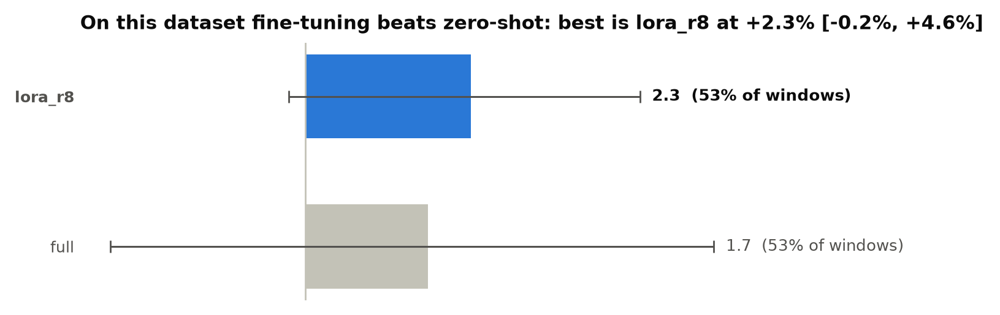

# Chronos-2 in Practice (4/5): Fine-Tuning, LoRA Against Full, and What It Actually Buys

**Five minutes on a consumer GPU and a 4.6 MB adapter bought 2.3% over zero-shot. Training all
119 million weights bought 1.7%, took a 456 MB checkpoint, and started forgetting. Both numbers
are smaller than the covariates in Part 3.**

*Disclosure: this article was drafted with the help of an AI assistant. Every experiment was run from the companion repository, every number is read from its results files, and the text was reviewed and edited by the author.*

> Draft for Medium. Every number is read from a CSV in [`results/`](../results); each figure
> names the file to upload. Published open access (not metered). Still to decide: repository URL.

---

- **Code:** [`07_finetune_lora`](https://github.com/epjover/chronos2-in-practice/blob/main/notebooks/07_finetune_lora.ipynb),
  [`08_finetune_full`](https://github.com/epjover/chronos2-in-practice/blob/main/notebooks/08_finetune_full.ipynb):
  both need a GPU (local, or Colab's T4).
- **Data:** hourly Spanish electricity, 2015–2018 (CC0): 26 series for training, load for the
  test, five cities' temperatures for the out-of-domain check.
- **Versions:** `chronos-forecasting==2.3.2`, `peft==0.21.2`, Python 3.11.
- **Hardware:** RTX 3070 (8 GB) for every training time, VRAM figure and latency below; Intel
  Core i9-12900K on the host.

---

[Part 3](#) ended with the forecast's own history dominating everything else, and with
covariates adding **+11.8%** on the Spanish price. This part asks the question that usually
comes next in a project, which is whether, if the inputs are as good as they get, it still makes
sense to go in and change the model's weights.

The answer on this dataset is *a little, and less than you would guess*. What matters more than the
headline number is that the experiment takes five minutes and costs nothing, so there is no reason
to argue about it when you can measure it instead. For a tour of the fine-tuning *options* the
library offers (target-only, covariate-informed, full and LoRA, with and without validation), Guo's
article on Towards Data Science [7] is the reference; this part takes one of those options through
the full 365-window backtest, with the bracket, the coverage and the out-of-domain check.

Everything below comes from [`07_finetune_lora.ipynb`](../notebooks/07_finetune_lora.ipynb) and
[`08_finetune_full.ipynb`](../notebooks/08_finetune_full.ipynb), run on an RTX 3070 (8 GB). The test
set is the same 365 day-ahead windows of 2018 that Part 2 established, so every number here lines
up directly with every number there.

## 1. A split that cannot leak, and training data that is not one series

Zero-shot forecasting is hard to leak, because the model never sees the test period. Fine-tuning
removes that protection, since the weights can memorise. So the notebook starts not with a model but
with three periods in time order:

| Period | Span (UTC) | Size | Used for |
| --- | --- | ---: | --- |
| train | 2014-12-31 23:00 → 2017-06-30 21:00 | 569,062 rows | gradient updates |
| validation | 2017-06-30 22:00 → 2017-12-31 23:00 | 702 windows | early stopping only |
| test | 2018-01-01 00:00 → 2018-12-31 22:00 | 365 windows | the backtest, never seen |

One detail matters more than it first appears. The validation set doesn't get handed over as one
long series. `window_series` splits it into forecast windows and turns each window into its own
series, with context drawn only from earlier data:

```python
from c2p.finetune import temporal_split, to_fit_inputs, to_univariate_series, window_series

HORIZON, CONTEXT, FREQ = 24, 2048, "h"
split = temporal_split(series, val_start="2017-06-30 22:00", test_start="2018-01-01")
train_inputs = to_fit_inputs(split.train, freq=FREQ, prediction_length=HORIZON)
val_frame = window_series(
    split.train, split.val, prediction_length=HORIZON, freq=FREQ, step=168, max_context=CONTEXT
)
val_inputs = to_fit_inputs(val_frame, freq=FREQ, prediction_length=HORIZON)
```

Without this, validation loss measures how well the model can continue a series it is already
partway through, and that isn't the task. With it, early stopping is driven by the same quantity the
test backtest will report.

There is also a data decision. One national load series is thin training data: two and a half years
of hourly values, and a 119M-parameter model will happily overfit it. So every numeric column of the
Spanish table becomes its own univariate series with `to_univariate_series`: load, price, the TSO's
own forecasts and generation by source, **26 series in all**. The fine-tune then means "learn
Spanish electricity", not "learn this one series".

## 2. LoRA, and the three numbers that decide whether it is worth it

Low-Rank Adaptation [1] keeps the pretrained weights frozen and instead trains a small pair of
matrices alongside each adapted layer. Here, the adapted layers are Chronos-2's own defaults:

```python
# c2p.finetune.LORA_TARGET_MODULES
LORA_TARGET_MODULES = (
    "self_attention.q",
    "self_attention.k",
    "self_attention.v",
    "self_attention.o",
    "output_patch_embedding.output_layer",
)
```

Copy that tuple rather than leaving it out. If you omit it, `peft` will guess the target modules
from the T5 architecture, and its guess adapts fewer layers than Chronos-2 does.

One run, at rank 8:

```python
from c2p.finetune import finetune, lora_config
from c2p.models import load_chronos2

result = finetune(
    load_chronos2(device=DEVICE),
    train_inputs,
    val_inputs=val_inputs,
    mode="lora",
    prediction_length=24,
    num_steps=1000,
    learning_rate=1e-5,
    batch_size=32,
    context_length=2048,
    lora_config=lora_config(r=8),  # lora_alpha defaults to 2*r
    early_stopping_patience=3,
    eval_steps=100,
)
```

Reloading and shipping the result takes just two lines:

```python
from c2p.finetune import load_finetuned

pipeline = load_finetuned(result.checkpoint_dir)  # LoRA: loads amazon/chronos-2, merges the adapter
pipeline.save_pretrained(
    "models/chronos-2-spain"
)  # one self-contained folder for Part 5's container
```

Those settings aren't arbitrary and they aren't mine. `Chronos2Model` in `autogluon.timeseries`
1.6.3 defaults to this combination: LoRA, `fine_tune_lr=1e-5`, `fine_tune_steps=1000`,
`fine_tune_batch_size=32`, `fine_tune_context_length=2048`. Starting from the library's defaults
means someone who never reads this repository can still reproduce the result.

**What a rank sweep costs** ([`07_lora_costs.csv`](../results/07_lora_costs.csv)), run for 1,000
steps each on an RTX 3070:

| run | trainable params | share of model | train time | peak VRAM | adapter on disk | best eval loss |
| --- | ---: | ---: | ---: | ---: | ---: | ---: |
| `lora_r4` | 603,456 | 0.50% | 5.0 min | 4,211 MB | 2.3 MB | 3.1349 |
| `lora_r8` | 1,206,912 | 1.00% | 5.0 min | 4,678 MB | 4.6 MB | 3.0962 |
| `lora_r16` | 2,413,824 | 1.98% | 5.0 min | 5,156 MB | 9.2 MB | 3.0598 |

Even before any accuracy number appears, this table tells a clear story. Training time stays
*identical* across ranks, because the backward pass is dominated by the frozen model rather than the
adapter. VRAM grows slowly, and all three ranks fit comfortably in 8 GB. The artifact itself runs to
only single-digit megabytes, which turns out to be the strongest operational argument for LoRA. You
can keep one adapter per customer, per region or per product line alongside one shared base model.

Validation loss drops steadily as rank increases, from 3.1349 to 3.0962 to 3.0598. Keep that in mind
for later.

## 3. Does it help? Yes, by about two percent

This is the same backtest as in Part 2: 365 daily cutoffs through 2018, a 24-hour horizon, 2,048
hours of context, and 11 quantiles.


*Figure 1. Skill against the zero-shot model on 365 day-ahead windows of 2018, with 95%
bootstrap intervals over windows. All three ranks land between +1.5% and +2.3%, and their
intervals overlap each other completely.*

| model | mean WQL | MASE | WAPE | skill vs zero-shot [95% CI] | windows won |
| --- | ---: | ---: | ---: | --- | ---: |
| zero-shot | 0.0388 | 0.5362 | 0.0467 | n/a | n/a |
| `lora_r4` | 0.0377 | 0.5230 | 0.0456 | **+1.9%** [+0.5, +3.1] | 52.9% |
| `lora_r8` | 0.0374 | 0.5178 | 0.0452 | **+2.3%** [−0.2, +4.6] | 53.2% |
| `lora_r16` | 0.0375 | 0.5188 | 0.0453 | **+1.5%** [−2.1, +4.7] | 53.2% |

Skill here follows fev-bench's definition, the one Part 2 adopted. It takes one minus the geometric
mean of the per-window error ratios, with a bootstrap interval worked out over the 365 windows. That
differs from the ratio of the mean WQLs, and this difference is why the ranking by skill and the
ranking by mean WQL can disagree slightly.

Look at the intervals before you look at the point estimates. The best point estimate is rank 8 at
+2.3%, but its interval includes zero. The only arm whose interval excludes zero is **rank 4** at
+1.9% [+0.5, +3.1], and that is the *smallest* adapter, the one with the worst validation loss. Rank
16 has the best validation loss but the widest, least convincing test interval. And Part 2's reading
rule still applies in full: one interval clearing zero among three that don't is the kind of pattern
chance throws up across many comparisons. So the defensible summary isn't that rank 4 works and the
others don't, but that all three adapters come in at around two percent and none of them is pinned
down on its own.

This isn't a paradox. It's the ordinary gap between a loss measured on 26 weeks of 2017 and a skill
score measured on 365 windows of 2018, and that gap is why the sweep exists in the first place. If
you tune rank on validation loss alone, you'll pick 16, but the backtest shows you'd be paying four
times the adapter size for nothing you can demonstrate.

Notice the win rate too: all three arms win about 53% of windows. A 2% average improvement spread
over 365 days doesn't mean the model has become newly right about the hard days. It means the model
is very slightly better on most of them.

**The coverage cost.** The 80% interval was already too narrow zero-shot, at 73.4% (Part 2). Rank 4
leaves it there, at 73.4%; the larger adapters make it narrower still (72.0% at rank 8, 70.3% at
rank 16), and the full fine-tune in section 4 takes it to 68.9%. The more capacity the fine-tune
has, the more it sharpens the model's confidence, and it does so faster than it improves the
accuracy. Part 5 shows the repair: a conformal calibration applied *after* the model, which works on
a fine-tuned checkpoint just as it does on the zero-shot one. If you depend on the intervals (and in
a day-ahead market you usually do), this is a real cost that the WQL headline hides.

## 4. Full fine-tuning: 100× the artifact, no better

Full fine-tuning updates all 119,477,664 parameters, and the learning rate has to drop along with
it. 1e-6 is the conventional choice, and it's also what AutoGluon suggests.

```python
full = finetune(
    load_chronos2(device=DEVICE),
    train_inputs,
    val_inputs=val_inputs,
    mode="full",
    learning_rate=1e-6,
    num_steps=1000,
    batch_size=32,
    context_length=2048,
    early_stopping_patience=3,
    eval_steps=100,
)
```



*Figure 2. Zero-shot, the best LoRA adapter and a full fine-tune on the same 365 windows. The two
fine-tuned models are indistinguishable from each other; only their costs differ.*

| model | mean WQL | skill vs zero-shot [95% CI] | train time | peak VRAM | artifact | latency |
| --- | ---: | --- | ---: | ---: | ---: | ---: |
| zero-shot | 0.0388 | n/a | (none) | n/a | (none) | 37 ms |
| `lora_r8` | 0.0374 | +2.3% [−0.2, +4.6] | 5.0 min | 4,678 MB | **4.6 MB** | 38 ms |
| `full` | 0.0373 | +1.7% [−2.7, +5.6] | 4.9 min | 5,497 MB | **455.8 MB** | 38 ms |

The full fine-tune reaches the best validation loss in this article, 2.9767, compared with 3.0962
for rank 8, and it also posts the best mean WQL, though only by a margin of 0.0001. Its skill score
comes out *lower* than rank 8's, and its interval is nearly three times wider. So on this dataset,
training 100% of the weights instead of 1% didn't buy anything measurable, and it cost a 456 MB
checkpoint instead of a 4.6 MB adapter.

Inference latency is identical across all three (37 to 38 ms per window). A LoRA adapter doesn't
make the served model slower, because the parameter count it adds is a rounding error, and it can be
merged into the base weights at load time.

## 5. What did it forget?

Both fine-tunes were trained on Spanish electricity, so the question a production team should ask
next is whether the model is still the general forecaster it was bought for. To test this, we ran
the same three models on **temperature** from the same dataset's weather table, covering five
cities, 52 weekly windows and a 24-hour horizon, a variable none of them was fine-tuned on.


*Figure 3. Out-of-domain check on hourly temperature for five Spanish cities, 52 weekly windows.
Positive is better than zero-shot. LoRA stays level; the full fine-tune drifts down.*

| model | mean WQL on temperature | MASE | skill vs zero-shot [95% CI] | windows won |
| --- | ---: | ---: | --- | ---: |
| zero-shot | 0.0935 | 0.7541 | n/a | (no comparison) |
| `lora_r8` | 0.0937 | 0.7555 | +0.2% [−0.7, +1.0] | 55.8% |
| `full` | 0.0947 | 0.7640 | **−0.8%** [−2.3, +0.6] | 42.3% |

This needs stating carefully, because it is easy to oversell. At 52 windows, neither interval
excludes zero, so we cannot call this proof of catastrophic forgetting. It shows the direction you
would predict, at the magnitude you would predict, given the sample size that one year of weekly
windows gives you. LoRA stays flat. The full fine-tune drops 0.8% and loses more windows than it
wins.

The mechanism isn't mysterious. LoRA's frozen base weights put a hard limit on how far the model can
move, and that limit is what protects behaviour on tasks you never trained for. If you're serving
one model across many domains, that matters more than 0.6 percentage points of skill on any single
one of them.

## 6. The decision, stated plainly

Put this article's gains next to the earlier ones, all measured on the same Spanish data with
the same protocol:

| Change | Gain | Measured as | Cost |
| --- | ---: | --- | --- |
| Context 64 → 2,048 hours (Part 2) | +52 points | skill vs seasonal naive, load | none, it is an argument |
| Covariates: TSO forecasts + past generation (Part 3) | +11.8% | WQL vs no covariates, price | a data pipeline |
| Full fine-tune, 119M weights | +1.7% | WQL vs zero-shot, load | 5 min GPU, 456 MB, some forgetting |
| LoRA rank 8 | +2.3% | WQL vs zero-shot, load | 5 min GPU, 4.6 MB |
| LoRA rank 4 | +1.9% | WQL vs zero-shot, load | 5 min GPU, 2.3 MB |

The first row sits on a different scale from the rest. It shows points of skill against a naive
baseline rather than a relative improvement over the previous setting, and it also targets something
different. It appears in the table because it is the cheapest lever in the series, not because the
numbers line up with the others.

Fine-tuning is the *last* lever you should reach for, not the first one. Every row above it costs
less and delivers more. That ordering is what this article is built around.

When fine-tuning is nonetheless the right call:

- **Your domain is unlike the pretraining corpus in real ways.** Intermittent demand, tick data,
  sensors with device-specific artefacts. Two percent on Spanish electricity doesn't tell you much about
  what a LoRA buys on data the model has effectively never seen.
- **You have many related series.** The training set here was 26 columns from one national grid.
  With thousands of stores or meters, the adapter has something to learn that zero-shot can't
  pull from a single context window.
- **The horizon and the loss are fixed.** Fine-tuning optimises for one `prediction_length` and
  one quantile set. That specialisation is what you're buying, but it's also why the served model
  is no longer general.

And when it is not:

- **Zero-shot is already close to the irreducible error.** Day-ahead national load is a
  well-behaved, strongly seasonal series, and there wasn't much left to win.
- **You have one short series.** The split above needs train, validation *and* an untouched test
  year. If you cannot afford all three, you cannot measure whether the fine-tune helped, and an
  unmeasured fine-tune is a liability.
- **You need calibrated intervals more than a sharper median.** Section 3's coverage column.

If you do fine-tune, start with LoRA at rank 4 or 8, use the library's default learning rate, stop
early on a windowed validation set, and always run the out-of-domain check from section 5 before
deploying. This sequence takes about ten minutes of GPU time.

## 7. Cheat sheet

Split in time (train, validation, test) before anything else, and cut the validation period into
forecast windows (`window_series`) so early stopping measures the task.

Start with LoRA, rank 4 or 8, the library's default learning rate, and pass the target modules
explicitly.

Score the fine-tune on the same backtest as the zero-shot model, read the bracket, and check
`coverage_80`, since fine-tuning narrows the bands.

Run an out-of-domain check before deploying a full fine-tune.

Expect about two percent on a well-behaved series. If you need more, Part 3's covariates are the
cheaper lever.

Start with LoRA, rank 4 or 8, the library's default learning rate, and pass the target modules
explicitly.

If you are already working in AutoGluon, the sweep above collapses into a hyperparameter dict:

Run an out-of-domain check before deploying a full fine-tune.

Expect about two percent on a well-behaved series. If you need more, Part 3's covariates are the
cheaper lever.

## 8. The same thing in one line

If you are already working in AutoGluon, the sweep above collapses into a hyperparameter dict:

```python
from autogluon.timeseries import TimeSeriesPredictor

predictor = TimeSeriesPredictor(prediction_length=24, eval_metric="WQL").fit(
    train_data,
    hyperparameters={"Chronos2": {"fine_tune": True, "fine_tune_lr": 1e-5}},
)
```

Pinning `hyperparameters` to `Chronos2` matters because, left alone, AutoGluon fits an ensemble, and
the resulting accuracy is no longer attributable to this model. The defaults it would use are the
ones in section 2, so this is the same experiment with less code around it, and it's also how the
managed deployment path in Part 5 works.

## What's next

Part 5 covers production. It looks at latency and throughput against batch size, context and
checkpoint on both CPU and GPU, and lays out three deployment paths along with their teardown
commands. It also works out the cost per million forecasts from published AWS rates, and finishes
with a monitoring panel that replays 2018 as though the actuals arrived a day late.

---

## References

1. Hu, E. J., *et al.* (2021). *LoRA: Low-Rank Adaptation of Large Language Models*.
   arXiv:2106.09685. https://arxiv.org/abs/2106.09685
2. Ansari, A. F., *et al.* (2025). *Chronos-2: From Univariate to Universal Forecasting*.
   arXiv:2510.15821. https://arxiv.org/abs/2510.15821
3. Shchur, O., *et al.* (2025). *fev-bench*. arXiv:2509.26468. https://arxiv.org/abs/2509.26468
4. Hugging Face *PEFT*. https://github.com/huggingface/peft
5. AutoGluon, *Forecasting with Chronos*.
   https://auto.gluon.ai/dev/tutorials/timeseries/forecasting-chronos.html
6. Dataset: *Hourly energy demand generation and weather* (CC0).
   https://www.kaggle.com/datasets/nicholasjhana/energy-consumption-generation-prices-and-weather
7. Guo, S. (2026). *Five Ways to Fine-Tune Chronos-2, the Time Series Foundation Model*. Towards
   Data Science.
   https://towardsdatascience.com/five-ways-to-fine-tune-chronos-2-the-time-series-foundation-model/

**Suggested tags:** Time Series Forecasting · Machine Learning · Foundation Models · LoRA ·
Python
