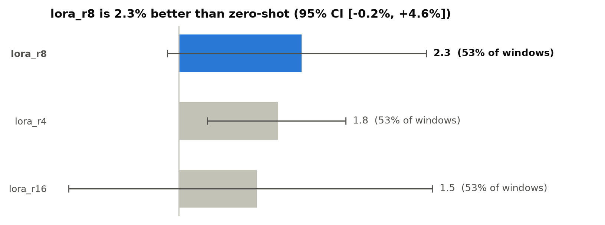
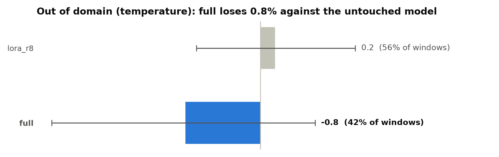

# Chronos-2 in Practice (4/7): Fine-Tuning, LoRA Against Full, and What It Buys

**At the library's defaults, a 4.6 MB LoRA adapter buys 2.7% over zero-shot, and training all 119
million weights buys 2.0%, which its interval cannot tell from zero, with a checkpoint a hundred
times larger. A learning rate ten times higher and a longer budget, chosen on a validation
half-year, buy 8.0% over three seeds: less than half of the 19.2% that half-year promised, visible only on the hardest third of the days, and at the price of
3.6% on temperature series the adapter was never trained on.**

*Disclosure: this article was drafted with the help of an AI assistant. Every experiment was run from the companion repository, every number is read from its results files, and the text was reviewed and edited by the author.*

> Draft for Medium. Every number is read from a CSV in [`results/`](../results); each figure
> names the file to upload. Published open access (not metered).

---

[Part 3](#) ended with the forecast's own history dominating everything else, and with the
operator's forecasts adding **+10.9%** on the Spanish price. This part asks the question that
usually comes next in a project: if the inputs are as good as they get, does it still make sense
to go in and change the model's weights?

On this dataset the answer depends on a choice the library makes for you. With its default
budget, fine-tuning buys two to three percent, and none of the variations tried here (rank,
adapter or all the weights) separates from the others. With a budget chosen on a validation
period it buys three times that, and it starts to cost something elsewhere. For a tour of the
fine-tuning *options* the library offers (target-only, covariate-informed, full and LoRA, with and
without validation), Guo's article on Towards Data Science [7] is the reference; this part takes
those options through the 365-window backtest of Part 2, three seeds at a time.

- **Code:** [`07_finetune_lora`](https://github.com/epjover/chronos2-in-practice/blob/main/notebooks/07_finetune_lora.ipynb),
  [`08_finetune_full`](https://github.com/epjover/chronos2-in-practice/blob/main/notebooks/08_finetune_full.ipynb):
  both need a GPU (local, or Colab's T4).
- **Data:** hourly Spanish electricity, 2015–2018 (CC0) [6]: 26 series for training, load and price
  for the test, five cities' temperatures for the out-of-domain check.
- **Versions:** `chronos-forecasting==2.3.2`, `peft==0.21.2`, Python 3.11.
- **Hardware:** RTX 3070 (8 GB) for every training time, VRAM figure and latency below; Intel
  Core i9-12900K on the host.

> **Terms from Part 2.** **WQL** is the error of the forecast's quantiles as a share of the
> series' level: 0.039 reads as 3.9%. **Skill** is one minus the geometric mean, over windows, of
> a model's WQL divided by a reference's: +10% is 10% less error on a typical window. **Total**
> is the same comparison on the summed error of all the windows, where the bad days weigh more.
> **Coverage** is how often the actual falls inside the 80% interval, so 80% is the target. A
> **window** is one forecast origin of the backtest, and the brackets are 95% bootstrap intervals
> over windows.

---

## 1. A split that cannot leak, and training data that is not one series

Zero-shot forecasting is hard to leak, because the model never sees the test period. Fine-tuning
removes that protection, since the weights can memorise. So the notebook starts not with a model but
with three periods in time order:

| Period | Span (UTC) | Size | Used for |
| --- | --- | ---: | --- |
| train | 2014-12-31 23:00 → 2017-06-30 21:00 | 569,062 rows | gradient updates |
| validation | 2017-06-30 22:00 → 2017-12-31 23:00 | 702 windows for the loss, 184 for the backtest | early stopping, and every choice in this article |
| test | 2018-01-01 00:00 → 2018-12-31 22:00 | 365 windows | the backtest, looked at after the choices |

The validation set doesn't get handed over as one long series. `window_series` splits it into
forecast windows and turns each window into its own series, with context drawn only from earlier
data:

```python
from c2p.finetune import temporal_split, to_fit_inputs, to_univariate_series, window_series

HORIZON, CONTEXT, FREQ = 24, 2048, "h"
split = temporal_split(series, val_start="2017-06-30 22:00", test_start="2018-01-01")
train_inputs = to_fit_inputs(split.train, freq=FREQ, prediction_length=HORIZON)
val_frame = window_series(
    split.train, split.val, prediction_length=HORIZON, freq=FREQ, step=168, max_context=CONTEXT
)
val_inputs = to_fit_inputs(val_frame, freq=FREQ, prediction_length=HORIZON)
```

Without this, validation loss measures how well the model can continue a series it is already
partway through, and that isn't the task. (The validation loss in the tables below is the
model's training objective, a quantile loss on its own standardised scale, averaged over these
windows. It compares one run with another and is not on the scale of WQL.)

The validation period is used twice. The 702 windows above (27 weekly cutoffs of 26 series) give
the loss that stops the training. Weekly cutoffs all forecast the same weekday, a Saturday here,
which Part 2 would not accept for a score; here they only decide at which step a run stops. The
same half-year also gets the backtest of Part 2, 184
day-ahead windows of the load, and that backtest is what chooses between configurations in
section 4. The test year is opened once those choices are made.

There is also a data decision. One national load series is thin training data: two and a half years
of hourly values, and a 119M-parameter model will happily overfit it. So every numeric column of the
Spanish table becomes its own univariate series with `to_univariate_series`: load, price, the TSO's
own forecasts and generation by source, **26 series in all**. The fine-tune then means "learn
Spanish electricity", not "learn this one series".

## 2. One LoRA run, and what it costs

Low-Rank Adaptation [1] keeps the pretrained weights of Chronos-2 [2] frozen and trains a small
pair of matrices alongside each adapted layer. Here, the adapted layers are Chronos-2's own defaults:

```python
# c2p.finetune.LORA_TARGET_MODULES
LORA_TARGET_MODULES = (
    "self_attention.q",
    "self_attention.k",
    "self_attention.v",
    "self_attention.o",
    "output_patch_embedding.output_layer",
)
```

Copy that tuple rather than leaving it out. If you omit it, `peft` [4] will guess the target modules
from the T5 architecture, and its guess adapts fewer layers than Chronos-2 does.

One run, at rank 8:

```python
from pathlib import Path

from c2p.finetune import finetune, lora_config
from c2p.models import load_chronos2

result = finetune(
    load_chronos2(device=DEVICE),
    train_inputs,
    val_inputs=val_inputs,
    mode="lora",
    prediction_length=24,
    num_steps=1000,
    learning_rate=1e-5,
    batch_size=32,
    context_length=2048,
    output_dir=Path("models/lora_r8"),
    lora_config=lora_config(r=8),  # lora_alpha defaults to 2*r
    early_stopping_patience=3,
    eval_steps=100,
    seed=42,
)
```

Reloading and shipping the result takes two lines:

```python
from c2p.finetune import load_finetuned

pipeline = load_finetuned(result.checkpoint_dir)  # LoRA: loads amazon/chronos-2, merges the adapter
pipeline.save_pretrained(
    "models/chronos-2-spain"
)  # one self-contained folder for Part 5's container
```

> **Without the repository.** `c2p.finetune.finetune` wraps one call of the library:
> `pipeline.fit(inputs=train_inputs, prediction_length=24, validation_inputs=val_inputs,
> finetune_mode="lora", learning_rate=1e-5, num_steps=1000, batch_size=32,
> context_length=2048)`. It returns a new pipeline and leaves the original untouched. Left to
> its defaults, `fit` runs a full fine-tune at `learning_rate=1e-6` with `batch_size=256`, and
> its documentation recommends 1e-5 for LoRA, so the mode and the learning rate are the two
> arguments to write out.

Those settings aren't mine. `Chronos2Model` in `autogluon.timeseries` 1.6.3 defaults to this
combination: LoRA, `fine_tune_lr=1e-5`, `fine_tune_steps=1000`, `fine_tune_batch_size=32`,
`fine_tune_context_length=2048`. They are "the library's defaults" for the rest of this article.

**What a run costs** ([`07_lora_costs.csv`](../results/07_lora_costs.csv)), averaged over three
seeds of 1,000 steps each:

| Run | Trainable params | Share of model | Train time | Peak VRAM | Adapter on disk | Best validation loss |
| --- | ---: | ---: | ---: | ---: | ---: | ---: |
| `lora_r4` | 603,456 | 0.50% | 5.1 min | 3,756 MB | 2.3 MB | 3.1396 |
| `lora_r8` | 1,206,912 | 1.00% | 5.2 min | 3,767 MB | 4.6 MB | 3.1006 |
| `lora_r16` | 2,413,824 | 1.98% | 5.1 min | 3,790 MB | 9.2 MB | 3.0637 |

The share counts the adapter in the total, which is why rank 16 reads 1.98% and not 2.02%.
Training time and memory do not depend on the rank, because the backward pass is dominated by the
frozen model rather than the adapter. All three fit in half of an 8 GB card. The artifact runs to
single-digit megabytes, which is the strongest operational argument for LoRA: one adapter per
customer, per region or per product line, next to one shared base model.

## 3. Ranks, and seeds

Each rank was trained three times with a different seed, which changes the order in which the
training windows are drawn. Without the repeats there is no way to tell a difference between rank 4
and rank 16 from the difference between two runs of rank 8. The backtest is the one of Part 2: 365
daily cutoffs through 2018, a 24-hour horizon, 2,048 hours of context, intervals resampled in
blocks of seven days.



*Figure 1. Skill against the zero-shot model on the 365 day-ahead windows of 2018, three seeds
averaged window by window, with 95% block-bootstrap intervals.*

| Model | WQL | Skill vs zero-shot [95% CI] | Single runs | Wins | 80% coverage |
| --- | ---: | --- | --- | ---: | ---: |
| zero-shot | 0.0388 | n/a | n/a | n/a | 73.4% |
| `lora_r4` | 0.0378 | +1.9% [+0.7, +3.1] | +1.8% to +2.1% | 55% | 73.2% |
| `lora_r8` | 0.0374 | +2.7% [+0.4, +4.8] | +2.3% to +3.0% | 56% | 72.2% |
| `lora_r16` | 0.0374 | +2.1% [−1.1, +5.3] | +1.5% to +2.7% | 54% | 70.6% |

Skill is Part 2's skill on a typical window, the fev-bench formula [3] applied to the windows:
one minus the geometric mean of the per-window error ratios. Each row averages its three runs
window by window before that mean is taken, and "Single runs" gives the lowest and the highest
of the three on their own.

**The rank does not matter here; the seed matters as much.** The three ranks, each averaged over
its seeds, differ by less than a point; single runs, across ranks and seeds, span 1.5 points. Anyone who trained each rank
once and picked the winner would have been choosing among seeds. The validation loss does fall
steadily with the rank (3.14, 3.10, 3.06), and the test year does not follow it: the largest
adapter has the best loss and the widest interval.

**All three win about 55% of the windows.** On any given day the adapted model is almost as likely
to be behind the zero-shot one as ahead of it. The gain is a small tilt, not a daily improvement.

**The intervals get narrower.** The 80% interval covered 73.4% zero-shot. Rank 4 barely moves it
(73.2%), rank 8 takes it to 72.2% and rank 16 to 70.6%. The more capacity the fine-tune has, the more it
sharpens the model's confidence, faster than it improves the accuracy. [Part 6](#) widens the
zero-shot model's intervals with a conformal calibration applied after the model. The method takes
any model's quantiles, though this series runs it on the zero-shot ones only.

## 4. The budget, chosen on validation

Look at the cost table again: in every run the best validation loss is at step 1,000 of 1,000. The
library's defaults stop while the loss is still falling, so whether more training helps is an open
question, and the test year is not the place to answer it.

The candidates are rank 8 with one seed: the default budget, four times the steps, ten times the
learning rate, and both. Each is scored on the **validation backtest** (the 184 day-ahead windows
of the second half of 2017, against the zero-shot model on those windows). The test scores are
computed in the same pass and shown beside them, but the choice reads only the validation column
([`07_budget_validation.csv`](../results/07_budget_validation.csv),
[`07_budget_test.csv`](../results/07_budget_test.csv)):

| Budget | Best step | Validation loss | Validation skill [95% CI] | Test skill [95% CI] |
| --- | ---: | ---: | --- | --- |
| 1,000 steps, lr 1e-5 | 1,000 of 1,000 | 3.0962 | +1.9% [−1.2, +5.1] | +2.3% [−0.2, +4.7] |
| 4,000 steps, lr 1e-5 | 4,000 of 4,000 | 2.8732 | +6.7% [+0.5, +12.5] | +2.2% [−2.5, +6.7] |
| 1,000 steps, lr 1e-4 | 800 of 1,000 | 2.7851 | +7.8% [+1.1, +14.1] | +3.4% [−2.4, +8.4] |
| 4,000 steps, lr 1e-4 | 2,200 of 4,000 | 2.6674 | +19.2% [+11.8, +25.9] | +8.3% [+1.8, +14.3] |

The first row is the default budget with one seed, which is why its validation loss (3.0962)
is not the 3.1006 of the cost table: that one averages three seeds.

**The defaults leave most of the gain unused.** At ten times the learning rate the loss reaches its
minimum before the budget runs out (step 800 of 1,000; step 2,200 of 4,000, where early stopping
ends the run at step 2,500), and the validation skill goes from 1.9% to 19.2%. The choice is the
last row.

**The validation half-year promised more than twice what the test year delivered.** +19.2% became
+8.3%. The winner carried over, the size did not. The validation half-year starts the hour after
the training data end, the test year starts six months later, and the configuration was selected
for doing well on the first. A gain measured on the period that chose it is optimistic, and here
it was optimistic by more than a factor of two. On the total error of each period, Part 2's other
reading, the same run goes from +23.4% to +14.1% (`12_two_readings.csv`): a smaller drop, and a
drop all the same.
(Over three seeds the test total is +12.9%, in the table of section 5.) The search is also part of the price: the three extra
candidates took 38 minutes of GPU between them.

**The chosen budget with three seeds, on the test year.** The +8.3% of the table is one run, the
one the search trained. Two more seeds of the same configuration give the figure this article
quotes from here on ([`07_tuned_summary.csv`](../results/07_tuned_summary.csv)): +8.0%
[+2.3, +13.3], with single runs between +8.3% and +9.8%. The three-seed figure sits just below every single run because the runs
are averaged window by window before the ratio is taken, and the windows on which one seed does
badly are not the ones on which another does. The 80% interval now covers 70.2%.

## 5. Full fine-tuning: a hundred times the artifact

Full fine-tuning updates all 119,477,664 parameters, at a learning rate ten times lower than
LoRA's. 1e-6 is the default of `Chronos2Pipeline.fit`, and its documentation recommends the higher
rate only for LoRA. The usual reasoning is that with the pretrained weights themselves moving, a
rate that suits a small adapter can move the model off what it learned in pretraining; this series
did not try a higher rate for the full fine-tune.

```python
full = finetune(
    load_chronos2(device=DEVICE),
    train_inputs,
    val_inputs=val_inputs,
    mode="full",
    prediction_length=24,
    learning_rate=1e-6,
    num_steps=1000,
    batch_size=32,
    context_length=2048,
    output_dir=Path("models/full"),
    early_stopping_patience=3,
    eval_steps=100,
    seed=42,
)
```


*Figure 2. The three fine-tunes against zero-shot on the same 365 windows, three seeds each.*

| Model | WQL | Skill vs zero-shot, typical window [95% CI] | Single runs | Total vs zero-shot [95% CI] | 80% coverage |
| --- | ---: | --- | --- | --- | ---: |
| LoRA rank 8, library defaults | 0.0374 | +2.7% [+0.4, +4.8] | +2.3% to +3.0% | +3.5% [+0.7, +6.0] | 72.2% |
| LoRA rank 8, budget chosen on validation | 0.0337 | +8.0% [+2.3, +13.3] | +8.3% to +9.8% | +12.9% [+6.0, +19.1] | 70.2% |
| full fine-tune, library defaults | 0.0373 | +2.0% [−2.0, +5.8] | +1.7% to +2.7% | +3.8% [−1.3, +8.5] | 69.7% |

The WQL column is a mean over the windows, so it orders the rows as the Total column does. The
typical window can order two close rows the other way, as it does here for the full fine-tune
and the default adapter.

| Model | Train time | Peak VRAM | Artifact | Latency per window |
| --- | ---: | ---: | ---: | ---: |
| LoRA rank 8, library defaults | 5.2 min | 3,767 MB | 4.6 MB | 35 ms |
| LoRA rank 8, budget chosen on validation | 10.3 min | 3,767 MB | 4.6 MB | 35 ms |
| full fine-tune, library defaults | 5.3 min | 5,498 MB | 455.8 MB | 35 ms |

Each interval above is against the zero-shot model, and two intervals that overlap do not say
which of two fine-tunes is better. The paired comparison on the same windows does
([`08_paired_skill.csv`](../results/08_paired_skill.csv)). The adapter with the chosen budget
against the default one: +5.5% [+0.6, +10.0] on a typical window, and +9.8% [+3.7, +15.6] on the
year's total. The full fine-tune against the default adapter: −0.7% [−3.0, +1.5], and +0.4%
[−2.4, +3.3] on the total.

So at the library's defaults, training 100% of the weights instead of 1% buys nothing
measurable, and it brings the lowest coverage of the three and a 456 MB checkpoint in place of a
4.6 MB adapter. The full fine-tune was not given a budget search of its own, so this is a
statement about the defaults and not about what full fine-tuning can reach.

**The gain is on the hard days.** Split the 365 windows into thirds by the error of the seasonal
naive, a model outside the comparison (thirds by the zero-shot model's own error would flatter
every alternative), and score each third separately
([`08_gain_by_difficulty.csv`](../results/08_gain_by_difficulty.csv)). Within a third the
windows are not consecutive, so these intervals resample single windows and not blocks:

| Days, by the seasonal naive's error | Zero-shot WQL | LoRA, defaults | LoRA, chosen budget | Full, defaults |
| --- | ---: | --- | --- | --- |
| easiest third | 0.0125 | +0.1% [−2.8, +2.8] | −1.9% [−9.8, +4.8] | −2.9% [−8.7, +2.2] |
| middle third | 0.0409 | +2.0% [−2.2, +6.3] | +1.6% [−8.4, +10.3] | −1.3% [−10.1, +6.5] |
| hardest third | 0.0629 | +5.7% [+2.4, +9.3] | +22.4% [+15.4, +29.1] | +9.6% [+3.6, +15.7] |

On two thirds of the days every interval includes zero, and on the easiest third the point
estimates of the chosen-budget adapter and of the full fine-tune are below it (−1.9% and −2.9%). The gain is on the
days that least resemble the day before, where the zero-shot error is five times that of the easy
days, and there the adapter with the chosen budget cuts it by more than a fifth. It is also why
the adapter's total error over the year falls by 12.9% while its skill on a typical day is 8.0%:
the hard days are where the error is, and the total counts them by their size.

Inference latency is the same for all three, 35 ms per window. That is the time the backtest
harness spends on each window, its own checks and frame handling included, which is why it sits
above the 27 ms that Part 5 measures for a bare `predict_df` call. A LoRA adapter does not make the
served model slower: it is merged into the base weights at load time.

## 6. What did it forget?

All of these models were trained on Spanish electricity, so the question a production team should
ask next is whether the model is still the general forecaster it was before. The dataset ships a
convenient test: hourly **temperature** for five Spanish cities, a different unit, scale and
shape, never part of the training data. Every run is reloaded from disk and scored on 73 windows
across 2018, one every five days.



*Figure 3. Out-of-domain check on hourly temperature for five Spanish cities, 73 windows.
Positive is better than zero-shot.*

| Model | WQL on temperature | Skill vs zero-shot [95% CI] | Single runs | Wins |
| --- | ---: | --- | --- | ---: |
| zero-shot | 0.0887 | n/a | n/a | n/a |
| LoRA rank 8, library defaults | 0.0880 | +1.0% [+0.3, +1.8] | +1.0% to +1.1% | 67% |
| LoRA rank 8, budget chosen on validation | 0.0919 | −3.6% [−5.9, −1.4] | −5.4% to −2.1% | 44% |
| full fine-tune, library defaults | 0.0883 | +0.7% [−0.5, +2.0] | +0.6% to +0.9% | 63% |

**The run that learned the most forgot the most.** The two fine-tunes at the library's defaults
did not get worse on temperature; the default LoRA is even slightly better, plausibly because
temperature and electricity share a daily cycle (the experiment does not test that explanation).
The adapter with the larger budget is 3.6% worse, with an interval that excludes zero, and each of
its three seeds is worse on its own. That is catastrophic forgetting in its
mild form (the loss of earlier abilities when a network is trained on something new [8]), and
it arrives with the gain, not with the number of weights trained.

A frozen base does not protect a LoRA adapter from this: the adapter is merged into the weights
it was trained beside, and the merged model is the one that forecasts. What limits the drift is how
far the training goes. The trade is 8.0% on the series you trained for against 3.6% on one you did
not, and it only matters if one model serves several domains. If each adapter serves its own
series, which is what a 4.6 MB artifact makes cheap, there is nothing to trade.

## 7. Fine-tuning with covariates, where there is more room

Day-ahead national load is a series on which zero-shot is already good, which makes it a hard place
to show what fine-tuning adds. The price of Part 3 is the other case: the zero-shot error is
larger, and the model has to use three covariates (the operator's forecasts of load, wind and
solar) whose relation to the price it can only read from the context.

`Chronos2Pipeline.fit` takes the same structure as prediction: a target, its past covariates and
the covariates whose future is known.

```python
price_train = to_fit_inputs(
    price_split.train,
    freq=FREQ,
    prediction_length=HORIZON,
    target="price_actual",
    known_covariates=["load_forecast_tso", "wind_onshore_forecast_tso", "solar_forecast_tso"],
)
```

The training set is now one series with its covariates, the reference is the zero-shot model
*with the same covariates*, and the learning rate is chosen on the validation backtest as before
([`08_price_summary.csv`](../results/08_price_summary.csv)):

| Model | WQL | Validation skill [95% CI] | Test skill [95% CI] | 80% coverage |
| --- | ---: | --- | --- | ---: |
| zero-shot, with the covariates | 0.0440 | n/a | n/a | 77.9% |
| LoRA, lr 1e-5 (one seed) | 0.0434 | +2.6% [+1.7, +3.5] | +2.3% [+1.3, +3.4] | 77.1% |
| LoRA, lr 1e-4 (chosen, three seeds) | 0.0424 | +5.1% [+2.8, +7.3] | +4.9% [+2.7, +7.3] | 73.6% |

Fine-tuning adds +4.9% on top of the covariates, with an interval clear of zero, from one series
and five minutes of training. The validation column is the seed that made the choice; the test
column of the last row averages three. Here the validation half-year predicted the test year
almost to the decimal (+5.1% for one seed against +4.9% over three), which it did not on the load. One experiment each way is not
enough to say when a validation gain transfers; it is enough to say that it has to be checked.

## 8. The decision

Put this article's gains next to the earlier ones, all measured on the same Spanish data with the
same protocol:

| Change | Gain | Measured as | Cost |
| --- | ---: | --- | --- |
| Context 64 → 2,048 hours (Part 2) | +40 points | skill vs seasonal naive, load | none, it is an argument |
| The operator's forecasts as covariates (Part 3) | +10.9% | WQL vs no covariates, price | a data pipeline |
| LoRA, budget chosen on validation | +8.0% | WQL vs zero-shot, load | 10 min GPU, 4.6 MB, a validation period, −3.6% out of domain |
| LoRA, library defaults | +2.7% | WQL vs zero-shot, load | 5 min GPU, 4.6 MB |
| Full fine-tune, library defaults | +2.0% | WQL vs zero-shot, load | 5 min GPU, 456 MB |
| LoRA on top of covariates | +4.9% | WQL vs zero-shot with covariates, price | 5 min GPU, 4.6 MB |

The first row sits on a different scale from the rest: points of skill against a naive baseline,
not a relative improvement over the previous setting. It is in the table because it is the
cheapest lever in the series.

Fine-tuning is the *last* lever to reach for, and the reason is not the size of the gain. It is
the only lever in this series that needs a period set aside to choose its settings, the only one
whose result depends on a random seed, and the only one that can make the model worse somewhere
else. Context and covariates have none of those costs.

When fine-tuning is the right call:

- **You can afford a validation period and several seeds.** The split above needs train,
  validation *and* an untouched test year. The gain on the validation period overstated the test
  gain by a factor of two on one target and not at all on the other.
- **Your domain is unlike the pretraining corpus.** Intermittent demand, tick data, sensors with
  device-specific artefacts. Eight percent on Spanish electricity says little about what an
  adapter buys on data the model has never seen anything like.
- **You have covariates the model must learn to use.** Section 7: the gain stacked on top of
  theirs.
- **Each adapter serves its own series.** Then the forgetting of section 6 costs nothing.

And when it is not:

- **You have one short series and no period to hold out.** An unmeasured fine-tune is a
  liability.
- **One model serves many domains.** Train less, or keep the zero-shot model for the others.
- **You need calibrated intervals more than a sharper median.** Every fine-tune here narrowed
  them, and Part 6 gets better intervals without touching the weights.

If you do fine-tune: LoRA at rank 8, the learning rate and the number of steps chosen on a
validation backtest and not left at the defaults, early stopping on windowed validation data, three
seeds before you quote a number, and the out-of-domain check of section 6 before you deploy.

## 9. The same thing in AutoGluon

This series did not run the snippet below; it follows AutoGluon's documentation [5]. If you are
already working in AutoGluon, the default run above collapses into a hyperparameter dict:

```python
from autogluon.timeseries import TimeSeriesPredictor

predictor = TimeSeriesPredictor(prediction_length=24, eval_metric="WQL").fit(
    train_data,
    hyperparameters={"Chronos2": {"fine_tune": True, "fine_tune_lr": 1e-5}},
)
```

Pin `hyperparameters` to `Chronos2`: left alone, AutoGluon fits an ensemble, and the accuracy is
no longer attributable to this model. Its defaults are the ones of section 2, and section 4 is
the reason to pass `fine_tune_lr` and `fine_tune_steps` yourself.

## Cheat sheet

- Split in time (train, validation, test) before anything else, and cut the validation period into forecast windows (`window_series`) so early stopping measures the task.
- Start with LoRA at rank 8 and pass the target modules explicitly. The rank matters less than the seed.
- Do not stop at the library's default budget. Try a learning rate of 1e-4 and more steps, and choose on a validation backtest, never on the test year.
- Expect the test gain to be smaller than the validation gain that chose it.
- Train three seeds before you quote a number, and report the range of the single runs.
- Compare two fine-tunes with a paired skill on the same windows, and look at which days carry the gain.
- Check `coverage_80`: fine-tuning narrows the intervals.
- Run an out-of-domain check before one fine-tuned model serves more than the series it was trained on.

## What's next

Part 5 covers production. It looks at latency and throughput against batch size, context and
checkpoint on both CPU and GPU, lays out three deployment paths along with their teardown
commands, and works out the cost per million forecasts from published AWS rates. Part 6 then
watches the model after it ships and repairs intervals that are too narrow, with a calibration
applied after the model.

---

## References

1. Hu, E. J., *et al.* (2021). *LoRA: Low-Rank Adaptation of Large Language Models*.
   arXiv:2106.09685. https://arxiv.org/abs/2106.09685
2. Ansari, A. F., *et al.* (2025). *Chronos-2: From Univariate to Universal Forecasting*.
   arXiv:2510.15821. https://arxiv.org/abs/2510.15821
3. Shchur, O., *et al.* (2025). *fev-bench*. arXiv:2509.26468. https://arxiv.org/abs/2509.26468
4. Hugging Face *PEFT*. https://github.com/huggingface/peft
5. AutoGluon, *Forecasting with Chronos*.
   https://auto.gluon.ai/dev/tutorials/timeseries/forecasting-chronos.html
6. Dataset: *Hourly energy demand generation and weather* (CC0).
   https://www.kaggle.com/datasets/nicholasjhana/energy-consumption-generation-prices-and-weather
7. Guo, S. (2026). *Five Ways to Fine-Tune Chronos-2, the Time Series Foundation Model*. Towards
   Data Science.
   https://towardsdatascience.com/five-ways-to-fine-tune-chronos-2-the-time-series-foundation-model/
8. Kirkpatrick, J., *et al.* (2017). *Overcoming catastrophic forgetting in neural networks*.
   PNAS 114(13), 3521–3526. https://doi.org/10.1073/pnas.1611835114

**Suggested tags:** Time Series Forecasting · Machine Learning · Foundation Models · LoRA ·
Python
