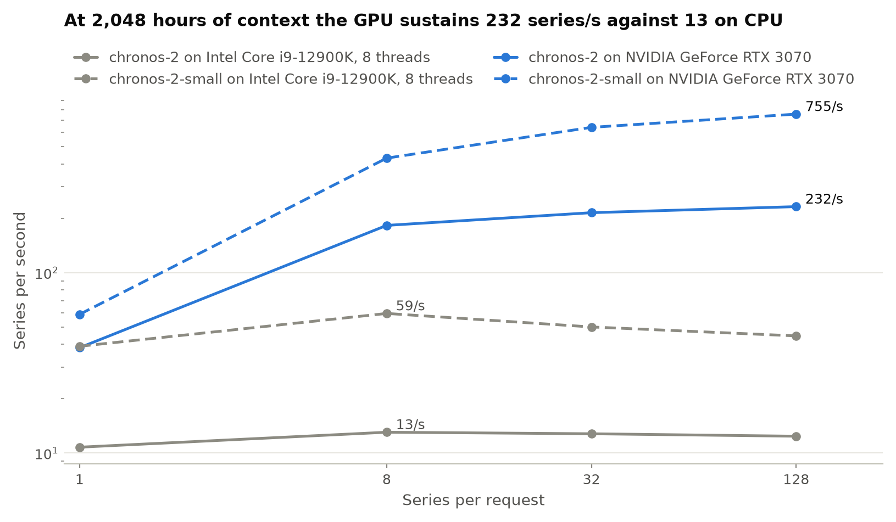
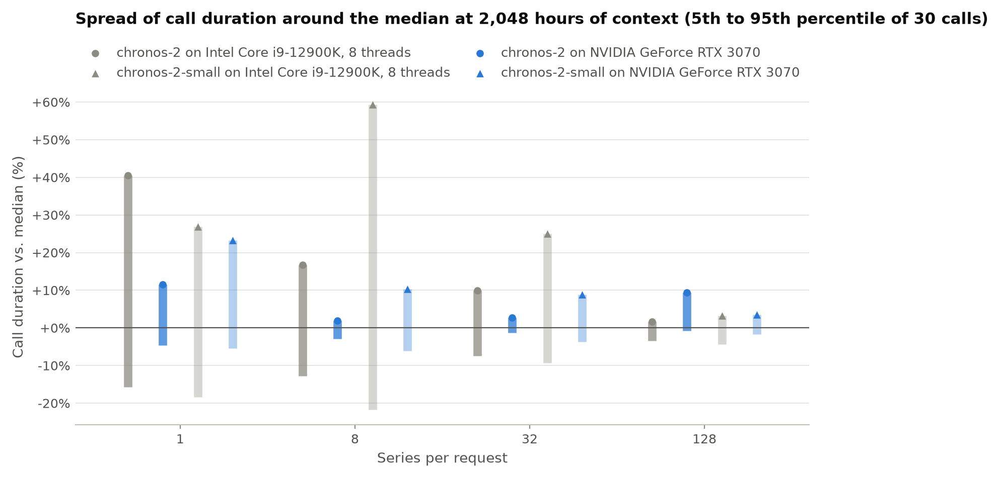
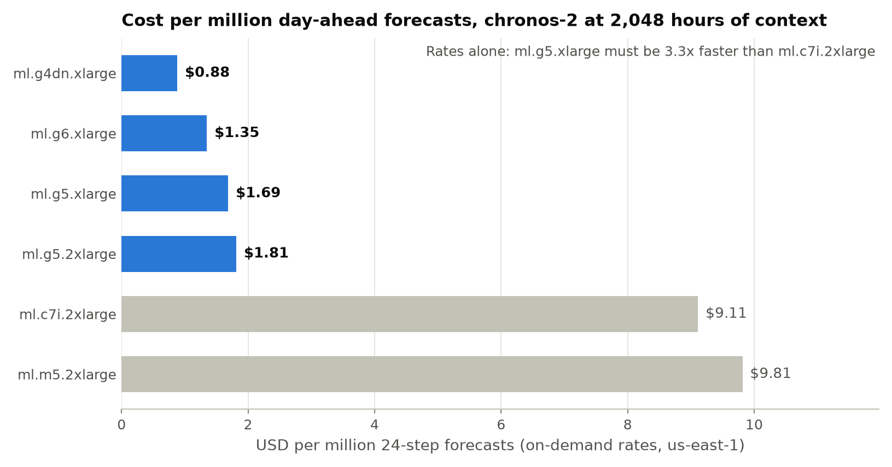
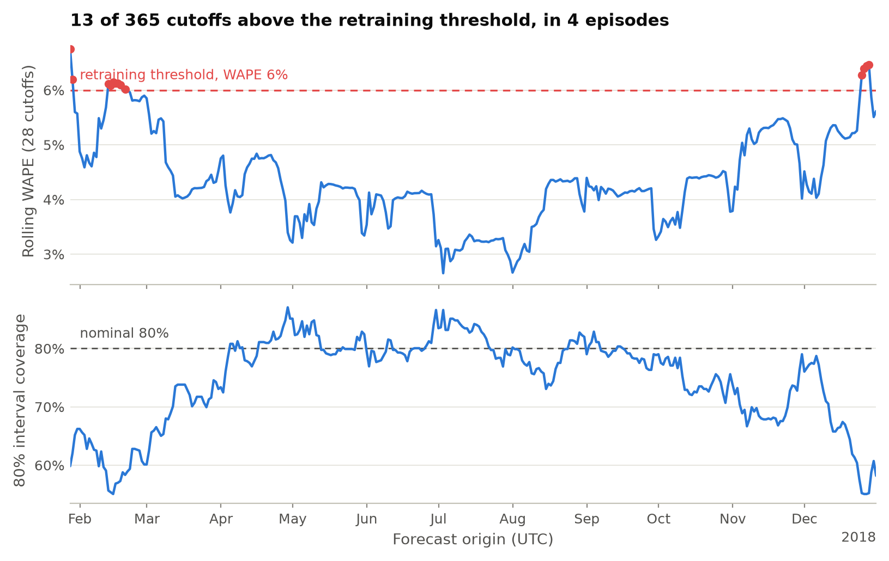
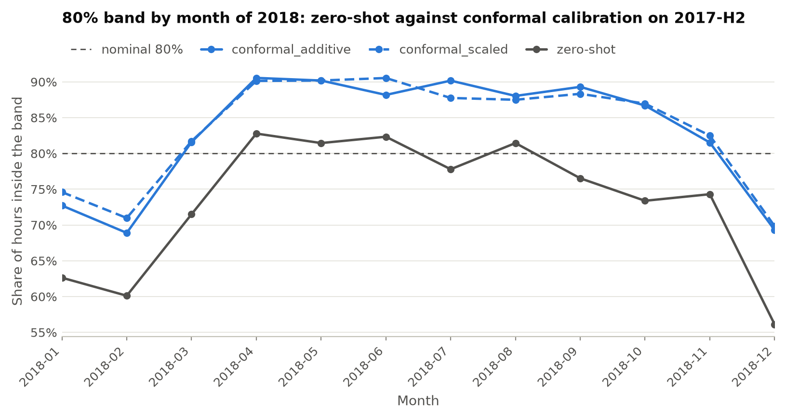

# Chronos-2 in Practice (5/5): Deployment, Performance and Monitoring

**A consumer GPU serves 216 series per second at 2,048 hours of context; eight CPU cores serve
13. That is a 16.5× gap, against a 3.3× price gap, which settles the hardware question and
makes every other deployment decision about idle time, not speed. The first version of this
benchmark said 59×, and the reason it was wrong is the most useful lesson in the article.**

*Disclosure: this article was drafted with the help of an AI assistant. Every experiment was run from the companion repository, every number is read from its results files, and the text was reviewed and edited by the author.*

> Draft for Medium. Every number is read from a CSV in [`results/`](../results); each figure
> names the file to upload. Published open access (not metered).

---

[Part 4](#) finished with a model that was ready to deploy and an adapter that came in at 4.6 MB.
This part picks up from there, covering how fast it runs, where you can run it, what it costs, and
how you find out when it stops working.

One framing note before the numbers. As of November 2026 AWS lists Chronos-2 in SageMaker
JumpStart but sells no pay-per-call API for it. The weights are Apache-2.0 and the library is
public, and every path below runs the model **in your own account** and bills you for the compute,
whether or not a request arrives.
That's the opposite of how a hosted LLM usually works, and it makes idle time, rather than latency,
the dominant cost term for most forecasting workloads. (Hosted alternatives exist outside AWS. Google's
BigQuery exposes TimesFM as the `AI.FORECAST` SQL function, and third-party services such as The
Forecasting Company's API serve Chronos-2 per request, with the provider choosing the deployed
variant and its limits. This article stays with the paths where you control the model.)

- **Code:** [`bench/`](https://github.com/epjover/chronos2-in-practice/tree/main/bench),
  [`deploy/`](https://github.com/epjover/chronos2-in-practice/tree/main/deploy),
  [`monitoring/`](https://github.com/epjover/chronos2-in-practice/tree/main/monitoring),
  [`scripts/cost_table.py`](https://github.com/epjover/chronos2-in-practice/blob/main/scripts/cost_table.py)
  : scripts rather than notebooks, because this is the part you run from a cron job.
- **Data:** hourly Spanish load, 2018, for the latency benchmark and the monitoring replay;
  `us-east-1` on-demand rates from the AWS Price List API.
- **Versions:** `chronos-forecasting==2.3.2`, `fastapi==0.162.0`, Python 3.11.
- **Hardware:** Intel Core i9-12900K with 8 cores available to the process, PyTorch on 8
  threads; NVIDIA RTX 3070 (8 GB). Every timing below is the median of 30 calls on this machine,
  with its percentiles, and says so in its CSV.

---

## 1. Throughput: batch size matters more than hardware, until it doesn't

[`bench/bench_cpu_gpu.py`](../bench/bench_cpu_gpu.py) sweeps three things the caller controls
(series per request, context length, and which checkpoint is loaded) on both CPU and GPU. Each cell
gets timed 30 times after a discarded warm-up run, except for the slowest cell, which only gets 12
runs because it hits the two-minute budget. The row records the median, the mean, the standard
deviation, the 5th and 95th percentiles and the extremes, and every individual timing also gets
written to a second CSV. The throughput quoted below is the median. The sweep was then run a second
time, a few minutes later, to see how much a single run can be trusted. The machine is an Intel Core
i9-12900K with 8 cores available to the process and an RTX 3070 with 8 GB of memory.

**Check the thread count before you believe a CPU number.** The first run of this benchmark reported
4 series per second on the CPU, but the machine can manage 13. The gap traced back to
`torch.get_num_threads()` returning 1, because the sandbox the benchmark ran in had left OpenMP at a
single thread even though `nproc` said eight, and nothing in the output would have shown that. The
script now calls `torch.set_num_threads()` itself and writes the CPU model, the cores available and
the thread count into every row, and the FastAPI service does the same at start-up. A latency figure
without its thread count mostly tells you about the container it ran in, and not much about the
model, which is the habit to carry forward from all this.



*Figure 1. Series per second against batch size at 2,048 hours of context, log-log; the line is
the median of 30 calls and the band runs from the slowest 5% to the fastest 5%. Batching is
transformative on the GPU and nearly useless on the CPU; the 27.9M-parameter `chronos-2-small`
sits a factor of three above the 119.5M-parameter base model everywhere.*

Full results are in [`results/bench_latency_cuda.csv`](../results/bench_latency_cuda.csv) and
[`results/bench_latency_cpu.csv`](../results/bench_latency_cpu.csv). What stands out is what happens
at 2,048 hours of context (medians):

| | 1 series | 8 | 32 | 128 | Peak |
| --- | ---: | ---: | ---: | ---: | ---: |
| `chronos-2`, RTX 3070 | 37.0/s | 170.6/s | 203.5/s | 216.2/s | **216/s** |
| `chronos-2`, 8 CPU cores | 9.1/s | 13.0/s | 13.1/s | 12.5/s | **13/s** |
| `chronos-2-small`, RTX 3070 | 57.0/s | 392.3/s | 594.0/s | 714.0/s | **714/s** |
| `chronos-2-small`, 8 CPU cores | 31.0/s | 43.9/s | 46.0/s | 42.3/s | **46/s** |


**How much to trust a latency number.** A median hides a shape, so it helps to look at the shape
itself ([`results/bench_stability.csv`](../results/bench_stability.csv), drawn in Figure 2). On the
GPU the slowest 5% of calls run 10% over the median in the typical cell and 34% over it in the
worst one (`chronos-2-small`, one series, 512 hours). On the CPU the typical cell's slow tail is
26% over the median, and single-series calls are far worse, with the 95th percentile for
`chronos-2` running 2.3× the median at 512 hours and 1.4× at 2,048 hours. Large batches are calm
on both devices (within 30% on the CPU, 16% on the GPU), because one long call averages out the
scheduler. Between the two complete runs, the median of a cell moved by 1.2% on the GPU in the
typical case (5.7% at most) and by 5.0% on the CPU (16% at most, for `chronos-2` at 512 hours and
8 series). So quote medians rather than means, since the CPU mean sits above the median in every
cell; never quote a CPU latency from a handful of calls; and treat any throughput difference under
about 5% on a GPU, or 15% on a CPU, as noise unless you ran it more than once.



*Figure 2. The 5th to 95th percentile of call duration relative to each cell's median, at 2,048
hours of context. The marker is the 95th percentile: how much slower than typical the slow calls
are. CPU cells spread two to four times wider than GPU cells, and small requests spread the most.*

**Batching is the single biggest lever on a GPU, and does almost nothing on a CPU.** Going from one
series per call to 128 multiplies GPU throughput by 5.8× at 2,048 hours of context, and by 23× at
512 hours (34.4 → 777.3 series/s). On the CPU the same change moves throughput by about 40%, and
then it gets worse, because eight cores are already saturated by a few series, so the extra work
just queues up. If you serve from a CPU, batching mainly cuts per-request overhead rather than
lifting throughput.

**Context is the hidden throughput cost.** On the GPU, quadrupling context from 512 to 2,048 hours
cuts peak throughput from 777 to 216 series per second. Part 2 found that context beyond 1,024 hours
bought about 1.4 points of skill, so this is what that trade costs on the other side.

**The small checkpoint runs more than three times faster and comes in roughly a quarter worse.**
`chronos-2-small` is 3.3× faster on the GPU and 3.5× faster on the CPU at 2,048 hours. Part 1
promised the other half of that trade, so
[`bench/small_vs_base_accuracy.py`](../bench/small_vs_base_accuracy.py) runs both checkpoints
through Part 2's protocol, using the same 365 day-ahead windows and 2,048 hours of context:

| Checkpoint | Params | WQL | 80% coverage | Skill vs `chronos-2` [95% CI] | Wins | Skill vs seasonal naive |
| --- | ---: | ---: | ---: | --- | ---: | ---: |
| `chronos-2` | 119.5M | 0.0388 | 73.4% | n/a | n/a | 63.9% |
| `chronos-2-small` | 27.9M | 0.0426 | 71.5% | **−24.8%** [−30.0, −20.3] | 29% | 54.9% |

That is a real cost. On the typical window the small model's quantile loss comes in a quarter
higher, and the interval is nowhere near zero. But it is also still 55% better than the seasonal
naive, and in Part 2's table it would sit above every classical baseline. The fair way to frame it
is that `chronos-2-small` is the right checkpoint when throughput is the binding constraint and a
quarter more error is affordable (a CPU-only serverless endpoint is the obvious case), and the wrong
one when the forecast's quality is what you are paid for.

**Single-request latency is good enough everywhere.** One series, 2,048 hours of context, 24-step
horizon, runs in 27 ms on the GPU (30 ms at the 95th percentile) and 109 ms on 8 CPU cores (154 ms
at the 95th). Either is fine for an interactive dashboard. Latency is almost never why you'd buy a
GPU, because throughput is the real driver.

## 2. Three places to run it

The repository ships three deployment paths, ordered by how much AWS takes care of for you.
All three share one thing, and each README says it plainly: **the command that deletes what you
created.**

### A container you run anywhere

[`deploy/fastapi`](../deploy/fastapi/) is a FastAPI app that ships with a multi-stage Dockerfile,
and the weights get baked in at build time, which means the container starts up offline. Every
request passes through the same `validate_and_prepare` checklist used in the notebooks, and every
response carries a SHA-256 hash of the canonical model input.

```bash
uv run --group deploy uvicorn app:app --app-dir deploy/fastapi --port 8000
uv run --group deploy python deploy/fastapi/smoke_test.py --wait 300 \
    --bench 1 8 32 128 --csv results/09_service_latency.csv
```

Measured against the running service using 8 CPU cores, a week of hourly context, and a 24-step
horizon:

| Series per request | Client p50 | Client p95 | Server p50 |
| ---: | ---: | ---: | ---: |
| 1 | 48.9 ms | 73.8 ms | 46.6 ms |
| 8 | 116.9 ms | 178.8 ms | 113.1 ms |
| 32 | 352.0 ms | 432.9 ms | 343.9 ms |
| 128 | 1,234.8 ms | 1,332.8 ms | 1,207.5 ms |

(Source: [`results/09_service_latency.csv`](../results/09_service_latency.csv), written by
`smoke_test.py --csv`.) The HTTP layer adds 2 to 27 ms on top of the model, which is negligible, but it helps to
know this precisely so you don't end up chasing the wrong bottleneck.

The validation surface is the unglamorous part that decides whether this survives contact with real
callers. It rejects bad input with a 422 that names the offending field, covering mismatched array
lengths, all-null series, duplicate ids or timestamps, timestamps off the frequency grid, mixed
naive and offset timestamps, NaN and Infinity, quantile levels outside (0, 1), and requests that go
past the limits: 1,000 series, horizon 1 to 1,024, and 32,768 grid steps per series. The library
then validates the frames a second time inside `predict_df`. That pass can be switched off with
`validate_inputs=False` once you guarantee its three conditions yourself (frames sorted by id and
timestamp, a future frame with `prediction_length` rows for every id, a regular grid), and the
service meets all three after `validate_and_prepare`. It keeps the flag at its default anyway: the
saving is a few milliseconds on requests that take tens, and a silent wrong forecast costs more.

### A managed endpoint in your account

[`deploy/sagemaker`](../deploy/sagemaker/) bundles a handler together with the `c2p` package into a
`model.tar.gz`, registers it, and spins up an endpoint. The handler speaks **the same JSON** as
the FastAPI app, so a client built against one also works against the other, and the two can be
compared on cost rather than on how much rewriting each one needed.

```bash
uv add --group cloud boto3 sagemaker
uv run --group cloud python deploy/sagemaker/deploy_endpoint.py --plan          # creates nothing
uv run --group cloud python deploy/sagemaker/deploy_endpoint.py --yes \
    --bucket my-bucket --role <execution-role-arn>
uv run --group cloud python deploy/sagemaker/deploy_endpoint.py --delete --yes
```

`--plan` is the default, so the script prints what it would create and what would keep billing, and
it does nothing until you pass `--yes`.

### Nothing at all: AutoGluon Cloud

[`deploy/autogluon_cloud`](../deploy/autogluon_cloud/) uses `TimeSeriesFoundationModel`, which
needs no handler, no image and no training job. It offers the three shapes a forecasting
workload takes:

```python
from autogluon.cloud import TimeSeriesFoundationModel

model = TimeSeriesFoundationModel("chronos-2", cloud_output_path="s3://bucket/prefix")

# (a) one job, writes to S3, exits: the nightly day-ahead run
forecasts = model.predict(history, prediction_length=24, quantile_levels=[0.1, 0.5, 0.9])

# (b) a dedicated endpoint, billed per hour until deleted
endpoint = model.deploy(instance_type="ml.c7i.xlarge")

# (c) serverless: scales to zero, CPU only, needs the weights cached in S3 first
endpoint = model.cache_model_artifact("s3://bucket/prefix/artifact").deploy(
    inference_mode="serverless",
    inference_config={"memory_size_in_mb": 6144, "max_concurrency": 5},
)
endpoint.delete_endpoint()
```

Option (c) is the only one in this article that bills nothing while it's idle. It's CPU-only, and it
pays a cold start on the first call after a quiet period (the official deployment guide puts it at
30 to 60 seconds), but for a once-a-day forecast that's a trade most people would happily take.

AWS also lists Chronos-2 in SageMaker JumpStart (`pytorch-forecasting-chronos-2`), offering the same
idea but through the console. Whichever option you pick, the endpoint belongs to you, and so does
the bill.

### Two things that do not change with the path

**The series you send are business data.** A national load curve is public, but a factory's load
curve is a production schedule, and a store's hourly traffic is its revenue. Every managed path
described above sends that data to an endpoint outside your network, and a forecast log (section 4)
keeps a copy of it. The weights are Apache-2.0 and the model never needs to call out anywhere (the
FastAPI image starts with `HF_HUB_OFFLINE=1`), so you can run the stack entirely on-premise if you
need to. Work out where the data is allowed to go before you decide where the model runs, because
that first constraint usually settles the second.

**The licence is permissive, and that's not something you can assume in this field.** Chronos-2's
weights and the `chronos-forecasting` library are Apache-2.0, which means commercial use,
modification and redistribution are all allowed, as long as you include attribution and a copy of
the licence. A LoRA adapter from Part 4 counts as a derivative work, so you're free to ship it. Part
1 pointed out that TimesFM-3, which claims a higher leaderboard score, comes under a non-commercial
licence, and a model you can't deploy for a customer isn't a better model for that customer. The
dataset used in this series is CC0, but check the terms of yours before it ends up in a training
job.

## 3. What it costs, and which part of that number you can trust

Cost tables go stale fast, so this one is generated rather than typed by hand.
[`scripts/fetch_cloud_prices.py`](../scripts/fetch_cloud_prices.py) reads the **AWS Price List Bulk
API** (public, no credentials needed, and it creates nothing) and writes
[`data/reference/cloud_prices.csv`](../data/reference/cloud_prices.csv), recording the SKU, the
effective date and the offer-file version alongside every rate. The figures below come from offer
version `20261111023957` for `us-east-1`, with rates effective 2026-11-01.

I went to the official source because the unofficial ones disagree. A quick survey of pricing blog
posts turned up four different figures for `ml.g5.xlarge`, and the numbers spanned a 40% range. So
if you're going to put a dollar sign in an article, read it from the API.



*Figure 3. Cost per million 24-step forecasts at 2,048 hours of context, comparing 8-vCPU CPU
instances with GPU instances at published `us-east-1` on-demand rates. The annotation is the
rate-only break-even, the one number here that does not depend on a local measurement.*

| Instance | vCPU / GPU | USD/hour | USD/month (730 h) | USD per million forecasts |
| --- | --- | ---: | ---: | ---: |
| `ml.g4dn.xlarge` | 4 / 1 | 0.736 | 537 | **0.95** |
| `ml.g6.xlarge` | 4 / 1 | 1.127 | 822 | 1.45 |
| `ml.g5.xlarge` | 4 / 1 | 1.408 | 1,028 | 1.81 |
| `ml.g5.2xlarge` | 8 / 1 | 1.515 | 1,106 | 1.95 |
| `ml.c7i.2xlarge` | 8 / none | 0.428 | 312 | **9.09** |
| `ml.m5.2xlarge` | 8 / none | 0.461 | 337 | 9.79 |

Read the two halves of this table differently, because they are not equally solid.

**The rates are exact.** The break-even ratio comes from them alone, because `ml.g5.xlarge` costs
3.29× what `ml.c7i.2xlarge` costs (the 8-vCPU instance, matched to the 8 cores the CPU number was
measured on), so it becomes the cheaper way to serve a given volume as soon as it runs more than
3.3× faster. Section 1 measured 16.5×, so for throughput work the GPU is not a close call. But
notice how much closer it got once the CPU was allowed to use its cores. With the single-thread
number the gap was 59×, and a benchmark error of that size would have bought a GPU nobody needed.

One caution applies to the GPU rows. The table assigns the *same* measured throughput, taken from an
RTX 3070, to every GPU instance, so within those four rows the ranking just reflects the ranking of
hourly rates. In reality `ml.g4dn.xlarge` carries a T4, which is an older and slower part than the
A10G in `ml.g5.xlarge`, so its row turns out to be the most optimistic one in the table. This
benchmark can't settle which GPU is cheapest per forecast, but it does show that the cheapest GPU
beats the cheapest 8-vCPU CPU instance by an order of magnitude. One external anchor: the
Chronos-2 paper reports over 300 series per second on a single A10G, for a batch of 1,024 series
with 2,048 steps of context and a 64-step horizon. That is a larger batch and a longer horizon
than anything measured here (the RTX 3070 reaches 216/s at 128 series, 2,048 hours of context and
a 24-step horizon), so the two figures are not directly comparable, but they put the `ml.g5.xlarge`
row in a plausible range rather than contradicting it.

**The cost per million is an estimate.** It multiplies a published rate by throughput measured
on *my* machine, and an RTX 3070 is not an A10G. Treat the column as an order of magnitude and
a ranking, not a quote. The table shows only 8-vCPU CPU instances because the CPU
measurement came from 8 cores, so quoting it against a 2-vCPU instance would flatter the
smaller instance by roughly the ratio of cores.

**Serverless avoids paying for idle time.** SageMaker Serverless Inference charges $0.00002 per
GB-second of request duration, so at 6 GB and the measured single-request CPU latencies, one million
single-series requests cost:

| Checkpoint | Context | Seconds per request | USD per million requests |
| --- | ---: | ---: | ---: |
| `chronos-2` | 512 | 0.054 | 6.42 |
| `chronos-2` | 2,048 | 0.109 | 13.13 |
| `chronos-2-small` | 512 | 0.017 | 2.09 |
| `chronos-2-small` | 2,048 | 0.032 | 3.88 |

Those latencies come from 8 dedicated cores. AWS sizes a serverless endpoint's compute from the
memory you choose and publishes no core count for it, so read the column as a lower bound, for the
same reason the instance table sticks to 8 vCPUs.

Per forecast, that comes out worse than any always-on instance, but what matters here is the
denominator. An always-on `ml.c7i.2xlarge` costs $312 a month *whether you use it or not*, and a
day-ahead forecaster that runs 365 times a year only needs it for a few minutes. At $13.13 per
million, the serverless bill doesn't catch up to that instance's $312 a month until around 24
million single-series requests a month (nine requests per second, around the clock). Below that,
serverless or a batch job works out cheaper, and what decides it is monthly bill against monthly
bill, not dollars per forecast.

**The rule of thumb.** If volume is high and steady and latency matters, use a GPU endpoint. If
traffic is bursty or interactive with modest volume, go serverless. A single scheduled run per day,
which is what day-ahead forecasting really amounts to, calls for a batch job that exits.

## 4. Monitoring: the forecast arrives before the truth does

A backtest tells you a model *was* good. Production asks whether it still is, and the two differ in
a structural way, because in production the actuals arrive after the forecast, often much later.
Everything in [`src/c2p/monitoring.py`](../src/c2p/monitoring.py) is built around that delay.

```python
from c2p.monitoring import (
    append_log,
    join_actuals,
    log_predictions,
    read_log,
    retraining_alerts,
    rolling_metrics,
)

rows = log_predictions(forecast, context, model_version="amazon/chronos-2@2.3.2", cutoff=cutoff)
append_log(rows, "logs/predictions.csv")  # no actual column: it does not exist yet
...
joined = join_actuals(read_log("logs/predictions.csv"), observed, target="load_actual")
rolling = rolling_metrics(joined, window=28, quantile_levels=(0.1, 0.9), nominal=0.8)
alerts = retraining_alerts(rolling, wape_threshold=0.06)
```

A few of the design decisions are meant to be copied.

**Log the input hash, not just the forecast.** `context_hash` is a stable digest of the exact frame
the model saw, NaNs included. Six weeks later, when a forecast looks wrong, this hash lets you tell
whether the model changed or the data changed. Without it those two causes look the same, and every
incident turns into an argument.

**Leave unresolved rows unresolved.** `join_actuals` keeps rows whose actual has not arrived,
with NaN in `actual`. The share of resolved rows is a signal in its own right. If it falls, your
data feed broke, and you want to know that before the error metric reacts a month later.

**Alert once per episode, not once per day.** `retraining_alerts` adds a `first_breach` column, true
only on the cutoff where a run of breaches starts. A threshold without this will page you every
morning for a week, and then you'll mute it.

[`monitoring/build_panel.py`](../monitoring/build_panel.py) demonstrates the loop by replaying 2018
in fast-forward. Each of the 365 cutoffs is forecast from its own past and written to the log with
no actual attached, and the actuals are joined afterwards (the same order of events as production,
but with the waiting removed). It produces 8,760 logged forecasts across 365 distinct input hashes.



*Figure 4. The panel an operator watches. Rolling WAPE over a trailing 28 cutoffs with the
retraining threshold, and the achieved coverage of the nominal 80% interval. Red markers are
cutoffs above the threshold.*

| | Min | Median | Max |
| --- | ---: | ---: | ---: |
| rolling WAPE (28 cutoffs) | 2.65% | 4.22% | 6.75% |
| 80% interval coverage | 55.1% | 77.5% | 87.1% |

The rolling WAPE pools 28 days of absolute error over 28 days of load, so it differs from Part 2's
per-window mean of 4.7%: the two agree on the level but differ in how the averaging is done.

At a 6% threshold, **13 of 365 cutoffs breach, in 4 episodes**: one in late January, two in
mid-February a day apart, and one in Christmas week. That clustering is the most useful thing in the figure, and it says more about the
rule than about the model. These are cold snaps and a national holiday, recurring and predictable
conditions, not drift. A fixed threshold on a seasonal series will page you every Christmas and
teach your on-call to ignore it. So either set the threshold from the same season last year, or
alert on the gap between this year and last year rather than on the level.

The coverage panel is the one I'd act on first. The rolling coverage of the nominal 80%
band averages 74.8% (73.4% over the whole year, as in Part 2), but it drops to 55% in winter, and that's the same under-coverage Part 2 found zero-shot and Part 4 made slightly
worse through fine-tuning. The median holds up fine, but winter doesn't. Section 5 fixes it.

**Input drift** is the complement (errors tell you something broke after the fact, while a shift
in the inputs can be seen before the actuals land). Comparing the first quarter of 2018 with the
last gives a mean shift of 0.03 reference standard deviations and 21.5% of current values
outside the reference 10–90% range, against 20% expected by construction. Nothing moved. That
is the answer you want from a drift check most of the time, and the reason to keep it cheap and
explainable rather than clever.

**The retraining rule, stated completely.** When the rolling WAPE over 28 cutoffs climbs above
threshold for the first time in an episode, we train a new LoRA adapter on data up to the breach and
evaluate it on the windows since the last deployment, then promote it only if the skill score's
confidence interval excludes zero. Part 4's numbers set the expectation, since an adapter takes 5
minutes and 4.6 MB to produce, so the expensive part of this loop is the evaluation rather than the
training.

## 5. Calibrating the intervals: the one fix the series owed

Every part turned up the same defect, and none of them fixed it. On Spanish load, the 80% band
covers only 73.4% of the hours (56% in December), while the levers used in Parts 2 to 4 (context,
covariates, fine-tuning) all work on the median. **Conformalized quantile regression** (Romano et
al., 2019) is the fix that targets the bands instead, and it needs no training. Over a period where
the actuals are known, you measure how far each interval missed by, and then widen future intervals
by the quantile of those misses so that calibration coverage comes out right. The adjustment is
learned once per quantile pair and per horizon step, and applied as a post-processing step
([`src/c2p/conformal.py`](../src/c2p/conformal.py)).

The protocol is set up so that nothing can have seen 2018. We calibrate on the 184 day-ahead windows
of the second half of 2017 (Part 4's validation period) and score on Part 2's 365 windows of 2018,
through the same harness
([`monitoring/calibrate_intervals.py`](../monitoring/calibrate_intervals.py)). There are two
variants: an **additive** shift in megawatts, the textbook form for one series, and a **scaled**
multiplier of the model's own interval width, the form that travels across series of different
levels. In code, the calibrated model is the same `Forecaster` as before:

```python
from c2p.conformal import ConformalForecaster, calibrate
from c2p.eval import backtest

calibration_frame = backtest(model, series_up_to_2017, calibration_config)  # forecasts + actuals
calibration = calibrate(calibration_frame, quantile_levels=config.quantile_levels, mode="scaled")
calibrated = ConformalForecaster(model, calibration)  # same .predict(); wider where it has to be
```

| | WQL | 80% coverage | 98% coverage | WQL skill vs zero-shot [95% CI] | Worst month (80%) |
| --- | ---: | ---: | ---: | --- | ---: |
| zero-shot | 0.0388 | 73.4% | 93.6% | n/a | 56.1% (Dec) |
| conformal, additive | 0.0387 | **83.2%** | **98.4%** | −5.9% [−6.9, −5.0] | 68.9% (Feb) |
| conformal, scaled | 0.0386 | **83.5%** | **98.5%** | −4.1% [−4.8, −3.4] | 69.9% (Dec) |



*Figure 5. Coverage of the 80% band by month of 2018, zero-shot against the two calibrated
variants. The calibration lifts the whole curve by about ten points; it cannot change its
shape.*


**The bands are trustworthy now, and the median did not pay for it.** Coverage comes in at 83% and
98%, a touch above nominal, which is what the method guarantees on a finite calibration set, and the
mean WQL stays the same to the third decimal. One housekeeping step is built into the adjustment:
widening the 80% band and the 98% band by different amounts can make quantiles cross (a 0.9 column
below the 0.8 one), so `conformalize` sorts the quantile columns of every row afterwards, the
rearrangement of Chernozhukov et al. (2010), which never worsens the pinball loss. The *typical* window does pay something: the skill
score runs −4 to −6%, because on an ordinary day the wider band costs a little pinball loss, and
only the bad days give that back. In the worst tenth of the zero-shot windows the calibrated WQL comes out
lower (0.147 with the scaled variant against 0.152, the `WQL_worst_decile` column of
`09_conformal_summary.csv`). That is the trade a reserve-margin decision wants, and a mean would
hide it.

**The adjustment is largest where the model is most overconfident, and that is interpretable.** The
additive shift for the 80% band runs from 40–80 MW at hours 21–23 of the horizon up to 1,300–1,400
MW at hours 8–9, because that is the morning ramp, local 06:00–09:00, where demand climbs fastest
and the model's bands do not widen enough to admit it. A per-step calibration finds this on its own,
but a single global factor would have widened the quiet evening by the same amount as the ramp.

**A global shift fixes the average, not the season.** The figure shows this plainly. Calibrated
on a half-year that contains December but not January or February, the correction over-covers
summer at 90% and still under-covers winter at 69–75%. The next step isn't a bigger shift but a
*conditional* one, calibrating by month, or letting the adjustment track the last few weeks of
misses (adaptive conformal inference). This is the retraining loop of section 4, applied to the
bands instead of the weights, and it's where I'd take this series next.

## 6. The series, in one page

Five articles, one dataset, one protocol. What moved the number, in order:

| Lever | Gain | Measured as | Where |
| --- | ---: | --- | --- |
| Context 64 → 2,048 hours | +52 points | skill vs seasonal naive, Spanish load | Part 2 |
| Covariates the market knows in advance | +49.5% | WQL vs univariate, EPF-DE | Part 3 |
| TSO forecasts + past generation | +11.8% | WQL vs no covariates, Spanish price | Part 3 |
| LoRA rank 8 on 2.5 years of Spanish electricity | +2.3% | WQL vs zero-shot, Spanish load | Part 4 |
| Full fine-tune, 119M weights | +1.7% | WQL vs zero-shot, Spanish load | Part 4 |
| GPU instead of 8 CPU cores | 16.5× | series per second, same model, threads set | Part 5 |
| `chronos-2-small` instead of `chronos-2` | 3.3× faster, −24.8% | WQL vs base model, Spanish load | Part 5 |
| Conformal calibration of the bands | 73.4% → 83.5% | coverage of the 80% band, WQL unchanged | Part 5 |

The rows sit on different scales and different targets, and that's on purpose. What the table shows
is the ordering, not the sum.

And what didn't move it: a weekly seasonal naive baseline instead of a daily one, forecasting load jointly with price (−0.1%), calendar features added on top of a model that
already reads the clock (−0.2%), and, on this dataset, the difference between Chronos-2 and the
previous-generation Chronos-Bolt on a clean univariate series.

The order matters more than any single row. Context and covariates are configuration; fine-tuning is
a project; hardware is a purchase order. Most teams start with the third.

## Cheat sheet

- Before any CPU number, print `torch.get_num_threads()` and set it yourself. Record the CPU
  model and the thread count next to every latency.
- Time each cell dozens of times and report the median with its 5th and 95th percentiles, never a
  mean of a handful of calls; run the sweep twice before reading a difference under 15% on a CPU.
- Measure throughput at the batch size you will use. On a GPU, batch; on a CPU, do not bother.
- Fetch prices from the Price List API and keep the offer version next to every number.
- Prefer a batch job for a scheduled forecast, serverless for bursty low volume, a GPU endpoint
  for high steady volume, and write the delete command before the create command.
- Log every forecast with its model version and input hash, then join the actuals later, and
  alert once per episode, with a threshold that knows what month it is.
- Calibrate the bands on last year before you publish an interval.

## Where this series would go next

A few things I chose not to do, in case you want to.

**Make the calibration seasonal.** Section 5 fixed the average coverage but left the shape alone, so
summer stayed over-covered and winter stayed under. Calibrating by month, or adapting the shift to
the last few weeks of misses, is the natural extension. The real test is whether it holds up in a
January the calibration never saw.

**Test the cold-start claim at scale.** Part 2 found that cross-learning added +2% to +4% when a new
series had 72 to 504 hours of history and four related series shared the frame. Five Spanish cities
make for a small frame, though. A more interesting test would be a retail chain opening its
hundredth store.

**Watch the field.** Chronos-2 led fev-bench when its paper came out in October 2025. Since then,
TimesFM-3 (August 2026, non-commercial licence), t0-gamma and Mistral's Timestral (both October
2026) have all claimed to beat it. The protocol in Part 2 is what to keep, and the model it describes can change. That's why
the protocol was written down in the first place.

---

## References

1. Ansari, A. F., *et al.* (2025). *Chronos-2: From Univariate to Universal Forecasting*, §5.4.
   arXiv:2510.15821. https://arxiv.org/abs/2510.15821
2. Shchur, O., *et al.* (2025). *fev-bench*. arXiv:2509.26468. https://arxiv.org/abs/2509.26468
3. AWS Price List Bulk API. https://docs.aws.amazon.com/aws-cost-management/latest/APIReference/
4. AutoGluon Cloud, *Time series foundation models*.
   https://auto.gluon.ai/cloud/stable/tutorials/foundation-model-timeseries.html
5. *Deploy Chronos to Amazon SageMaker* (notebook).
   https://github.com/amazon-science/chronos-forecasting/blob/main/notebooks/deploy-chronos-to-amazon-sagemaker.ipynb
6. FastAPI. https://fastapi.tiangolo.com/
7. Romano, Y., Patterson, E. & Candès, E. J. (2019). *Conformalized Quantile Regression*.
   NeurIPS 2019. arXiv:1905.03222. https://arxiv.org/abs/1905.03222
8. Chernozhukov, V., Fernández-Val, I. & Galichon, A. (2010). *Quantile and Probability Curves
   Without Crossing*. Econometrica 78(3). https://doi.org/10.3982/ECTA7880
9. Dataset: *Hourly energy demand generation and weather* (CC0).
   https://www.kaggle.com/datasets/nicholasjhana/energy-consumption-generation-prices-and-weather
10. Model card: `amazon/chronos-2`. https://huggingface.co/amazon/chronos-2 (the A10G throughput
    figure is from reference 1, with its footnote on batch, context and horizon).
11. Amazon SageMaker AI, *Deploy models with Amazon SageMaker Serverless Inference* (memory size
    and compute). https://docs.aws.amazon.com/sagemaker/latest/dg/serverless-endpoints.html
12. The Forecasting Company API, *Overview* (available models, among them `chronos-2`).
    https://docs.retrocast.com/documentation

**Suggested tags:** Time Series Forecasting · MLOps · Machine Learning · Foundation Models ·
Python
