# Chronos-2 in Practice (1/5): How It Works, Messy Data and Your First Forecast

**A 120M-parameter forecasting model, no training, a week of Spanish electricity demand in quantiles, and the one data mistake that more than doubles its error.**

*Disclosure: this article was drafted with the help of an AI assistant. Every experiment was run from the companion repository, every number is read from its results files, and the text was reviewed and edited by the author.*

> Draft. Every number in the text is read from a CSV in [`results/`](../../results); each figure
> names the file to upload to Medium. Still to decide before publishing: the repository
> URL (`scripts/set_repo_url.py`). Published open access (not metered); the AI disclosure above
> follows [Medium's policy](https://help.medium.com/hc/en-us/articles/22576852947223-Artificial-Intelligence-AI-content-policy).

---

It takes ten lines of Python, no training and no hyperparameters, and a 120-million-parameter model
reads four years of hourly Spanish electricity demand and returns the next week as a distribution,
with 21 quantile levels, natively, up to the 1st and 99th percentiles. On a desktop CPU it takes
about three tenths of a second, and the median forecast lands 811 MW from what actually happened:
2.8% of average demand.

Then you delete 18 rows from the input, not the values but the *rows* themselves, the way a failed
export or a careless `dropna()` deletes them. You hand the model that, tell it the data is hourly,
and nothing complains, no error, no warning. Its error more than doubles. Across 20 weekly forecast
origins, the weighted quantile loss rises by 111% on average, and by 203% in a typical week.

This article is about the gap between those two paragraphs. Part 1 of five covers what Chronos-2 is,
what its benchmark numbers mean and where they turn out thinner than they look, how to get a first
probabilistic forecast out of it, and the data checklist that keeps the second paragraph from
happening to you. Parts 2 to 5 go on to cover evaluation, covariates, fine-tuning and production.

There are already good walkthroughs of what Chronos-2 can do (Guo's two-part series on Towards Data
Science, 2026, tours the four forecasting modes and five ways to fine-tune). This series asks a
different question, namely how much each of those capabilities *delivers*, measured the same way
every time, on one real dataset, with a baseline in every table and a confidence interval on every
number. Where a result is small or absent, it says so.

- **Code:** [`chronos2-in-practice`](https://github.com/epjover/chronos2-in-practice):
  notebooks [`00_data_checks`](https://github.com/epjover/chronos2-in-practice/blob/main/notebooks/00_data_checks.ipynb)
  and [`01_quickstart`](https://github.com/epjover/chronos2-in-practice/blob/main/notebooks/01_quickstart.ipynb),
  both runnable on a CPU and openable in Colab. `c2p` in the imports is the repository's own
  helper package (`src/c2p/`, installed by `uv sync`), not something from PyPI: the model
  itself comes from `chronos-forecasting`.
- **Data:** the CC0 Kaggle dataset *Hourly energy demand generation and weather* (Spanish load,
  prices, generation and the grid operator's own day-ahead forecasts, 2015–2018).
- **Versions:** `chronos-forecasting==2.3.2` on Python 3.11. The Chronos API has changed between
  minor releases, so the version matters.
- **Hardware:** every timing in the series names the machine it ran on: here an Intel Core
  i9-12900K (8 cores available to the process) and, where a GPU is used, an RTX 3070 with 8 GB.
  The notebooks print this with `run_metadata()`, next to the library versions.

---

## 1. From Chronos to Chronos-2

Chronos-2 is the third generation of Amazon's time series foundation models, and the family has
changed shape with every release.

**Chronos (March 2024)** treated forecasting as a language-modelling problem. It would scale a
series, bin the values into a fixed vocabulary, and train a T5 encoder–decoder to predict the next
token. To get a distribution, you sampled 20 trajectories and took quantiles of them. It worked,
though it was slow in practice.

**Chronos-Bolt (November 2024)** did away with the vocabulary. Values now go in as *patches* (short
blocks of consecutive steps), and the model produces quantiles for the full horizon directly, in a
single forward pass. That makes it much faster and more accurate.

**Chronos-2 (October 2025)** keeps the patches and the direct quantiles, and it adds something
neither predecessor could manage, since it reads several series at once and lets them inform each
other. One 120M-parameter encoder now covers univariate forecasting, multivariate forecasting, and
forecasting with past and known-future covariates, all zero-shot and all run through the same
`predict_df` call. The weights are released under Apache-2.0.

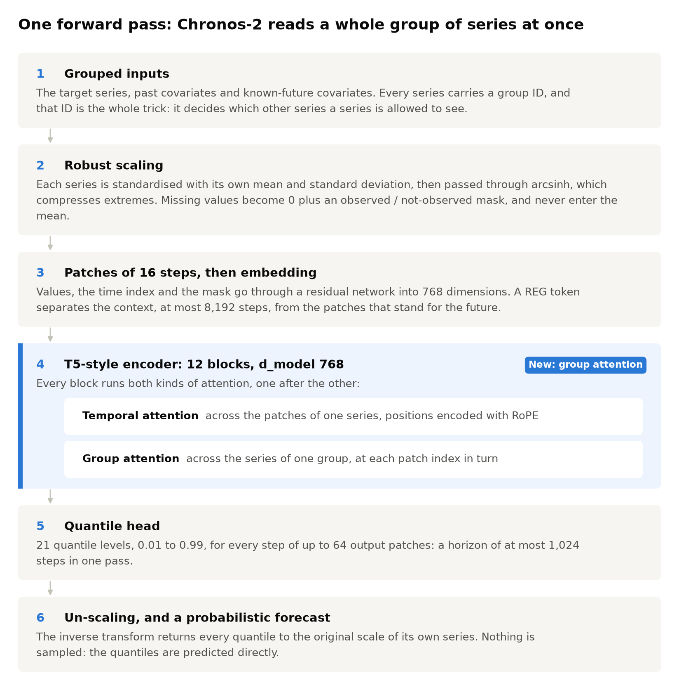

*Figure 1. One forward pass through Chronos-2. Drawn by `c2p.plots.architecture` from the limits
reported by the loaded checkpoint; the stages come from section 3 of the technical report.*

Step 4 makes the difference. Chronos-2 is an encoder-only transformer that follows the T5 encoder
closely (12 blocks, `d_model` 768, 12 heads, rotary position embeddings), but each block
runs attention **twice**:

- **Time attention** runs along the temporal axis, across the patches of one series. It's the
  ordinary attention every sequence model already has.
- **Group attention** runs across *series*, at a given patch index. Series inside a group
  exchange information with each other, but series in different groups can't see each other at all.

Every series in a batch carries a **group ID**, and the layer turns those IDs into an attention
mask. Series inside a group have no natural order, so group attention uses no positional embeddings,
and it treats them as a set rather than a sequence.

That single mechanism is the only idea you need for this entire series, since each mode of the
model is just a different way of assigning group IDs:

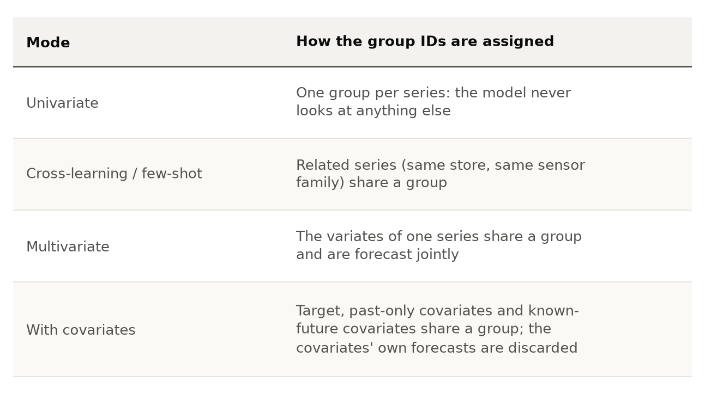

*Table 1. Columns: Mode, How the group IDs are assigned.*

Parts 2 and 3 are, quite literally, that table applied twice.

It helps to note two more details before the first forecast, because both come back later.

**The model never sees dates.** It gets a *relative* time index, each step's position divided by the
maximum context length, plus a mask, and nothing else. No month, no day of week, no holiday. It can
pick up the *periodic* part of the calendar from the series itself (part 3 measures how well), but
anything aperiodic, holidays above all, has to come in as a covariate. On the ten national holidays
of 2018, a single holiday flag cuts the quantile loss by 14%. More immediately, Chronos-2 has no way
to notice that a row is missing, and that's why section 5 of this article matters.

**Everything beyond univariate was learned from synthetic data.** The pretraining corpus mixes real
univariate datasets with synthetic ones, but the multivariate and covariate *structures* are
entirely synthetic, built by imposing relationships on univariate series. The authors say this
plainly in the discussion, and an ablation backs it up: a Chronos-2 trained only on synthetic data
performs "only slightly below" the released model on two of the three benchmarks. So the capability
you are about to rely on for real covariates was never trained on a real covariate.

## 2. What the benchmarks say, and what they don't

The technical report puts the 120M model through three benchmarks, measuring it against the
strongest pretrained competitors as well as a set of statistical baselines.

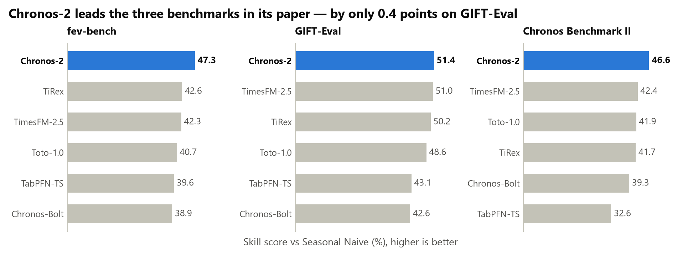

*Figure 2. Skill scores from the Chronos-2 technical report, Tables 3, 4(a) and 5(a). The values
are copied with their source into `data/reference/paper_benchmarks.csv`, and the figure is drawn
from that file.*

Two headline metrics come up again and again, and each one answers a different question:

- **Win rate** is the share of *pairwise comparisons against the other models* that a model
  wins. It tells you how often you would have been right to pick it.
- **Skill score** is the average percentage improvement over Seasonal Naive. It's one minus
  the geometric mean, across the benchmark's tasks, of the model's error divided by Seasonal
  Naive's error. Zero means "no better than repeating last week," and it tells you by how much.

A model can lead on one and not the other, so read both.

**fev-bench** (100 tasks, the broadest coverage of real scenarios and the only one of the three with
covariate tasks): none of its datasets were seen during training. Scored on scaled quantile loss,
Chronos-2 takes a 90.7% win rate and a 47.3% skill score, against 80.8% / 42.6% for TiRex and 75.9%
/ 42.3% for TimesFM-2.5; the report's bootstrap intervals show the margin over both holds up beyond
chance. This is the benchmark where the covariate machinery shows up, and Chronos-2's win margin is
largest here.

**GIFT-Eval** covers 97 tasks from 55 datasets, weighted towards high-frequency series and long
horizons. On WQL, Chronos-2 scores 51.4 against TimesFM-2.5's 51.0, so it leads by **0.4 points**.
But there is a caveat that matters more than that lead. The authors kept the pretraining corpus
clear of every GIFT-Eval *test* split, but it does partially overlap the *training* portions of some
GIFT-Eval datasets. So these numbers are not strictly zero-shot, and for that the report points to
the synthetic-only variant.

**Chronos Benchmark II** covers 27 tasks, and most of them have short histories, averaging under 300
steps, with none of them appearing in the training corpus. The model scored 46.6 against 42.4 for
TimesFM-2.5. Short histories are where a pretrained model earns its keep, since there is nothing to
fit.

The generational jump is just as visible. Chronos-Bolt, which sits in the same library and is one
call away, scores 38.9 on fev-bench against 47.3. Part 2 uses it as a free baseline.

**The leaderboard has already moved.** By 25 October 2026, TimesFM-3 (released 31 August 2026, under
a non-commercial licence) and t0-gamma (13 October 2026) were both claiming higher scores than
Chronos-2 on public leaderboards. So check
[fev-bench](https://huggingface.co/spaces/autogluon/fev-bench) and
[GIFT-Eval](https://huggingface.co/spaces/Salesforce/GIFT-Eval) before you quote a ranking, and date
whatever snapshot you cite. Even so, Chronos-2 remains a defensible default for reasons a ranking
doesn't capture: Apache-2.0 weights, native covariate support, fine-tuning in the same library, and
an ecosystem (AutoGluon, SageMaker) that's already wired for it.

None of this settles anything about *your* series. A benchmark picks your default, but it does not
evaluate your problem. Part 2 replaces all of it with a rolling-origin backtest on one real dataset
against Seasonal Naive, AutoETS and Chronos-Bolt.

## 3. Install it and load it

Pin the library version, since the 2.3.0 release already changed an input format once. In the
companion repository that's a single command, and it also picks the PyTorch build:

```bash
# CPU, or any machine without an NVIDIA GPU
uv sync --extra cpu
# NVIDIA GPU (Windows or Linux), CUDA 13.0 wheels
uv sync --extra cu130
```

In a project of your own, the only package you need is the model's:

```bash
uv add "chronos-forecasting==2.3.2"   # or: pip install "chronos-forecasting==2.3.2"
```

Where it runs is decided when PyTorch is installed. In code it is one argument:

```python
from chronos import Chronos2Pipeline

pipeline = Chronos2Pipeline.from_pretrained("amazon/chronos-2", device_map="cpu")  # or "cuda"
```

Loading it reports the limits you will keep bumping into:

```text
Parameters:       119.5 M
Context:          the last 8,192 steps at most
Horizon:          up to 1,024 steps in one pass
Native quantiles: 21 levels from 0.01 to 0.99
```

History beyond 8,192 steps is **ignored** rather than summarised, and for hourly data that cap works
out to about eleven months. The horizon cap sits at 1,024 steps (64 output patches of 16 steps), so
a week of hourly demand at 168 steps fits comfortably within it. Ask for more and the library
warns rather than refuses (pass `limit_prediction_length=True` to make it refuse): it unrolls
autoregressively, appending nine quantile paths of its own forecast to the context, running the
model again on each and recombining the results, with known-future covariates slid along. The
authors say the quality of such forecasts "may degrade" because the model was not trained for
it, and the effective batch grows ninefold. If you need a month of hourly steps, forecast at a
coarser frequency instead. The 21 native levels also include
0.01 and 0.99, which is unusual, since most pretrained models stop at the nine deciles. Those two
extra levels are what let the model handle rare-event questions such as demand peaks.

There is also `autogluon/chronos-2-small`, a 28M checkpoint with the same API. On the week below it
has 4.3× fewer parameters and predicts 3.3× faster, at the cost of about 40% more WQL. One week
is not a benchmark, though; over the full year of day-ahead windows in part 5 the gap settles at
about a quarter more quantile loss, so quote that figure rather than this one.

## 4. Your first forecast, in ten lines

We forecast Spanish national load (`load_actual`, in MW) 168 hours ahead from a fixed origin: Sunday
2018-11-11 22:00 UTC, which is 23:00 in Madrid, so the horizon runs from Monday 00:00 to Sunday
23:00 local time. Rather than trusting that sentence, the notebook checks it against the calendar,
and confirms that the week contains no national holiday. Holiday weeks are where a calendar
covariate earns its place, and that comes up in part 3.

The data has been through the checklist of section 6 first. Then:

```python
from chronos import Chronos2Pipeline

pipeline = Chronos2Pipeline.from_pretrained("amazon/chronos-2", device_map=DEVICE)
context = series[series["timestamp"] <= CUTOFF]  # item_id, timestamp, load_actual
forecast = pipeline.predict_df(
    context,
    target="load_actual",
    prediction_length=168,
    quantile_levels=[0.01, 0.1, 0.5, 0.9, 0.99],
)
```

That's the API for a first forecast: a long-format frame with one row per `item_id` and `timestamp`,
a cutoff, `from_pretrained`, and `predict_df`. A couple of points about that call:

- **Do not pass `freq`.** If you leave it out, `predict_df` infers the frequency from the timestamps and *refuses* a series with missing rows. Passing `freq` switches that check off, so only do this for data you have already verified (section 5 covers this in detail).
- Timestamps must be timezone-naive, because timezone-aware ones raise an error.
- `quantile_levels` chooses what comes back. Native levels are returned as predicted, and others are interpolated between them. The `predictions` column is the median.

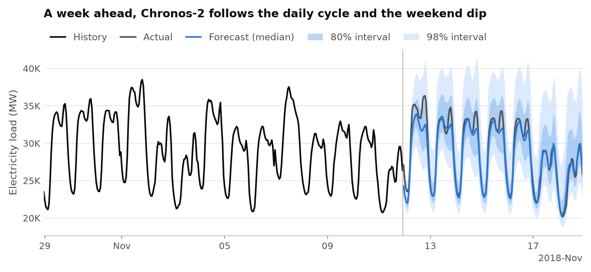

*Figure 3. One week ahead from a fixed origin. Black: the history the model saw. Grey: what
happened. Blue: the median. Bands: the 80% and 98% intervals.*

Read a fan chart in three passes. First, ask whether the median reproduces the structure, both the
daily cycle and the weekend dip. Then ask whether the bands widen where the series is harder to
predict, later in the horizon and around the daily peaks. Finally, check whether the actual line
stays inside the bands about as often as it should.

For this week:


*Table 2. Columns: .*

If anything the bands are a little wide here. And one week is an anecdote in either direction,
because in the 24-hour backtest of the next section, the same model on the same clean series has a
window-to-window standard deviation of WQL *larger than its mean*. Nothing above is compared to a
baseline, either. Part 2 does that properly: many origins, bootstrap intervals, Seasonal Naive,
AutoETS, Chronos-Bolt.

## 5. What Chronos-2 does with imperfect data

Everything in this section follows from one sentence in section 3.1 of the report, that the model
sees **positions, not dates**. The timestamps you pass in determine only the timestamps that come
back out. Inside, every step is just "the one after the previous one".

Put that together with how the input is built, and the three common data problems separate out
cleanly:

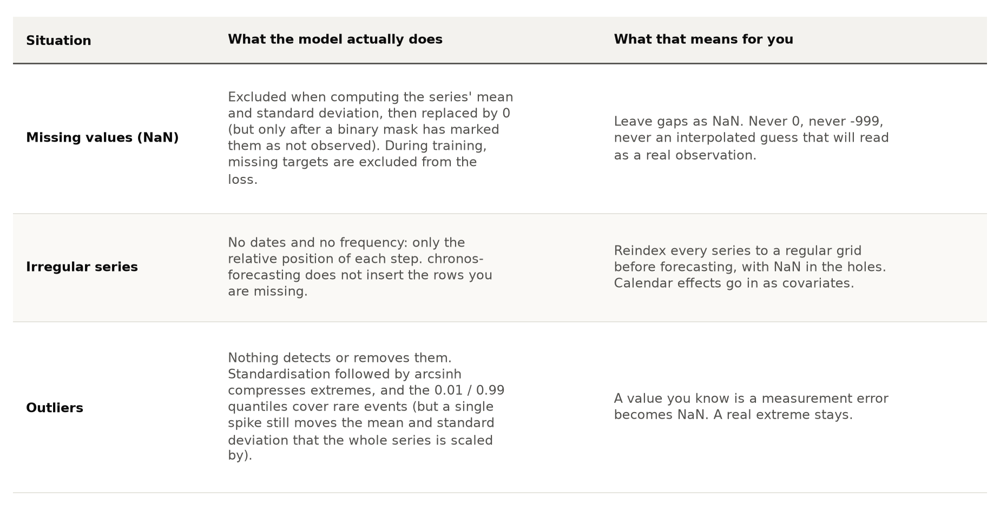

*Table 3. Columns: Situation, What the model actually does, What that means for you.*

How much each one costs is a measurement, not an opinion.

### The experiment

There's one series (Spanish national load), one clean baseline, and five corruptions, tested with a
rolling-origin backtest. It uses 20 forecast origins spaced a week apart, each one forecasting the
next 24 hours from a 2,048-hour context. The corruption only touches the model's input, because the
harness keeps the clean series intact, so cutoffs, actuals and metric scaling stay the same across
scenarios. Each window's random generator is seeded from its own cutoff, so the gaps land on the
same hours in every gap scenario.

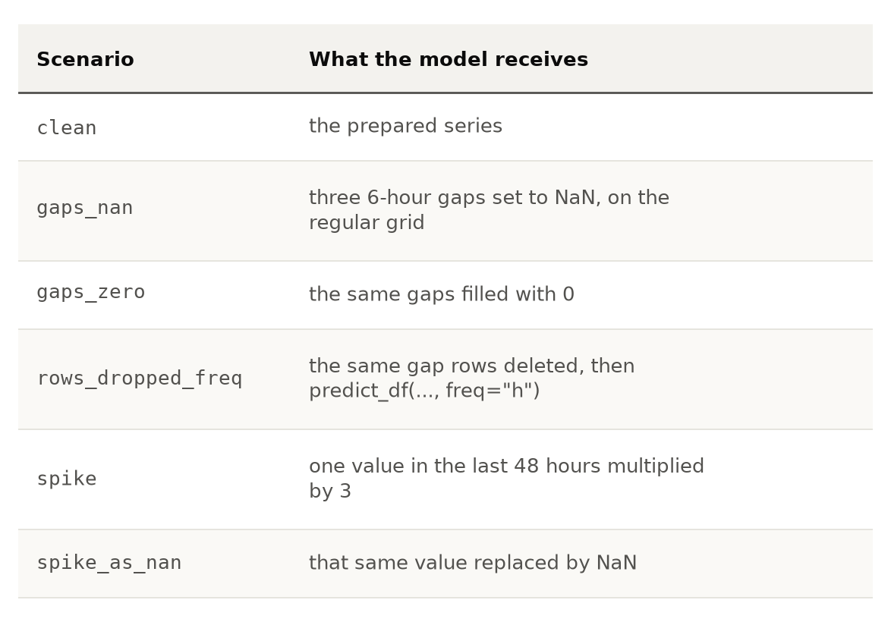

*Table 4. Columns: Scenario, What the model receives.*

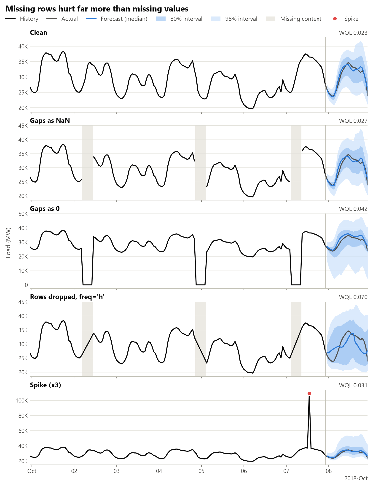

*Figure 4. One representative window (the one whose clean WQL is the median across windows, chosen without looking at the corrupted scenarios). Grey spans: missing values or missing rows. Red dot: the spike. Panels have their own y scale.*

### The result

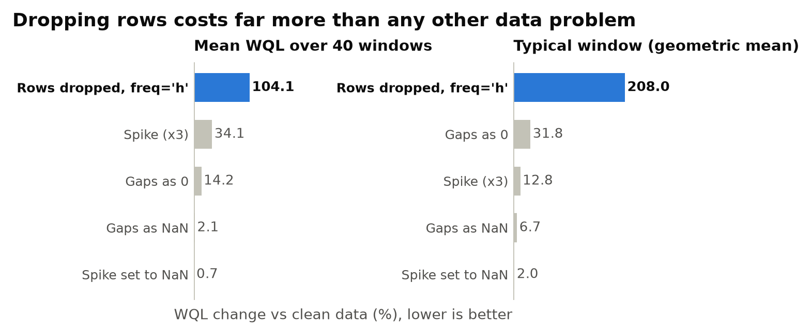

*Figure 5. WQL change against clean data over 20 windows. Left: change in the mean. Right: the
typical window, as the geometric mean of the paired ratios.*

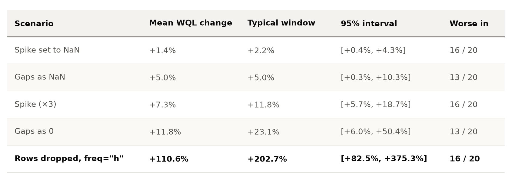

*Table 5. Columns: Scenario, Mean WQL change, Typical window, 95% interval, Worse in.*

Four findings, ordered by how much they should change what you do.

**Dropping rows sits in a different league.** Eighteen deleted rows out of a 2,048-hour context,
just 0.9% of the input, cost more than everything else put together, and the confidence interval
doesn't come close to the others. The reason comes down to mechanics, because once a row disappears,
every value before the gap shifts one step later in the model's view of the series. Six missing
hours hand the model the preceding week's daily cycle six hours out of phase, and it has no dates to
notice with.

**And the library will not save you.** Call `predict_df` without `freq` on that frame and it
refuses, because it cannot infer a frequency. Pass `freq="h"`, which feels like helpfully telling it
something it already knows, and it accepts the frame silently and returns a confident, wrong
forecast. This is the one real trap in this API, and it explains why the repository's wrapper
asserts a regular grid before every call, and why the scenario above has to bypass that wrapper to
exist at all.

**A sentinel zero costs about twice as much as a NaN does**, roughly +23.1% against +5.0% in a
typical window. Zero looks like a plausible demand reading, so the model treats a reporting outage
as a national blackout, and the per-series standardisation gets dragged along with it. The cost of a
NaN gap, by contrast, is roughly the cost of the information that is lost.

**Replacing a known-bad value with NaN nearly erases it.** In a typical window the tripled value
costs +11.8%, but the same value set to NaN costs only +2.2%. This is the cheapest data-quality
fix on the list, as long as you're sure it's an error and not a real peak you'll later be asked
to forecast.

### Seeing missing rows

Missing rows don't show up in a line chart, because it just joins the neighbouring points across the
gap. A day × hour grid makes them obvious, and it also shows that reindexing puts them back as NaN
at precisely the hours they were lost from:

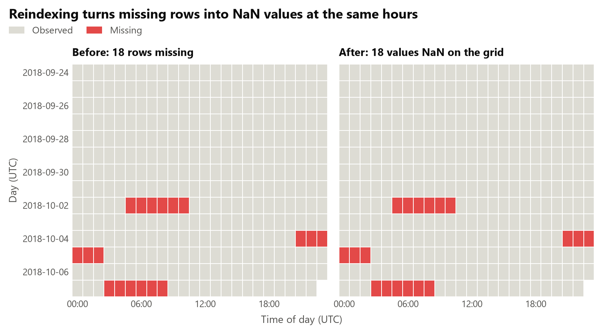

*Figure 6. Two weeks of the same series, before and after `validate_and_prepare()`. Red: no row
at all (left), or NaN on the grid (right).*

## 6. The checklist

This is the function sitting between sections 4 and 5. `validate_and_prepare()` works through nine
named steps and hands back the clean frame along with a report of what it found:

```python
from c2p.data import spain_energy_frame, validate_and_prepare

energy, report = validate_and_prepare(spain_energy_frame(), freq="h", target="load_actual")
print(report)
```

```text
DataReport (freq='h', 1 series)
  rows in -> out:              35,064 -> 35,064
  duplicated rows resolved:    0
  sentinel values -> NaN:      0
  missing timestamps inserted: 0
  missing values after prep:   load_actual=36
```

The Spanish energy table needs no structural repair. It's a well-kept file, with 36 missing load
values left as NaN for the model to mask. The weather table from the same dataset tells a different
story. It starts with 178,396 rows and ends up with 175,320, because 3,076 of them are duplicate
readings for the same city and hour. Temperatures arrive in Kelvin, and one of the five city names
carries a leading space that silently breaks every join you write against it.

What the checklist checks, and why:

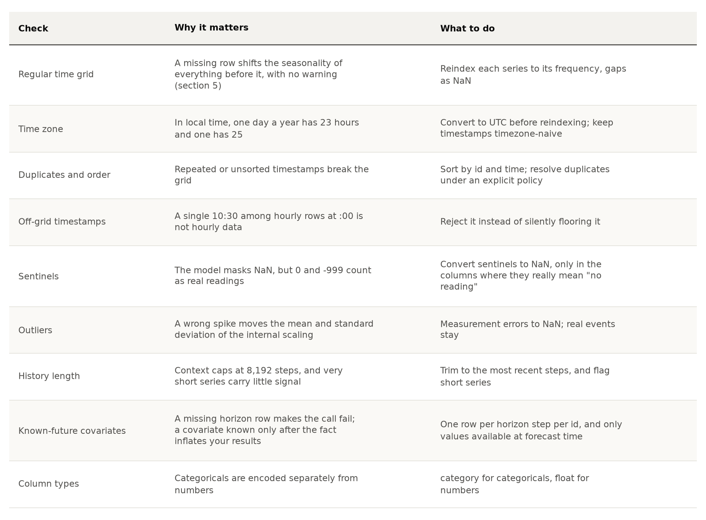

*Table 6. Columns: Check, Why it matters, What to do.*

And a short list of what **not** to do, because Chronos-2 already does it or doesn't need it: don't
normalise, don't difference, don't detrend, don't impute. The model standardises each series itself
and masks NaN, and imputed values come back to you dressed as observations. Leave the target in its
own units and post-process the quantiles if you have to, clipping negatives, for instance.

One rule earns its own line, because it is the easiest way to publish a result that is not real:
**observed weather is a past covariate, never a known-future one.** The dataset ships observed
temperatures, and feeding them to the horizon hands the model information it could not have had at
forecast time. Part 3 uses the grid operator's published day-ahead forecasts instead, and says so.

## Cheat sheet

- Pin `chronos-forecasting==2.3.2`; the input format has changed between minor versions.
- Long format, one row per `item_id` and `timestamp`, timezone-naive UTC, regular grid.
- Run `validate_and_prepare()` first; leave gaps as NaN; never fill with `0` or `-999`.
- Leave `freq` out of `predict_df` unless you have verified the grid yourself.
- Ask for the quantiles you need in `quantile_levels`; `predictions` is the median.
- Do not normalise, difference, detrend or impute, because the model does the first and masks the rest.

If you want to run all of this on your own CSV in a single command,
`examples/forecast_your_series.py` takes the column names, the frequency and the horizon, prints the
checklist report, and writes out the quantile forecast along with a fan chart. Add `--backtest N`
and it also runs the part 2 evaluation against a seasonal naive baseline.

## What's next

Part 2 turns the anecdote from section 4 into a proper evaluation. It runs rolling-origin
backtesting with the metrics the Chronos-2 paper uses (WQL, MASE, and a skill score against Seasonal
Naive with bootstrap intervals), along with interval coverage, and compares the results against
Seasonal Naive, AutoETS and Chronos-Bolt. It then takes up the two questions the group-ID table sets
up: how much context helps, and whether a series with three weeks of history is better forecast
alone or in a group with its neighbours.

---

## References

1. Ansari, A. F., Shchur, O., Küken, J., *et al.* (2025). *Chronos-2: From Univariate to
   Universal Forecasting*. arXiv:2510.15821. https://arxiv.org/abs/2510.15821
2. Amazon Science (2025). *Introducing Chronos-2: from univariate to universal forecasting*.
   https://www.amazon.science/blog/introducing-chronos-2-from-univariate-to-universal-forecasting
3. Ansari, A. F., Stella, L., Turkmen, C., *et al.* (2024). *Chronos: Learning the Language of
   Time Series*. arXiv:2403.07815. https://arxiv.org/abs/2403.07815
4. Model card: `amazon/chronos-2`. https://huggingface.co/amazon/chronos-2
5. Library: `chronos-forecasting`. https://github.com/amazon-science/chronos-forecasting
6. Shchur, O., *et al.* (2025). *fev-bench*. arXiv:2509.26468. https://arxiv.org/abs/2509.26468
7. Aksu, T., *et al.* (2024). *GIFT-Eval: A Benchmark for General Time Series Forecasting Model
   Evaluation*. arXiv:2410.10393. https://arxiv.org/abs/2410.10393
8. Leaderboards, consulted 25 October 2026:
   [fev-bench](https://huggingface.co/spaces/autogluon/fev-bench) and
   [GIFT-Eval](https://huggingface.co/spaces/Salesforce/GIFT-Eval)
9. Dataset: *Hourly energy demand generation and weather* (CC0).
   https://www.kaggle.com/datasets/nicholasjhana/energy-consumption-generation-prices-and-weather
10. Classmethod (2025). Tests of Chronos-2 with a missing past target and with missing
    covariates. https://dev.classmethod.jp/articles/how-chronos-2-forecast-changes-when-past-target-is-missing/
11. Guo, S. (2026). *Five Questions About Chronos-2, the Time Series Foundation Model* and
    *Five Ways to Fine-Tune Chronos-2, the Time Series Foundation Model*. Towards Data Science.
    https://towardsdatascience.com/five-questions-about-chronos-2-the-time-series-foundation-model/
    and https://towardsdatascience.com/five-ways-to-fine-tune-chronos-2-the-time-series-foundation-model/

**Suggested tags:** Time Series Forecasting · Machine Learning · Foundation Models · Python ·
Deep Learning
