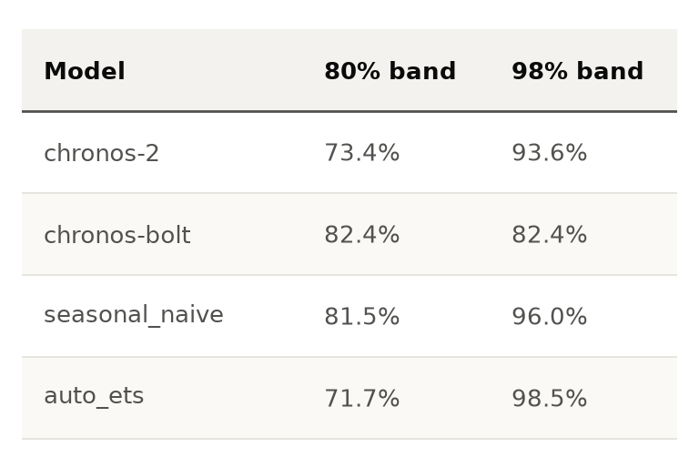
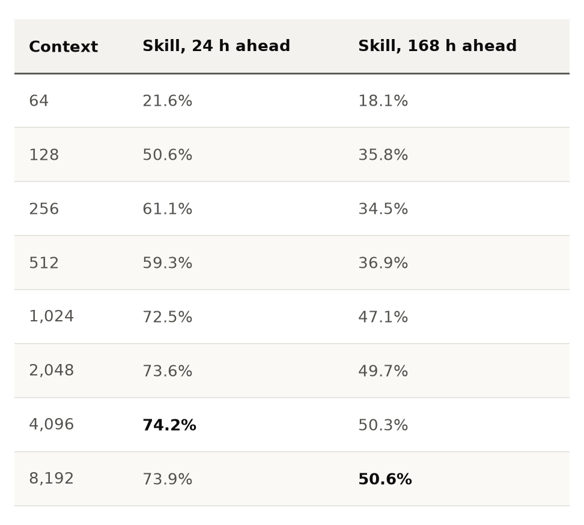

# Chronos-2 in Practice (2/5): Evaluation, Context Length, Multivariate and Cold Start

**365 day-ahead forecasts, four baselines, and the uncomfortable result that the
previous-generation Chronos-Bolt ties with Chronos-2 on a clean univariate series.**

*Disclosure: this article was drafted with the help of an AI assistant. Every experiment was run from the companion repository, every number is read from its results files, and the text was reviewed and edited by the author.*

> Draft for Medium. Every number is read from a CSV in [`results/`](https://github.com/epjover/chronos2-in-practice/tree/main/results); each figure
> names the file to upload. Published open access (not metered).

---

[Part 1](#) ended with a single week of Spanish electricity demand and a warning that one week
proves nothing. In this part the model gets measured properly, with 365 day-ahead forecasts across
2018, four baselines, and bootstrap intervals, and we ask the three questions a benchmark table
cannot answer: is it calibrated, how much history does it use, and what happens when a series barely
has any?

The headline result is roughly what you'd expect. Chronos-2 cuts the weighted quantile loss of a
seasonal naive baseline by **64%**, and it wins in 84% of the 365 windows.

The second result is different. **Chronos-Bolt** (the previous generation, from 2024, one call away
in the same library, and 8.4 skill points behind Chronos-2 on fev-bench) scores 62.1% here against
Chronos-2's 63.9%, and the confidence intervals overlap widely. On a clean, strongly seasonal,
univariate series with no covariates, the newer model's edge doesn't show up. This isn't a knock on
Chronos-2, though. It explains why this article exists at all, rather than just a leaderboard
screenshot.

- **Code:** [`02_evaluation`](https://github.com/epjover/chronos2-in-practice/blob/main/notebooks/02_evaluation.ipynb),
  [`03_context_length`](https://github.com/epjover/chronos2-in-practice/blob/main/notebooks/03_context_length.ipynb),
  [`04_multivariate_coldstart`](https://github.com/epjover/chronos2-in-practice/blob/main/notebooks/04_multivariate_coldstart.ipynb)
- **Data:** hourly Spanish electricity load and price, 2015–2018 (CC0), plus observed weather for
  five cities.
- **Versions:** `chronos-forecasting==2.3.2`, Python 3.11.

---

## 1. Three rules, enforced by construction

Replaying history is easy to get wrong, and the wrong ways all look like good results too.
Whether the final number means anything comes down to three rules:

1. **The forecaster only sees the past**, meaning the rows with `timestamp <= cutoff`, and nothing else.
2. **The horizon carries only what is known in advance.** Targets and past-only
   covariates never cross the cutoff, and only columns explicitly declared as known covariates do.
3. **Actuals are joined after the model has answered**, and the join requires a single forecast row per series, target and step, so a model that drops or misaligns a series fails loudly
   instead of scoring well.

The companion repository enforces all three in the harness rather than in each notebook. A guard
re-checks the window invariants immediately before every `predict` call, the future frame is built
from an explicit allow-list, and the scoring join is an outer join that raises on any missing or
unexpected row. This is what separates a backtest you wrote yourself from one you can hand to
someone else to run. Running one takes four calls.

A word on names first, since from here on the snippets use the companion package `c2p` as well as
`chronos` itself. `load_chronos2` is `Chronos2Pipeline.from_pretrained` plus a parameter count and a
log line, while `Chronos2Forecaster` wraps `predict_df` behind the one `predict` method every model
in the series shares, so the harness can call Chronos-2, a seasonal naive and a fine-tuned
checkpoint the same way. It also passes `freq` (Part 1 told you not to), because it asserts the
regular grid itself before every call. Nothing in `c2p` changes what the model computes, but it does
fix the protocol around it.

```python
import pandas as pd

from c2p.baselines import SeasonalNaive
from c2p.eval import backtest, evaluate, skill_table
from c2p.experiments import day_ahead_config
from c2p.models import Chronos2Forecaster, load_chronos2

DEVICE = "cuda"  # or "cpu"; the notebooks use c2p.config.get_device()
config = day_ahead_config(fast_mode=False, max_context=2048)  # 365 windows, 24 h, cutoff 22:00 UTC
models = [Chronos2Forecaster(load_chronos2(device=DEVICE)), SeasonalNaive(season_length=24)]
metrics = pd.concat(
    [evaluate(backtest(model, series, config), series, config) for model in models]
)  # one row per model and window: WQL, MASE, WAPE, coverage_80, coverage_98, seconds
skill = skill_table(metrics, baseline="seasonal_naive")  # skill, 95% CI and win rate per model
```

`backtest` runs the model on every window and joins the actuals afterwards. `evaluate` scores each
window, and `skill_table` compares models over the same windows. Everything in this article and the
next three comes down to one of those three frames, saved to a CSV.

The protocol is fixed once, in `c2p/experiments.py`, so every later article measures the same thing.
The test year is 2018, and each window forecasts the next 24 hours from a cutoff at 22:00 UTC (23:00
in Madrid, the day-ahead problem a grid operator solves), with one window per day. That gives 365
windows and 8,760 scored hours.


*Figure 1. The windows that ran, drawn from the harness's own output. Only the last week of each
2,048-hour context is shown; at full length a 24-hour horizon is 1% of the row and disappears.*

One choice deserves mention. The context is capped at 2,048 steps, the length Chronos-2 was
pretrained with, and section 5 sweeps that cap rather than defending it.

## 2. Against the baselines

A metric without a baseline doesn't tell you much. Is a WQL of 0.039 good? Four baselines make it
answerable, and each one closes a specific objection. To start, the columns, in plain terms, run as
follows:

- **WQL** (weighted quantile loss) scores the entire distribution, not just the median. It is the
  pinball loss of each decile forecast, averaged over the nine deciles and divided by the mean
  absolute actual. A WQL of 0.039 reads as "the quantile errors come to about 3.9% of the
  demand". It is the metric the Chronos-2 paper and fev-bench rank on. Lower is better.
- **MASE** scores the median against the error a seasonal naive forecast made on the series'
  own history. A value of 1.0 means the model is as good as repeating yesterday, and 0.5 means
  it is twice as good.
- **WAPE** is the sum of the median's absolute errors over the sum of the actuals, which gives
  the percentage error a business reader expects.
- **Skill** and the **bracket** after it show how much lower the model's WQL is than the
  baseline's, with a 95% confidence interval from resampling the 365 windows a thousand times.
  If the bracket contains zero, the year of data cannot tell the two models apart.
- **Wins** is the share of windows in which the model beat the baseline outright.


*Table 1. Columns: Model, WQL, MASE, WAPE, Skill vs seasonal naive, Wins.*

The skill score uses fev-bench's definition, `1 − geometric mean(model error / baseline error)` over
the windows, along with a 95% bootstrap interval. It's computed over the windows of one dataset
rather than the tasks of a benchmark, so these numbers are *not* comparable with the leaderboard
numbers in Part 1. The win rate is the share of windows the model wins.

There's one rule for reading this part and the three that follow it. Across the series there are
something like thirty of these 95% intervals, and with that many, one or two will clear zero purely
by chance. So a lone row whose interval just edges past zero doesn't carry much weight on its own.
Trust an effect when it's large relative to its interval, when the arms around it move in the same
direction, or both. An isolated "significant" result should push you to look harder rather than
count as a finding.


*Figure 2. Skill against the 24-hour seasonal naive over 365 windows, with bootstrap intervals.*

The headline is the least surprising part of that table.

**AutoETS is 65% *worse* than repeating yesterday.** That isn't a typo or a bug. It's what automatic
exponential smoothing does to hourly electricity load, and the reason comes down to how the model is
built. statsforecast fits seasonal ETS models up to a period of 24, so this AutoETS can represent
the daily cycle but *not* the weekly one, and electricity demand is a two-seasonality series. So
this result says something about AutoETS-as-configured, not about statistical methods generally, and
a fairer classical contender here would be a multi-seasonal decomposition (MSTL, TBATS) or the
weekly naive. It stays in the table because it's the baseline most people reach for first, and
because a pretrained model beating a badly matched classical model by 3× is a weaker claim than it
looks.

**The reference is not weak.** The obvious objection to a 64% skill score is that the 24-hour naive
is a straw man on a series with a weekly cycle. The weekly naive answers that objection too, coming
in at 0.0782 against 0.0748, a skill of −2.5% with an interval that spans zero. On this series the
daily naive is, if anything, the *stronger* of the two cheap baselines. The 64% figure is earned.

**Chronos-2 and Chronos-Bolt are indistinguishable here, and they fail differently.** (A note on
size, because it is easy to assume the opposite. `chronos-bolt-base` has 205M parameters to
Chronos-2's 120M. The generational change was in the architecture, not the parameter count.) Bolt
has the lower mean WQL (0.0343 vs 0.0388) and the higher win rate (88% vs 84%); Chronos-2 has the
higher skill score and beats Bolt head-to-head in 213 of 365 windows. Both can be true at once
because the skill score is a geometric mean over windows while the mean WQL is dragged down by the
worst ones, and Chronos-2's worst window is considerably worse (WQL 0.369 against Bolt's 0.249). So
if what matters to you is the typical day, pick Chronos-2, and if what matters is the bad days, pick
Bolt. On this task, a fair summary is that the generational gap reported on fev-bench does not
reproduce, which is what you would predict from Part 1, where Chronos-2's margin came overwhelmingly
from covariate tasks. Part 3 puts covariates in and the picture changes.

## 3. Are the intervals calibrated?

Accuracy and calibration make different promises, and leaderboards only track one of them. An 80%
interval is a claim that the actual value falls inside it 80% of the time. With 8,760 scored hours
to check it against, that claim can be tested.


*Figure 3. Achieved coverage against the nominal level. Left of the dashed line is over-confident.*



*Table 2. Columns: Model, 80% band, 98% band.*

**Chronos-2's bands are too narrow on this series**, coming in at 73.4% where 80% was promised, and
93.6% where 98% was. It is the most accurate model in the table by skill score, yet it gives the
poorest picture of its own uncertainty. If you are sizing a reserve margin or a stock buffer off the
0.9 quantile, that gap is what costs money, and nothing in the accuracy metrics would have warned
you of it.

**Chronos-Bolt's two bands are identical, to four decimal places.** This isn't a coincidence,
because Bolt was trained on the nine deciles only, so a request for the 0.01 and 0.99 quantiles gets
clamped to its 0.1 and 0.9. Its "98% interval" *is* its 80% interval. The library does warn about
this, but the warning is easy to scroll past, and the coverage table is where it really becomes
visible. If you need tail quantiles, that's a hard reason to prefer Chronos-2, regardless of the
skill-score tie mentioned above.

## 4. Could the model have seen this dataset?

The Spanish dataset is public and predates the model, so it's a fair question to ask. Appendix A of
the technical report lists the pretraining corpus, and this dataset isn't named there. But "not
named" is a weaker claim than "not seen," since an overlapping series could still slip in through an
aggregated source.

`autogluon/chronos-2-synth` is the published control. It shares the same architecture but was
trained *only* on synthetic data, so it cannot have seen any real dataset. Over the same 365
windows, it is **16.8% worse** than Chronos-2 in WQL on a typical window, with a 95% interval of
[10.9%, 23.0%].

That gap is larger than the one the paper reports between the two checkpoints on its benchmarks,
where the synthetic-only model trails by roughly 0.2 to 1.4 skill *points*. The two quantities
aren't really the same measure (relative WQL on one dataset against skill points across a
benchmark), so this is a flag to investigate, not a finding of contamination. It's also what you'd
expect to see if real pretraining data helps on real European electricity series, which is the more
believable alternative explanation and probably the likelier one. It does establish a method,
though. If you're about to publish a zero-shot result on a public dataset, run the synthetic-only
control and report the gap.

## 5. How much history does Chronos-2 use?

Chronos-2 was pretrained at a context of 2,048 steps and post-trained to 8,192. The paper reports
that the extension helped most on GIFT-Eval, "which contains many high-frequency datasets with long
seasonal periods". Spanish hourly load is just that kind of series, and this turns the claim into a
testable prediction. Error should fall steeply until the context covers a few weekly cycles (168
steps each), and then flatten, with more to gain at a longer horizon.


*Figure 4. Skill against seasonal naive versus context length, two horizons, 52 weekly windows.
Bands are 95% bootstrap intervals.*



*Table 3. Columns: Context, Skill, 24 h ahead, Skill, 168 h ahead.*

The prediction holds up, though with some caveats. At a one-day horizon, the gain is mostly used up
by 1,024 steps (six weeks), and the last three doublings add only 1.4 points between them,
well inside the intervals. At a one-week horizon, though, the curve keeps climbing right to
the end, which matches the predicted direction, since a longer horizon has more shape to get right
and keeps paying for history.

There are two wrinkles in this. The curve doesn't rise cleanly, since 512 scores below 256 at a
24-hour horizon, and 8,192 comes in a hair below 4,096, and at 52 windows that's noise rather than a
finding, because adjacent context lengths here are hard to tell apart. And the biggest single jump,
from 512 to 1,024, doesn't land on any obvious seasonal boundary, so the tidy story that the model
needs to see a week isn't quite what the data says.

In practice, **2,048 is a good default and the 8,192 post-training buys little on a daily horizon**,
but you should sweep the knob once on your own series, because the spread from worst to best setting
runs over 50 skill points, far larger than the gap between any two models in section 2. Cost makes
up the other half of this trade, and it gets measured in Part 5.

## 6. Multivariate mode, and the cold start

Both of these rely on the same mechanism from Part 1, the group ID, just aimed at different
problems.

**Joint targets barely move.** When Spanish load and price are forecast together (`target=[...]`,
one group) rather than separately, across 52 weekly windows, load changes by only −0.1% [−4.1, +3.9]
and price improves by +2.1% [+0.2, +4.0]. One of these is essentially a null result, and the other
gain is too small to plan around. This matches the paper, where multivariate gains are modest and
Chronos-2 in *univariate* mode already beats a natively multivariate competitor. So if you're hoping
joint targets will carry your project, don't count on it.

**The cold start needed a better question.** The intuitive experiment, cutting a series to three
weeks and seeing whether grouping it with neighbours helped, produced nothing, and the reason
mattered. On hourly temperature at a 24-hour horizon, three weeks of history is *as good as four
years*. The handicap we were trying to repair did not exist. So the experiment turned into a sweep,
testing how short history has to get before it starts to hurt, and whether grouping helps more as it
shortens.

Five Spanish cities supply the temperatures, one turned cold and the other four left complete,
across 52 weekly *episodes*. Each episode re-truncates the cold series, so every window is a real
short-history forecast, not one that regrows as the backtest advances.


*Figure 5. Two paired measurements against context length: what a short history costs, and what
sharing a group returns.*


*Table 4. Columns: History, Cost of the short history, Cross-learning gain.*

The handicap is real, but only below about a week. At three days the cold series scores 11% worse on
quantile loss, and by three weeks the gap is gone. Cross-learning returns a consistent 2–4%
(positive at every history length, but only at three weeks is the bracket clear of zero). It does
**not** grow as history shortens, though, which is the direction the paper's reasoning suggests.
With 52 windows the brackets are too wide to call that a contradiction, so the data cannot tell, and
the next step should be more series rather than more words.

The control is the part of this experiment I would keep. Putting all five cities in the same call
with *separate* groups scores **−0.00%** against forecasting the cold city alone, and to two decimal
places that is nothing. Series have to share a group ID rather than just share a frame, and that one
number is what lets you credit the 2–4% to the shared group rather than to the batching.

In code, each of the two modes takes a single argument:

```python
# Multivariate: load and price forecast jointly, as one group of two targets
joint = Chronos2Forecaster(pipeline).predict(
    energy,
    prediction_length=24,
    quantile_levels=[0.1, 0.5, 0.9],
    freq="h",
    target=["load_actual", "price_actual"],
)
# Cross-learning: every series in the frame shares one group and informs the others
grouped = Chronos2Forecaster(pipeline, cross_learning=True).predict(
    weather, prediction_length=24, quantile_levels=[0.1, 0.5, 0.9], freq="h", target="temp_c"
)
```

The control above is the second call with `cross_learning=False`: same frame, separate groups.

One practical detail that the library documents and that is easy to miss: with `cross_learning=True`
the forecast depends on the batch, because every series in the batch joins the group. The
docstring of `predict_df` warns that very large batches "deviate from the maximum group size used
during pretraining" and suggests "a batch size around 100 (as used in the Chronos-2 technical
report)", so the default `batch_size=256` is not the right setting for this mode; here the frame
has five series, so the whole frame is one group. If you cross-learn across thousands of meters, split them into
batches of related series (same region, same product line) rather than letting the batch boundary
decide who informs whom.

## Cheat sheet, and what to carry into Part 3

- Never report a single window. `backtest` → `evaluate` → `skill_table` make up the full loop, and
  the bracket matters as much as the number.
- Put a cheap baseline in every table. If AutoETS or the seasonal naive is not there, nobody can
  tell whether 0.039 is good.
- Check coverage as well as error. `coverage_80` should read about 0.80.
- A number to beat: **WQL 0.0388, skill 63.9%** zero-shot on day-ahead Spanish load. Covariates
  (Part 3) and fine-tuning (Part 4) are measured against it on the same windows.
- A caution, though: on a clean univariate series the generational gap over Chronos-Bolt did not
  appear, so pick your model based on your own data.
- Something else needs fixing: the 80% bands are too narrow at 73.4%. Whatever the next parts do
  to accuracy, coverage is the check that confirms they did not break the uncertainty along the way, and
  Part 5 repairs it afterwards, without touching the model.
- One knob deserves a sweep, since context length moved the result by more than any model choice
  did.
- For your own data, `examples/forecast_your_series.py your.csv ... --backtest N` runs this same
  loop (seasonal naive baseline, skill score, bootstrap interval, coverage) on a CSV of yours.

Part 3 brings covariates into the picture, including the operator's published day-ahead forecasts,
first replicated on fev-bench's own German price task, and then asks which of these the forecast is
using.

---

## References

1. Ansari, A. F., *et al.* (2025). *Chronos-2: From Univariate to Universal Forecasting*.
   arXiv:2510.15821. https://arxiv.org/abs/2510.15821
2. Shchur, O., *et al.* (2025). *fev-bench*. arXiv:2509.26468. https://arxiv.org/abs/2509.26468,
   and the `fev` package: https://github.com/autogluon/fev
3. Hyndman, R. J. & Athanasopoulos, G. (2021). *Forecasting: Principles and Practice*, 3rd ed.
   https://otexts.com/fpp3/
4. Nixtla, `statsforecast`: https://github.com/Nixtla/statsforecast
5. `amazon/chronos-bolt-base`: https://huggingface.co/amazon/chronos-bolt-base
6. `autogluon/chronos-2-synth`: https://huggingface.co/autogluon/chronos-2-synth
7. Dataset: *Hourly energy demand generation and weather* (CC0).
   https://www.kaggle.com/datasets/nicholasjhana/energy-consumption-generation-prices-and-weather

**Suggested tags:** Time Series Forecasting · Machine Learning · Foundation Models · Python ·
Model Evaluation
