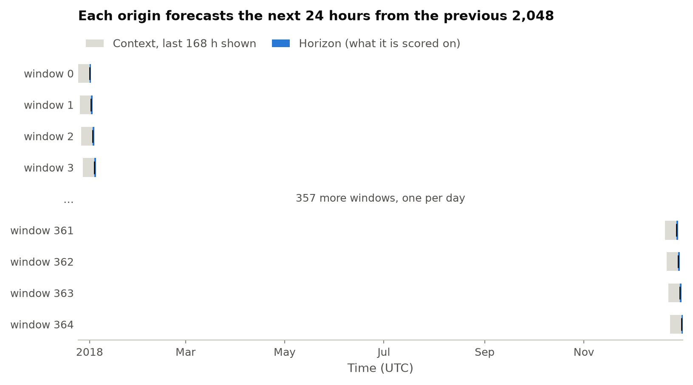
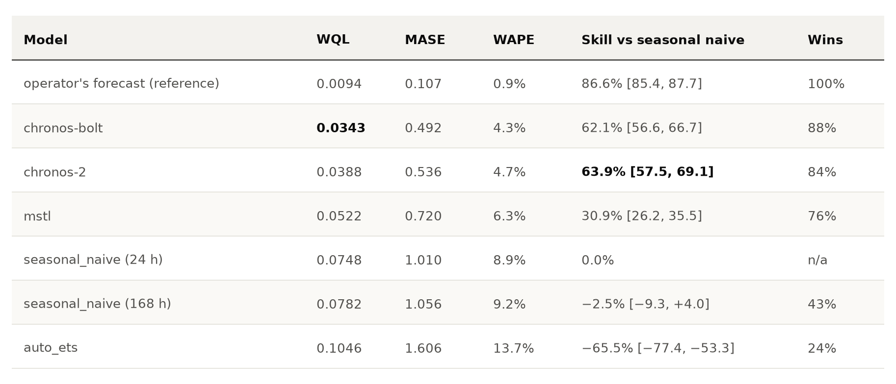
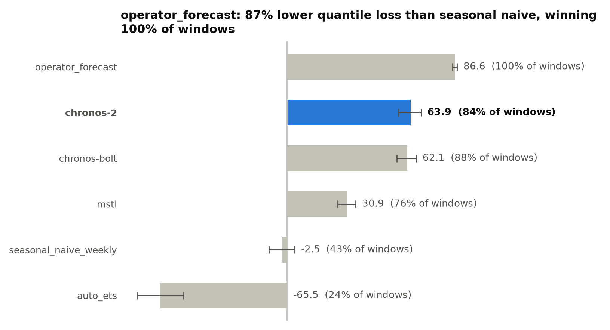
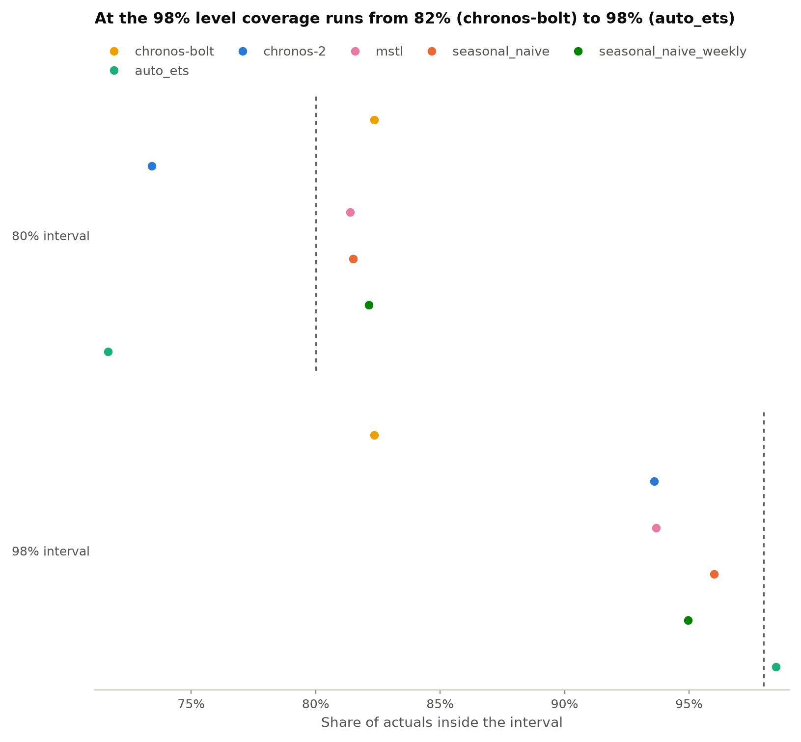
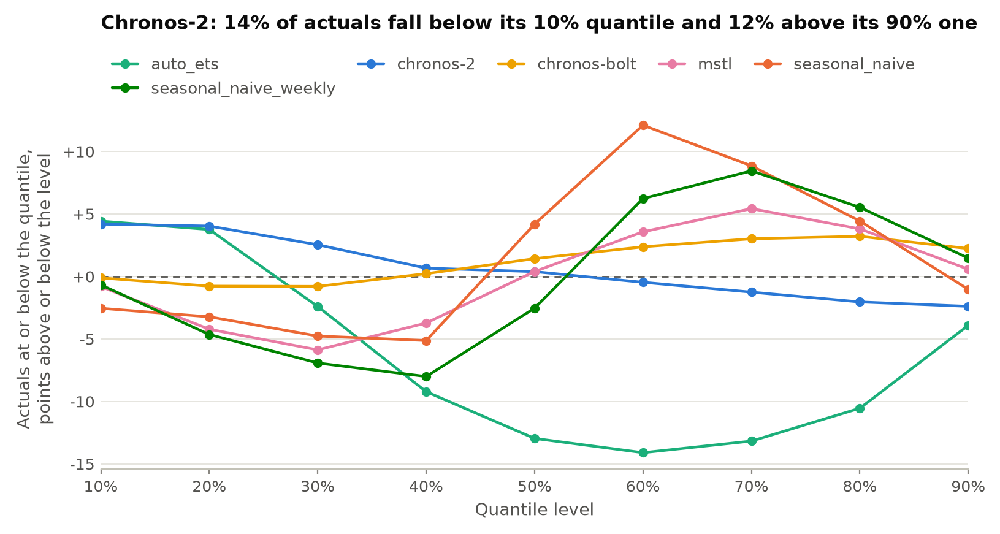
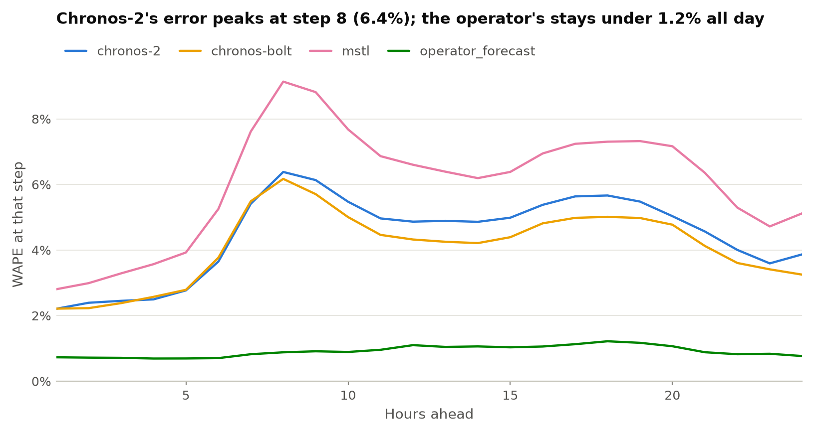
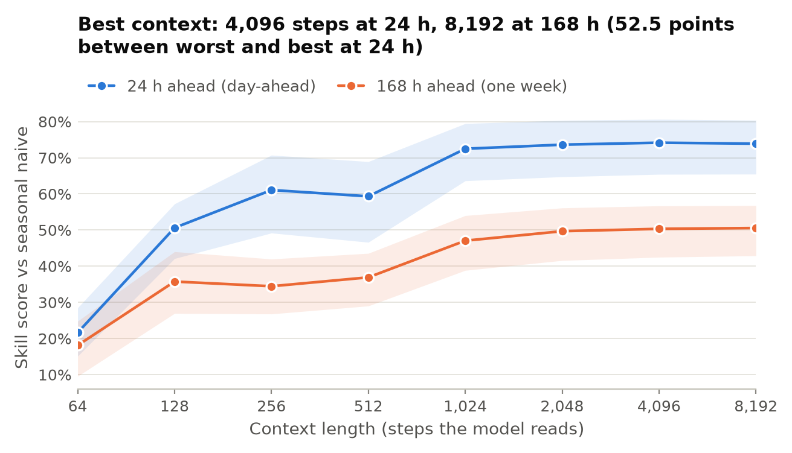
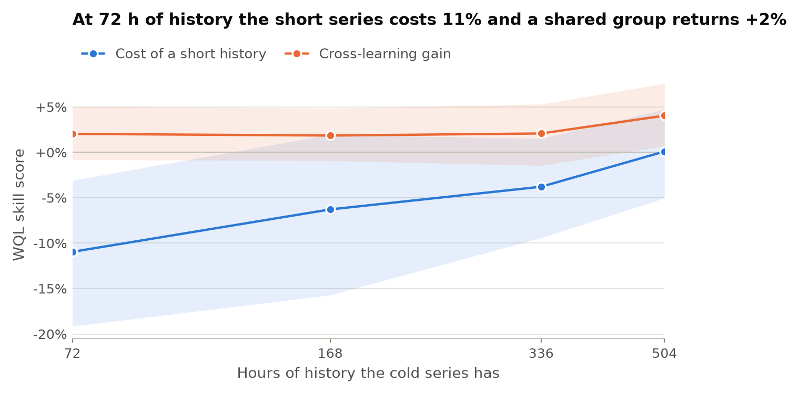
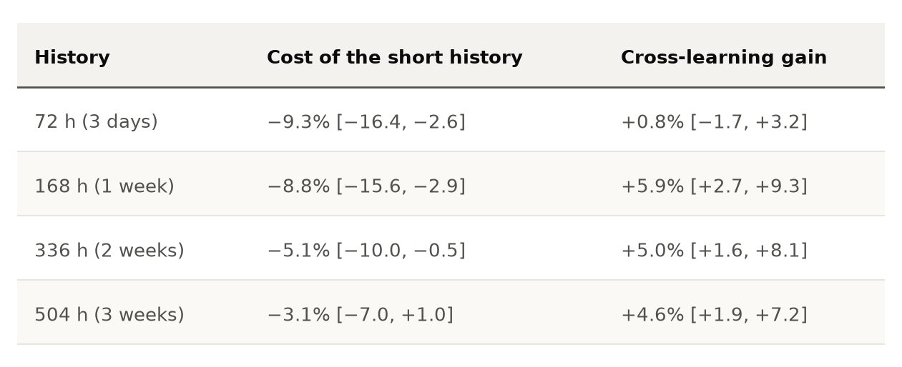

# Chronos-2 in Practice (2/7): Evaluation, Context Length, Multivariate and Cold Start

**365 day-ahead forecasts, five baselines, the grid operator's own forecast as the reference, and
the uncomfortable result that the previous-generation Chronos-Bolt ties with Chronos-2 on a clean
univariate series.**

*Disclosure: this article was drafted with the help of an AI assistant. Every experiment was run from the companion repository, every number is read from its results files, and the text was reviewed and edited by the author.*

> Draft for Medium. Every number is read from a CSV in [`results/`](https://github.com/epjover/chronos2-in-practice/tree/main/results); each figure
> names the file to upload. Published open access (not metered).

---

[Part 1](#) ended with a single week of Spanish electricity demand and a warning that one week
proves nothing. In this part the model gets measured properly, with 365 day-ahead forecasts across
2018, five baselines, and bootstrap intervals, and we ask the three questions a benchmark table
cannot answer: is it calibrated, how much history does it use, and what happens when a series barely
has any?

The headline result is roughly what you'd expect. Chronos-2 cuts the weighted quantile loss of a
seasonal naive baseline by **64%**, and it wins in 84% of the 365 windows.

The second result is different. **Chronos-Bolt** (the previous generation, from 2024, one call away
in the same library, and 8.4 skill points behind Chronos-2 on fev-bench, Table 3 of [1]) scores
62.1% here against Chronos-2's 63.9%, and the confidence intervals overlap widely. On a clean,
strongly seasonal, univariate series with no covariates, the newer model's edge doesn't show up.
This isn't a knock on Chronos-2, though. It explains why this article exists at all, rather than
just a leaderboard screenshot.

The third result puts both in their place. The dataset carries the day-ahead forecast that the
Spanish grid operator published at the time, and that forecast is five times more accurate than
either model: a 0.9% error against 4.7%. A zero-shot model that reads the history and nothing else
is a strong baseline, and it is a long way from the professional answer.

- **Code:** [`02_evaluation`](https://github.com/epjover/chronos2-in-practice/blob/main/notebooks/02_evaluation.ipynb),
  [`03_context_length`](https://github.com/epjover/chronos2-in-practice/blob/main/notebooks/03_context_length.ipynb),
  [`04_multivariate_coldstart`](https://github.com/epjover/chronos2-in-practice/blob/main/notebooks/04_multivariate_coldstart.ipynb)
- **Data:** hourly Spanish electricity load and price, 2015–2018 (CC0), plus observed weather for
  five cities.
- **Versions:** `chronos-forecasting==2.3.2`, Python 3.11.

---

## 1. Three rules, enforced by construction

Replaying history is easy to get wrong, and the wrong ways all look like good results too.
Whether the final number means anything comes down to three rules:

1. **The forecaster only sees the past**, meaning the rows with `timestamp <= cutoff`, and nothing else.
2. **The horizon carries only what is known in advance.** Targets and past-only
   covariates never cross the cutoff, and only columns explicitly declared as known covariates do.
3. **Actuals are joined after the model has answered**, and the join requires a single forecast row per series, target and step, so a model that drops or misaligns a series fails loudly
   instead of scoring well.

The companion repository enforces all three in the harness rather than in each notebook. A guard
re-checks the window invariants immediately before every `predict` call, the future frame is built
from an explicit allow-list, and the scoring join is an outer join that raises on any missing or
unexpected row. This is what separates a backtest you wrote yourself from one you can hand to
someone else to run. Running one takes four calls.

A word on names first, since from here on the snippets use the companion package `c2p` as well as
`chronos` itself. `load_chronos2` is `Chronos2Pipeline.from_pretrained` plus a parameter count and a
log line, while `Chronos2Forecaster` wraps `predict_df` behind the one `predict` method every model
in the series shares, so the harness can call Chronos-2, a seasonal naive and a fine-tuned
checkpoint the same way. It also passes `freq` (Part 1 told you not to), because it asserts the
regular grid itself before every call. Nothing in `c2p` changes what the model computes, but it does
fix the protocol around it.

```python
import pandas as pd

from c2p.baselines import SeasonalNaive
from c2p.eval import backtest, evaluate, skill_table
from c2p.experiments import day_ahead_config
from c2p.models import Chronos2Forecaster, load_chronos2

DEVICE = "cuda"  # or "cpu"; the notebooks use c2p.config.get_device()
config = day_ahead_config(fast_mode=False, max_context=2048)  # 365 windows, 24 h, cutoff 22:00 UTC
models = [Chronos2Forecaster(load_chronos2(device=DEVICE)), SeasonalNaive(season_length=24)]
metrics = pd.concat(
    [evaluate(backtest(model, series, config), series, config) for model in models]
)  # one row per model and window: WQL, MASE, WAPE, coverage_80, coverage_98, seconds
skill = skill_table(metrics, baseline="seasonal_naive")  # skill, 95% CI and win rate per model
```

`backtest` runs the model on every window and joins the actuals afterwards. `evaluate` scores each
window, and `skill_table` compares models over the same windows. Everything in this article and the
rest of the series comes down to one of those three frames, saved to a CSV.

> **Without the repository.** The harness is a loop around one library call. For each cutoff,
> `context = df[df["timestamp"] <= cutoff]`, then
> `pipeline.predict_df(context, prediction_length=24, quantile_levels=[0.1, 0.5, 0.9])`, then a
> merge of the result with the rows of `df` after the cutoff. What `c2p.eval` adds is the checks
> around that loop and the metrics, which are `fev`'s own.

The protocol is fixed once, in `c2p/experiments.py`, so every later article measures the same thing.
The test year is 2018, and each window forecasts the next 24 hours from a cutoff at 22:00 UTC (23:00
in Madrid, the day-ahead problem a grid operator solves), with one window per day. That gives 365
windows and 8,760 scored hours.

Sweeps that would be too slow on 365 windows use a sample of them, and the sample has one rule: its
step is never a whole number of weeks. A first version of this series took one window a week, which
meant 52 forecasts of the same weekday, and on this series the weekday matters. Chronos-2's skill
against the seasonal naive runs from 53% on Tuesdays to 73% on Mondays and Saturdays, because
repeating yesterday is a poor forecast of a Monday and a good one of a Tuesday. The samples below
take one window every five days (73 windows) or every eight (45, when the horizon is a week), so
every weekday is forecast.



*Figure 1. The windows that ran, drawn from the harness's own output. Only the last week of each
2,048-hour context is shown; at full length a 24-hour horizon is 1% of the row and disappears.*

One choice deserves mention. The context is capped at 2,048 steps, the length Chronos-2 was
pretrained with, and section 5 sweeps that cap rather than defending it.

## 2. Against the baselines

A metric without a baseline doesn't tell you much. Is a WQL of 0.039 good? Five baselines and one
reference make it answerable, and each one closes a specific objection. To start, the columns, in
plain terms, run as follows:

- **WQL** (weighted quantile loss) scores the entire distribution, not just the median. It is the
  pinball loss of each decile forecast (the proper scoring rule for a quantile [8]), averaged over
  the nine deciles and divided by the mean absolute actual. A WQL of 0.039 reads as "the quantile
  errors come to about 3.9% of the demand". It is the metric the Chronos-2 paper and fev-bench
  rank on [1, 2]. Lower is better.
- **MASE** scores the median against the error a seasonal naive forecast made on the series'
  own history [9]. A value of 1.0 means the model is as good as repeating yesterday, and 0.5
  means it is twice as good.
- **WAPE** is the sum of the median's absolute errors over the sum of the actuals, which gives
  the percentage error a business reader expects.
- **Skill** and the **bracket** after it show how much lower the model's WQL is than the
  baseline's, with a 95% confidence interval from resampling the windows a thousand times. If the
  bracket contains zero, the year of data cannot tell the two models apart.
- **Wins** is the share of windows in which the model beat the baseline outright.



*Table 1. Columns: Model, WQL, MASE, WAPE, Skill vs seasonal naive, Wins.*

The skill score uses fev-bench's definition [2], `1 − geometric mean(model error / baseline error)`
over the windows, along with a 95% bootstrap interval. It's computed over the windows of one dataset
rather than the tasks of a benchmark, so these numbers are *not* comparable with the leaderboard
numbers in Part 1. The win rate is the share of windows the model wins.

**The intervals resample weeks, not days.** Consecutive days are not independent draws: a cold week
is seven bad windows in a row, and the error of one day is correlated with the next (0.47 between
adjacent windows here). A bootstrap that resamples single days treats 365 windows as 365 separate
pieces of evidence and returns an interval that is too narrow: [60.4, 66.9] for Chronos-2. The
table resamples blocks of seven consecutive days instead, the moving-block bootstrap [10], and the
same skill gets [57.5, 69.1], nearly twice as wide. Every interval over the 365 daily windows in
this series is computed that way. The sampled windows of sections 5 and 6 are at least five days
apart and are resampled one by one.

There's one rule for reading this part and the three that follow it. Across the series there are
something like thirty of these 95% intervals, and with that many, one or two will clear zero purely
by chance. So a lone row whose interval just edges past zero doesn't carry much weight on its own.
Trust an effect when it's large relative to its interval, when the arms around it move in the same
direction, or both. An isolated "significant" result should push you to look harder rather than
count as a finding.



*Figure 2. Skill against the 24-hour seasonal naive over 365 windows, with bootstrap intervals.*

The headline is the least surprising part of that table.

**AutoETS is 65% *worse* than repeating yesterday.** That isn't a typo or a bug. It's what automatic
exponential smoothing does to hourly electricity load, and the reason comes down to how the model is
built. statsforecast fits seasonal ETS models up to a period of 24 [4], so this AutoETS can
represent the daily cycle but *not* the weekly one, and electricity demand is a two-seasonality
series. So this result says something about AutoETS-as-configured, not about statistical methods
generally. It stays in the table because it's the baseline most people reach for first, and because
a pretrained model beating a badly matched classical model by 3× is a weaker claim than it looks.

**MSTL is the fair classical contender, and it is 31% better than the naive.** MSTL [11] splits
the series into a daily component, a weekly component and a trend, repeats the two seasonal parts
and forecasts the rest with a non-seasonal ETS. It is fitted on each window's own history, it sees
both cycles, and it lands between the naive and the pretrained models: Chronos-2's WQL is 48%
lower than MSTL's [41.3, 53.1]. That is the comparison to quote when someone asks what the
foundation model buys over a competent statistical model, and it is a good deal smaller than the
gap to AutoETS.

**The reference is not weak.** The obvious objection to a 64% skill score is that the 24-hour naive
is a straw man on a series with a weekly cycle. The weekly naive answers that objection too, coming
in at 0.0782 against 0.0748, a skill of −2.5% with an interval that spans zero. On this series the
daily naive is, if anything, the *stronger* of the two cheap baselines. The 64% figure is earned.

**The operator's forecast is in another league, and it should be.** The first row is not a model
we ran. It is the `total load forecast` column of the dataset: the day-ahead forecast the Spanish
grid operator published at the time. EU Regulation 543/2013 (Article 6) requires that forecast to
be public at the latest two hours before the day-ahead market closes [12], so it existed around ten
in the morning of the previous day, well before our 22:00 UTC cutoff, and replaying it through the
same windows is fair. Its error is 0.9% of demand against Chronos-2's 4.7%, and it wins 299 of the
365 days against Chronos-2 on WQL, an uneven contest in the model's favour: the operator publishes
one number per hour, so its WQL is its WAPE, while the model is scored on nine quantiles. The
operator had what no model in this table has: weather forecasts, the calendar, and years of tuning
on this one series. Read the row as the ceiling of the problem. The distance between 4.7% and 0.9%
is the room that better inputs have to work in, and Part 3 uses the operator's forecast as one.

**Chronos-2 and Chronos-Bolt are indistinguishable here, and they fail differently.** (A note on
size, because it is easy to assume the opposite. `chronos-bolt-base` has 205M parameters to
Chronos-2's 120M. The generational change was in the architecture, not the parameter count.) Bolt
has the lower mean WQL (0.0343 vs 0.0388) and the higher win rate (88% vs 84%); Chronos-2 has the
higher skill score and beats Bolt head-to-head in 213 of 365 windows. Both can be true at once
because the skill score is a geometric mean over windows while the mean WQL is dragged down by the
worst ones, and Chronos-2's worst window is considerably worse (WQL 0.369 against Bolt's 0.249).
Scored directly against each other, Chronos-2's skill over Bolt is +4.6% with an interval of
[−1.1, +9.8]: a year of days does not separate them. So if what matters to you is the typical day,
lean to Chronos-2, and if what matters is the bad days, lean to Bolt. On this task, a fair summary
is that the generational gap reported on fev-bench does not reproduce, which is what you would
predict from Part 1, where Chronos-2's margin came overwhelmingly from covariate tasks. Part 3 puts
covariates in and the picture changes.

## 3. Are the intervals calibrated?

Accuracy and calibration make different promises, and leaderboards only track one of them. An 80%
interval is a claim that the actual value falls inside it 80% of the time. With 8,760 scored hours
to check it against, that claim can be tested.



*Figure 3. Achieved coverage against the nominal level. Left of the dashed line is over-confident.*


*Table 2. Columns: Model, 80% band, 98% band.*

**Chronos-2's bands are too narrow on this series**, coming in at 73.4% where 80% was promised, and
93.6% where 98% was. It is the most accurate model in the table by skill score, yet it gives the
poorest picture of its own uncertainty. If you are sizing a reserve margin or a stock buffer off the
0.9 quantile, that gap is what costs money, and nothing in the accuracy metrics would have warned
you of it.

**Chronos-Bolt's two bands are identical, to four decimal places.** This isn't a coincidence,
because Bolt was trained on the nine deciles only [5], so a request for the 0.01 and 0.99 quantiles
gets clamped to its 0.1 and 0.9. Its "98% interval" *is* its 80% interval. The library does warn
about this, but the warning is easy to scroll past, and the coverage table is where it becomes
visible. If you need tail quantiles, that's a hard reason to prefer Chronos-2, regardless of the
skill-score tie mentioned above.

Two bands are two points of a curve. The reliability diagram checks all nine deciles: for each
level, the share of the 8,760 actuals that fell at or below the model's quantile, which should
equal the level.



*Figure 4. Reliability of the nine deciles. On the diagonal the quantile means what it says.*

Chronos-2's curve crosses the diagonal at the median (50.4% of actuals below its 0.5 quantile) and
is too flat on both sides: 14.2% of the actuals fall below its 0.1 quantile instead of 10%, and
87.6% below its 0.9 quantile instead of 90%. The model is centred and overconfident, in both
tails, by about the same amount. That is the shape a post-hoc calibration can repair, and Part 6
does it.

The last diagnostic asks where in the day the error sits.



*Figure 5. WAPE by hour of the horizon, 365 windows pooled. Step 1 is midnight in Madrid in
winter.*

Chronos-2's error is 2.2% in the first hour, stays under 3% through the night, and peaks at 6.4%
at step 8, the morning ramp, when the day's demand shows whether it is a working day, a holiday or
a cold morning. The afternoon and evening sit near 5%. The operator's forecast stays between 0.7%
and 1.2% all day. The gap is widest at the hours where knowing the calendar and the weather helps
most, which is a preview of what covariates are for.

## 4. Could the model have seen this dataset?

The Spanish dataset is public and predates the model, so it's a fair question to ask. Appendix A of
the technical report lists the pretraining corpus, and this dataset isn't named there. But "not
named" is a weaker claim than "not seen," since an overlapping series could still slip in through an
aggregated source.

`autogluon/chronos-2-synth` is the published control [6]. It shares the same architecture but was
trained *only* on synthetic data, so it cannot have seen any real dataset. Over the same 365
windows, it is **16.8% worse** than Chronos-2 in WQL on a typical window, with a 95% interval of
[9.0%, 25.2%].

That gap is larger than the one the paper reports between the two checkpoints on its benchmarks
(section 5.4 of [1], Figure 8b),
where the synthetic-only model trails by roughly 0.2 to 1.4 skill *points*. The two quantities
aren't really the same measure (relative WQL on one dataset against skill points across a
benchmark), so this is a flag to investigate, not a finding of contamination. It's also what you'd
expect to see if real pretraining data helps on real European electricity series, which is the more
believable alternative explanation and probably the likelier one. It does establish a method,
though. If you're about to publish a zero-shot result on a public dataset, run the synthetic-only
control and report the gap.

## 5. How much history does Chronos-2 use?

Chronos-2 was pretrained at a context of 2,048 steps and post-trained to 8,192. The paper reports
(section 5.4 of [1], Figure 8c) that the extension helped most on GIFT-Eval, "which contains many
high-frequency datasets with long seasonal periods". Spanish hourly load is just that kind of
series, and this turns the claim into a testable prediction. Error should fall steeply until the
context covers a few weekly cycles (168 steps each), and then flatten, with more to gain at a
longer horizon.



*Figure 6. Skill against seasonal naive versus context length at two horizons: 73 windows five days
apart for the day ahead, 45 windows eight days apart for the week ahead. Bands are 95% bootstrap
intervals.*


*Table 3. Columns: Context, Skill, 24 h ahead, Skill, 168 h ahead.*

The first half of the prediction holds. The gain is mostly used up by 1,024 steps (six weeks):
from there to 8,192 the day-ahead skill rises 2.9 points, well inside intervals that are 14 points
wide. The second half does not. At a one-week horizon the curve has the same shape and flattens at
the same place, and the last three doublings add the same 2.9 points. On this series a longer
horizon does not keep paying for history.

There are two wrinkles in this. The day-ahead curve doesn't rise cleanly, since 512 scores below
256, and with 73 windows that's noise rather than a finding, because adjacent context lengths here
are hard to tell apart. And the largest jump after the first doubling, from 512 to 1,024, doesn't
land on any obvious seasonal boundary, so the tidy story that the model needs to see a week isn't
quite what the data says.

In practice, **2,048 is a good default and the 8,192 post-training buys little on this series**,
but you should sweep the knob once on your own, because the spread from worst to best setting runs
to 41 skill points, far larger than the gap between any two models in section 2. Cost makes up the
other half of this trade, and it gets measured in Part 5.

## 6. Multivariate mode, and the cold start

Both of these rely on the same mechanism from Part 1, the group ID, just aimed at different
problems.

**Joint targets do not move the forecast.** When Spanish load and price are forecast together
(`target=[...]`, one group) rather than separately, across 73 windows, load changes by −1.3%
[−4.5, +1.8] and price by +0.9% [−0.8, +2.6]. Both intervals contain zero. This matches the paper,
where multivariate gains are modest (section 5.2 of [1]) and Chronos-2 in *univariate* mode
already beats a natively multivariate competitor. So if you're hoping joint targets will carry
your project, don't count on it.

**The cold start needed a better question.** The intuitive experiment, cutting a series to three
weeks and seeing whether grouping it with neighbours helped, produced nothing, and the reason
mattered. On hourly temperature at a 24-hour horizon, three weeks of history cost 3% against four
years, with an interval that includes zero. The handicap we were trying to repair was barely
there. So the experiment turned into a sweep, testing how short history has to get before it
starts to hurt, and whether grouping helps more as it shortens.

Five Spanish cities supply the temperatures, one turned cold and the other four left complete,
across 73 *episodes* five days apart. Each episode re-truncates the cold series, so every window
is a real short-history forecast, not one that regrows as the backtest advances.



*Figure 7. Two paired measurements against context length: what a short history costs, and what
sharing a group returns.*



*Table 4. Columns: History, Cost of the short history, Cross-learning gain.*

The handicap is real below about two weeks. At three days the cold series scores 9% worse on
quantile loss, and by three weeks the bracket includes zero. Cross-learning returns about 5% from
one week of history on, with brackets clear of zero at all three lengths, and nothing measurable
at three days. So it does **not** grow as history shortens, which is the direction the paper's
reasoning suggests: with only three days of its own, the cold series gains the least from its
neighbours. One reading is that the model needs enough of the series to recognise which
neighbours resemble it; the data here cannot confirm that, and the next step should be more
series rather than more words.

The control is the part of this experiment I would keep. Putting all five cities in the same call
with *separate* groups scores **+0.00%** against forecasting the cold city alone, and to two decimal
places that is nothing. Series have to share a group ID rather than just share a frame, and that one
number is what lets you credit the 5% to the shared group rather than to the batching.

In code, each of the two modes takes a single argument:

```python
# Multivariate: load and price forecast jointly, as one group of two targets
joint = Chronos2Forecaster(pipeline).predict(
    energy,
    prediction_length=24,
    quantile_levels=[0.1, 0.5, 0.9],
    freq="h",
    target=["load_actual", "price_actual"],
)
# Cross-learning: every series in the frame shares one group and informs the others
grouped = Chronos2Forecaster(pipeline, cross_learning=True).predict(
    weather, prediction_length=24, quantile_levels=[0.1, 0.5, 0.9], freq="h", target="temp_c"
)
```

The control above is the second call with `cross_learning=False`: same frame, separate groups.

One practical detail that the library documents and that is easy to miss: with `cross_learning=True`
the forecast depends on the batch, because every series in the batch joins the group. The
docstring of `predict_df` warns that very large batches "deviate from the maximum group size used
during pretraining" and suggests "a batch size around 100 (as used in the Chronos-2 technical
report)", so the default `batch_size=256` is not the right setting for this mode; here the frame
has five series, so the whole frame is one group. If you cross-learn across thousands of meters, split them into
batches of related series (same region, same product line) rather than letting the batch boundary
decide who informs whom.

## Cheat sheet, and what to carry into Part 3

- Never report a single window. `backtest` → `evaluate` → `skill_table` make up the full loop, and
  the bracket matters as much as the number.
- Sample windows across weekdays, and resample consecutive days in blocks. Both mistakes make a
  result look surer than it is, and both were in the first version of this series.
- Put a cheap baseline in every table, and a competent one. If the seasonal naive is not there,
  nobody can tell whether 0.039 is good; if MSTL is not there, nobody can tell what the foundation
  model adds.
- If the domain has a professional forecast, put it in the table. Here it is five times better
  than the zero-shot model.
- Check coverage as well as error. `coverage_80` should read about 0.80, and the reliability
  diagram says where it does not.
- A number to beat: **WQL 0.0388, skill 63.9%** zero-shot on day-ahead Spanish load. Covariates
  (Part 3) and fine-tuning (Part 4) are measured against it on the same windows.
- A caution, though: on a clean univariate series the generational gap over Chronos-Bolt did not
  appear, so pick your model based on your own data.
- Something else needs fixing: the 80% bands are too narrow at 73.4%. Whatever the next parts do
  to accuracy, coverage is the check that confirms they did not break the uncertainty along the way, and
  Part 6 repairs it afterwards, without touching the model.
- One knob deserves a sweep, since context length moved the result by more than any model choice
  did.
- For your own data, `examples/forecast_your_series.py your.csv ... --backtest N` runs this same
  loop (seasonal naive baseline, skill score, bootstrap interval, coverage) on a CSV of yours.

Part 3 brings covariates into the picture, including the operator's published day-ahead forecasts,
first replicated on fev-bench's own German price task, then asks which of these the forecast is
using, and ends by handing the model the operator's load forecast itself.

---

## References

1. Ansari, A. F., *et al.* (2025). *Chronos-2: From Univariate to Universal Forecasting*.
   arXiv:2510.15821. https://arxiv.org/abs/2510.15821
2. Shchur, O., *et al.* (2025). *fev-bench*. arXiv:2509.26468. https://arxiv.org/abs/2509.26468,
   and the `fev` package: https://github.com/autogluon/fev
3. Hyndman, R. J. & Athanasopoulos, G. (2021). *Forecasting: Principles and Practice*, 3rd ed.,
   chapter 5.10 (time series cross-validation). https://otexts.com/fpp3/tscv.html
4. Nixtla, `statsforecast`: https://github.com/Nixtla/statsforecast
5. `amazon/chronos-bolt-base`: https://huggingface.co/amazon/chronos-bolt-base
6. `autogluon/chronos-2-synth`: https://huggingface.co/autogluon/chronos-2-synth
7. Dataset: *Hourly energy demand generation and weather* (CC0).
   https://www.kaggle.com/datasets/nicholasjhana/energy-consumption-generation-prices-and-weather
8. Gneiting, T. & Raftery, A. E. (2007). *Strictly Proper Scoring Rules, Prediction, and
   Estimation*. Journal of the American Statistical Association, 102(477), 359–378.
   https://doi.org/10.1198/016214506000001437
9. Hyndman, R. J. & Koehler, A. B. (2006). *Another look at measures of forecast accuracy*.
   International Journal of Forecasting, 22(4), 679–688.
   https://doi.org/10.1016/j.ijforecast.2006.03.001
10. Künsch, H. R. (1989). *The Jackknife and the Bootstrap for General Stationary Observations*.
    The Annals of Statistics, 17(3), 1217–1241. https://doi.org/10.1214/aos/1176347265
11. Bandara, K., Hyndman, R. J. & Bergmeir, C. (2021). *MSTL: A Seasonal-Trend Decomposition
    Algorithm for Time Series with Multiple Seasonal Patterns*. arXiv:2107.13462.
    https://arxiv.org/abs/2107.13462
12. Commission Regulation (EU) No 543/2013 on submission and publication of data in electricity
    markets, Article 6(1)(b). https://eur-lex.europa.eu/eli/reg/2013/543/oj

**Suggested tags:** Time Series Forecasting · Machine Learning · Foundation Models · Python ·
Model Evaluation
