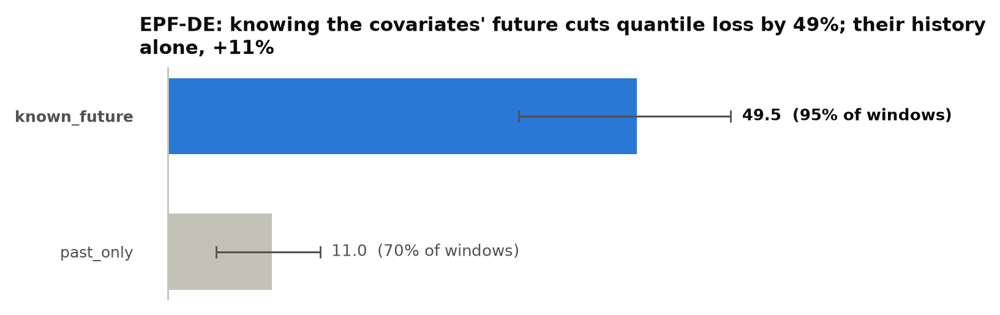
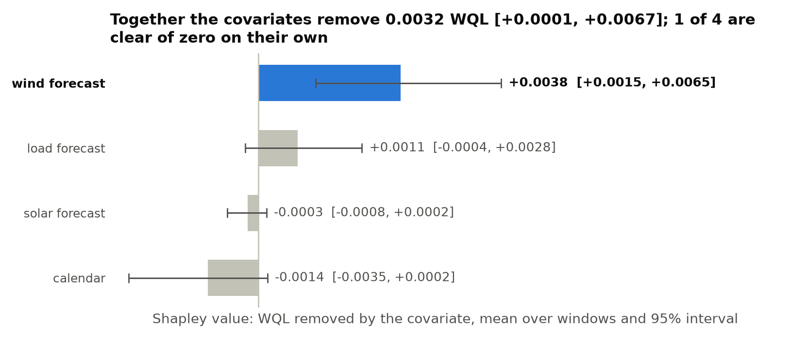
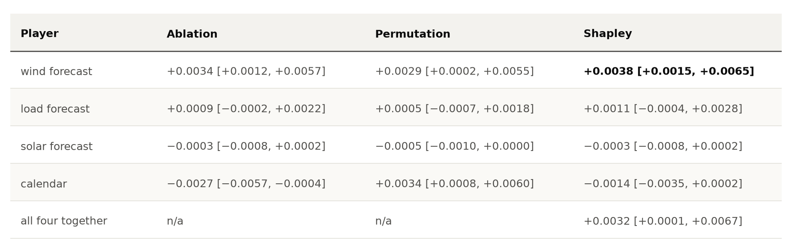
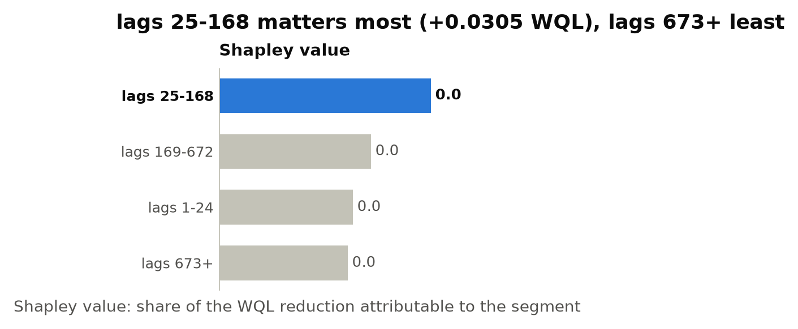
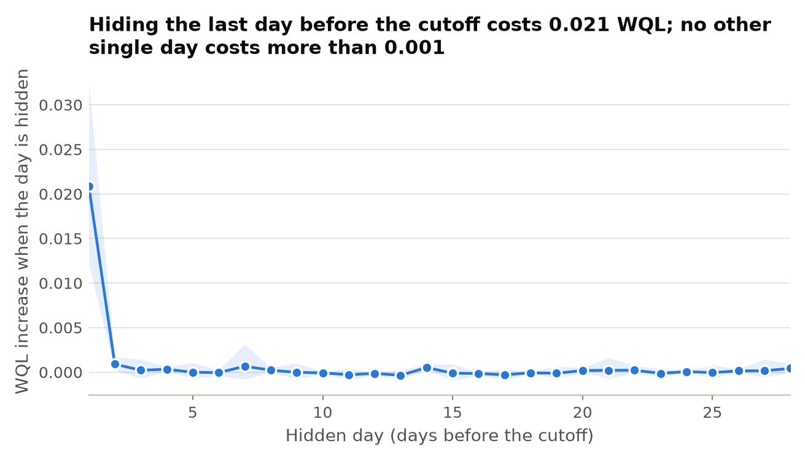
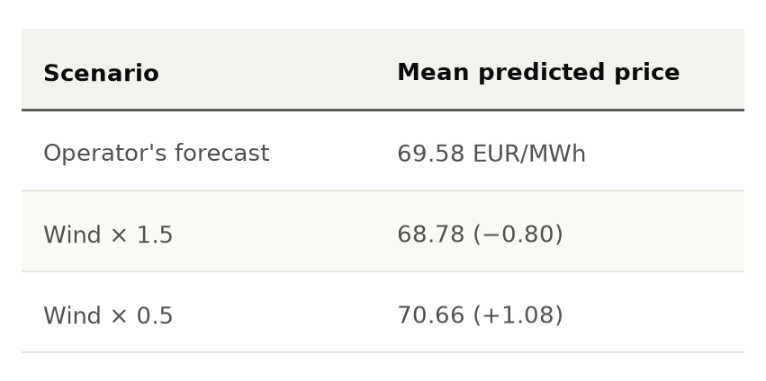

# Chronos-2 in Practice (3/7): Covariates and What Drives the Forecast

**Knowing the covariates' future halves the quantile loss on fev-bench's own German price task.
Knowing only their history takes off 11%. The gap is the whole story.**

*Disclosure: this article was drafted with the help of an AI assistant. Every experiment was run from the companion repository, every number is read from its results files, and the text was reviewed and edited by the author.*

> Draft for Medium. Every number is read from a CSV in [`results/`](https://github.com/epjover/chronos2-in-practice/tree/main/results); each figure
> names the file to upload. Published open access (not metered).

---

[Part 2](#) established a number to beat and a protocol to beat it with, and it ended on a result
that needed explaining. On a clean univariate series, Chronos-2 and the older Chronos-Bolt came out
tied within the error bars. The Chronos-2 paper's own benchmark tables say where the difference
should show up (covariate tasks, by a wide margin: section 5.2 and Figure 4 of [1]), so that's
where this claim gets tested rather than just taken at its word.

It holds, and the size of the gain matters too. On **EPF-DE**, fev-bench's German day-ahead
electricity price task, handing Chronos-2 the two covariates the market knows in advance cuts the
weighted quantile loss by **49.5%** against the same task without them, winning 19 of 20 published
windows. Handing it the *same two series* but stopping at the cutoff (history only, no future) still
brings an improvement of **11.0%**.

This contrast matters more than anything else in the article. A covariate becomes valuable not
because it correlates with your target, but because you know its future.

The article ends on the strongest covariate a forecaster can have: a professional forecast of the
target itself. Part 2 showed the grid operator's day-ahead load forecast beating every model by a
factor of five. Section 6 hands it to Chronos-2, and what happens is a useful lesson in what a
foundation model does and does not do with a nearly perfect input.

- **Code:** [`05_covariates`](https://github.com/epjover/chronos2-in-practice/blob/main/notebooks/05_covariates.ipynb),
  [`06_explainability`](https://github.com/epjover/chronos2-in-practice/blob/main/notebooks/06_explainability.ipynb)
- **Versions:** `chronos-forecasting==2.3.2`, `fev==0.10.0`, Python 3.11.

---

## 1. One rule, and no flag

Chronos-2 treats covariates as series that belong to the same group as the target. What kind of
covariate a column turns out to be comes down to one thing:

- if a column of `df` is **not** in `future_df`, it counts as a **past covariate**, because the model only sees its history and nothing beyond the cutoff;
- if a column appears in **both**, it counts as a **known-future covariate**, because the model also sees its values across the horizon.

In code, this is the covariate API:

```python
history = price[["item_id", "timestamp", "price_actual", "load_forecast_tso", "gen_solar"]]
future = tomorrow[["item_id", "timestamp", "load_forecast_tso"]]  # 24 rows per series, horizon only

forecast = pipeline.predict_df(
    history,  # the target and every covariate's past
    future_df=future,  # ONLY the covariates you will have tomorrow
    target="price_actual",
    prediction_length=24,
    quantile_levels=[0.1, 0.5, 0.9],
)
# load_forecast_tso is in both frames -> known-future covariate
# gen_solar is in history only       -> past covariate
```

The same rule covers categorical covariates: a column of dtype `category` or string is encoded
as a category, a float column goes in as a number, and section 5 checks whether the choice
matters.

There is no third option and no argument to set, which is neat, but it's also where the most
expensive mistake in applied forecasting tends to hide. A "known-future" covariate has to be
knowable *at forecast time*. A published day-ahead forecast qualifies, but the value that was
eventually observed does not, and nothing in the API will stop you from using it anyway.

In the companion repository the backtest harness makes this choice explicit rather than implicit.
Only columns declared as `known_covariates` get placed in the future frame, and a guard checks
before every call that nothing else has crossed the cutoff.

## 2. Replicating EPF-DE, not approximating it

EPF-DE is the clearest of fev-bench's covariate tasks [2]. It forecasts the German day-ahead price
24 hours ahead, with Amprion's load forecast and a combined PV + wind forecast serving as known
covariates, across 20 evaluation windows. The data comes from the open benchmark of Lago et al.
[6], which is where the electricity price forecasting literature compares its models.

"Replicating" here means reproducing the published task, rather than building something that only
resembles it. The repository loads the task from the fev-bench task list, restates it as its own
backtest configuration (horizon, window count, step, seasonality, covariate columns all copied from
the task), and then checks the translation:

```python
from c2p.fev_tasks import (
    assert_cutoffs_match,
    load_fev_task,
    task_backtest_config,
    task_series_frame,
)

task = load_fev_task("epf_de")
epf = task_series_frame(task)
config = task_backtest_config(task)
assert_cutoffs_match(task, epf, config)  # our 20 windows == fev's 20 published cutoffs
```

If the translation were off by a single step, that assertion fails and the replication stops. The check is less of a formality than it sounds, because without it, "we reproduced the benchmark task" is just a claim
nobody can check, including you.

Three arms keep apart two effects that are easy to mix up:


*Table 1. Columns: Arm, What the model gets, WQL, Skill vs univariate, Wins.*



*Figure 1. EPF-DE: the covariates' history against their future, scored on the task's own 20
windows.*

**Knowing the future is roughly four and a half times as valuable as knowing the history.** If most of the gain had shown up in `past_only`, covariates would just be extra context,
and you could stop worrying about forecast availability. It didn't turn out that way, and that
changes the engineering work. You're no longer asking "which series correlate with my target" but
"which series do I have a trustworthy forward view of".

One more number that does not usually get reported: coverage of the 80% interval improves along with
accuracy, going 71.5%, then 76.3%, then 84.4%. The covariates do not just shrink the error; they
also make the model's own uncertainty more reliable. Part 2 found Chronos-2's bands too narrow on
Spanish load, and this is the first thing in the series that moves them in the right direction.

## 3. The same design on Spanish prices

The Spanish dataset carries the same covariates. The grid operator publishes day-ahead forecasts of
load, solar and onshore wind the day before, so for a horizon that ends within the next day they are
legitimately known. The protocol follows the same 365 day-ahead windows used in Part 2, with the
same weekly-block intervals.

**Which price is this?** The dataset has two price columns and documents neither, so the
repository checks them against the market operator's own files (`scripts/check_price_columns.py`,
on OMIE's hourly day-ahead prices for 2018 [9]). `price actual`, the target here, is not the
day-ahead market price: it runs a steady 6.1 EUR/MWh above it (standard deviation 1.8) with a
correlation of 0.990, which is what the final price looks like once the costs of the later markets
and system services are added to the day-ahead result. Forecasting it one day ahead is, to within
that nearly constant premium, the day-ahead price forecasting problem, and that is how to read
this section. The other column, `price day ahead`, sounds like the natural baseline or covariate
and is neither: it matches OMIE's price to the cent on 233 days of 2018 and on no hour at all of
another 130. It is not used anywhere in this series.

The ladder adds one kind of information at a time, so you can attribute each rung to its own cause.


*Figure 2. Spanish day-ahead forecast of the final price, WQL improvement over no covariates, 365
windows. The two leak arms of section 4 are left out of the chart.*


*Table 2. Columns: Rung, WQL, Skill vs none, Wins.*

**Calendar features do nothing, and next to better covariates they cost a little.** That's the
finding most likely to catch out anyone who has built a classical forecasting pipeline, where
hour-of-day and day-of-week dummies are usually the first thing added. On its own the calendar's
interval sits tight around zero at −0.2%, and the rung wins fewer than half its windows. The last
row goes further: the operator's forecasts *without* the calendar beat the same forecasts with it
by 2.8% [+0.6, +5.1], and have the lowest mean loss of the table. The reason shows up in Part 1's
architecture section, because Chronos-2 reads *positions*, and 2,048 positions of hourly price
already carry the daily and weekly cycle far more precisely than five derived columns ever could.
You add calendar features when a model can't see that shape on its own, but this one already does,
and five extra series in the group are five more things for the attention to weigh.

One qualification is needed here, because it bears on the advice from Part 1. The calendar rung
bundles four *periodic* features (hour, weekday, month, weekend) together with the one aperiodic
feature, holidays, and 2018 has only ten national holidays among 365 windows, too few to shift a
yearly score no matter what happens on them. So the notebook also runs a rung with the holiday flag
on its own, and scores both calendar rungs separately on the ten windows whose horizon falls on a
holiday:


*Table 3. Columns: Rung, All 365 windows, 10 holiday windows, 355 ordinary windows.*

Both halves of Part 1's claim hold up. The periodic calendar is redundant, since the model
reads it off the series itself, and on the days that do *not* follow the series' rhythm the flag
takes fourteen percent off the quantile loss, with an interval that clears zero even at
ten windows. The yearly null amounts to an average of a large gain on ten days and a small cost, too
small to pin down, spread across the other 355 days. Keep the holiday flag and drop the rest of the
calendar.

**The operator's forecasts bring 8 to 11%, and past generation adds nothing that can be measured
on top.** The three forecasts alone take 10.9% off the loss, with an interval well clear of zero.
The `+past generation` rung reaches 11.8%, which looks like three and a half more points than
`+TSO forecasts` until you compare it with the forecasts alone: the difference is +0.9% [−1.1,
+3.1]. Most of that apparent gain was the calendar's small cost being diluted. A ladder is only as
good as its rungs, and this one needed the extra row to be read correctly.

The direction of the wind effect is the textbook one. Wind and solar have near-zero marginal cost,
so a windy day pushes expensive plants out of the merit order and lowers the price [10], and a
forecast of wind is a forecast of that pressure.

The gain is also considerably smaller than EPF-DE's 49.5%, but that isn't a contradiction. One
comparison I'm leaving out is price error in EUR/MWh between the two markets, because the years
differ, the price levels differ, and so does the volatility. What carries over is the relative
improvement, and reading it fairly suggests that how much covariates help is a property of the
market rather than of the model. A recent benchmark of Chronos-2 on daily wholesale prices across 23
European markets reaches a similar conclusion from the other direction: the model's relative value
depends on the comparator, the information set and the evaluation period [8].

## 4. The leak, and what it looks like

Two arms probe the mistake, and they disagree, which is what makes it interesting.


*Table 4. Columns: Arm, Skill vs none, Wins.*

**Swapping the published forecasts for the observed values changes almost nothing**, and if anything
leaves results a touch worse. The reason has more to do with economics than with statistics. The
bulk of this price is set in an auction held the day before delivery, by participants who bid on
what was known then, and the operator's published forecasts were part of what was known. They
behave less like a noisy stand-in for the outcome and more like an input the market itself used.
What load and wind turned out to be the next day moved the later, smaller markets, not the
auction. A leak doesn't automatically help, and in this dataset the covariate without any leak
also happens to be the better one.

**Handing over a copy of the target is what a leak looks like when it bites**: 83.3% improvement,
a confidence interval two points wide, and 365 wins out of 365. That signature, an
implausibly large gain paired with an implausibly tight interval and a perfect win rate, is what
you should learn to recognise, because the mechanism behind it isn't always as obvious as copying
a column. A "customer lifetime value" field recomputed nightly, a status flag updated on
completion, a weather observation joined by date: each of these can sit in the frame looking like
an ordinary covariate.

So the rule isn't "leaks inflate results by X%". **A covariate that makes your model
dramatically better is a reason to audit the column, not to publish.** And where a quantity exists
in both a forecast and an observed version, prefer the forecast.

## 5. A categorical covariate

Chronos-2 takes categories as well as numbers, and the weekday is a clean test of whether the
choice matters, because it can be written either way: as the number 0 to 6, which tells the model
that Sunday is "six times" Monday, or as seven unordered labels. In pandas the difference is the
column's dtype, and `predict_df` does the rest:

```python
frame["weekday"] = frame["timestamp"].dt.day_name().astype("category")  # a category, not a number
```

Both versions were added to the price history as a known-future covariate, on the 365 windows:


*Table 5. Columns: Weekday given as, WQL, Skill vs no covariates.*

Neither helps, which section 3 already predicted for a periodic feature, and the encoding makes no
difference that a year of windows can detect. That is the reassuring result. The encoding will
matter for a covariate whose categories carry information the series does not (a promotion type,
a tariff, a holiday kind): Part 7 uses one of those on a retail panel.

## 6. When the covariate is a professional forecast of the target

Part 2 put the operator's day-ahead load forecast in the table as a reference: a 0.9% error
against Chronos-2's 4.7%. That forecast is public before the cutoff, so it is also a legitimate
known-future covariate for the load. There are two ways to use it.

- **As a covariate.** Put the operator's forecast in `future_df` and let the model work out, from
  the context alone, that this column is nearly the target.
- **Correct it.** Forecast what the operator got wrong, `load − operator forecast`, with Chronos-2
  on its own, and add the operator's forecast back. The operator carries the level and the shape;
  the model only has to find out whether the operator's errors persist from one day to the next.
  `c2p.baselines.ResidualForecaster` wraps any forecaster this way.

The operator publishes one number per hour, so the comparison is made twice: on WQL, where a model
that states its uncertainty is scored on its quantiles and the operator on a single number, and on
WAPE, where both sides are point forecasts.


*Table 6. Columns: Forecast of Spanish load, WQL, WAPE, 80% band covers, WAPE vs the operator.*

**As a covariate, the operator's forecast cuts Chronos-2's error by almost three quarters, and
leaves it worse than the forecast it was given.** The error falls from 4.67% to 1.28%, the largest
gain from a covariate in this series. But the column it was handed has an error of 0.94%. The
model does not copy a covariate, however good; it blends it with its own reading of the history,
and here its own reading is the weaker of the two. A zero-shot model has no way to learn that one
input deserves nearly all of the weight. That takes training, which is Part 4's subject.

**Correcting the operator's forecast matches it as a point forecast and adds what it lacks.** The
residual model's WAPE is 0.93% against 0.94%, a difference of +1.6% with an interval that contains
zero: the operator's errors have little left in them that the last weeks can predict. What the
residual model adds is the distribution. Its 80% band covers 78.1% of the hours, the closest to
the nominal 80% of the three Chronos-2 rows, around a forecast that is five times better than the
model's own. Its WQL of 0.0074 is 21.4% [+19.4, +23.3] below the operator's 0.0094, and all of
that gain comes from having quantiles at all.

The practical reading: when a strong forecast of your target already exists, do not ask a
foundation model to beat it from the history, and do not expect it to pass the forecast through
untouched. Ask it for the part the forecast does not provide, which is usually the uncertainty.

## 7. Which covariates is the forecast using?

Chronos-2 ships no explainer: no `.explain()`, no importance attribute. What it does ship is
something attribution needs. Zero-shot inference costs only one forward pass, so switching an input
off and measuring the damage is cheap in a way it never is for a model you had to train.

Everything below is model-agnostic. None of it reads attention weights, and that's on purpose,
because attention has a long record of not being a faithful account of what a model used [5], and
Chronos-2's group attention has had no such validation at all. Inputs you can switch off give
answers you can check.

Three ways to ask "how much did this input matter", each one a loop over forward passes:

- **Ablation**: drop one covariate, keep the rest, measure how much WQL gets worse.
- **Permutation**: keep the column but shuffle its values across time, so the model gets a
  covariate with the right distribution and the wrong timing [11, 12].
- **Shapley values**: run every subset of the covariates (four players, so sixteen subsets)
  and credit each one with its average gain over all the subsets it joins [4]. Of the three
  methods, this is the only one that accounts for two inputs carrying the same information.

There are four covariate players: calendar treated as a group, and each operator forecast counted on
its own, on the price task of section 3 and on all 365 day-ahead windows. A first version of this
analysis used twelve windows, and none of its attributions could be told apart from zero: the
covariates remove a few thousandths of WQL, less than the difference between one day and the next.
Sixteen coalitions times 365 windows is 5,840 forecasts, and the stacked windows pass through the
model in batches, in under three minutes on the GPU of this series.

```python
from c2p.eval import iter_windows
from c2p.explain import covariate_shapley, importance_summary, stack_windows

PLAYERS = {
    "calendar": ("hour", "day_of_week", "month", "is_weekend", "is_holiday"),
    "load forecast": ("load_forecast_tso",),
    "solar forecast": ("solar_forecast_tso",),
    "wind forecast": ("wind_onshore_forecast_tso",),
}
context, future, actuals = stack_windows(list(iter_windows(price, config)))  # 365 windows, stacked
explanation = covariate_shapley(
    Chronos2Forecaster(pipeline),
    context,
    future,
    covariates=PLAYERS,
    prediction_length=24,
    freq="h",
    target="price_actual",
    value="wql_reduction",
    actuals=actuals,  # credit = how much WQL each player removes
)
# One row per window and player; the summary adds the mean and a 95% interval over the windows,
# resampling blocks of seven consecutive days.
importance_summary(explanation.shapley, value="shapley", block_length=7)
```

`ablation_importance` and `permutation_importance` take the same arguments and return the same
shape. Use `value="prediction_mean"` instead of `"wql_reduction"` and you attribute the forecast's
level rather than its error, which matters when there are no actuals yet to compare against.



*Figure 3. Exact Shapley values over sixteen coalitions: each player's average marginal
contribution to the WQL reduction over 365 windows, with its 95% interval.*



*Table 7. Columns: Player, Ablation, Permutation, Shapley.*

The numbers are in units of WQL removed, and the last row is the sanity check: the four players'
Shapley values add up, window by window, to what all the covariates remove together, 0.0032 of
the no-covariate WQL of 0.0499. That is the same 0.0499 to 0.0467 the ladder measured for
`+TSO forecasts`, reached by another route.

**Read the interval before the ranking.** One covariate is clear of zero under all three methods:
the wind forecast, which accounts for more than the total on its own. The load and solar forecasts
cannot be told apart from zero by any method, on a full year of windows. If this table had been
read as a ranking, as its twelve-window predecessor was, it would have told a story about four
players. It supports a story about one.

**The calendar is where the methods disagree, and the disagreement is the lesson.** Ablation says
that removing the calendar *improves* the forecast (−0.0027, clear of zero), which is the last row
of section 3's ladder seen from the other side. Permutation says that shuffling the calendar
*hurts* it (+0.0034, also clear of zero). Both are right, because they ask different questions.
Permutation measures how much the model relies on a column: hand it a calendar that says Tuesday
on a Sunday and it believes it. Ablation measures whether the forecast is better with the column
than without. A model can lean on an input that does it no good, and permutation importance, the
method most libraries offer first [11], cannot tell you so. Attribution says what the model uses, not
what you should keep; the ladder is what answers the second question.

## 8. Which part of the past?

The same machinery applies to the target's own history. Hertel et al. (2026) cut the context into
four segments, the last day, the rest of the week, the rest of four weeks and everything older, and
treat each one as a player that a coalition can switch off. The windows are the same 365, and the
intervals resample them in the same weekly blocks.



*Figure 4. Shapley values of four context segments over the 365 windows, with 95% block-bootstrap
intervals.*


*Table 8. Columns: Segment, Shapley value [95% CI].*

**The price's own history outweighs the covariates by more than an order of magnitude.** The whole
context removes 0.1084 of WQL; the four covariate players of section 7 remove 0.0032 between them.
The ratio is 34, with an interval from 15 to 178 that is this wide because its denominator sits
close to zero. For all the attention covariates get, including in this article, the series itself
remains the dominant input.

**Recent history carries most of it, and old history carries little per hour.** The last day alone
holds 40% of the total. The hours older than four weeks are two thirds of the 2,048-hour context
and hold 12%. That is Part 2's context curve seen from the inside: the skill stopped growing
after about a thousand hours because the hours added beyond that point are these.

**Occlusion agrees about the last day and disagrees about everything else.** Slide a one-day gap
back through the last four weeks, one day at a time. Hiding the most recent day costs
0.0209 [0.0121, 0.0325] of WQL, and no other single day costs more than 0.0009. Read on its own,
that says only yesterday matters. The Shapley values say that the three older segments hold 60% of
the total. Both are right, and the difference is redundancy. Occlusion hides one day while the 27
others stay in place, and the neighbours of a hidden Tuesday stand in for it; a Shapley value also
averages over coalitions in which the neighbours are missing. Information that exists in several
copies looks worthless to occlusion, which is the reason not to read an occlusion curve as a
ranking of what the model needs.



*Figure 5. Occlusion: the WQL cost of hiding one day of history, by how many days before the
cutoff it sits, with 95% block-bootstrap intervals over the 365 windows.*

## 9. What-if: move a covariate and watch

Attribution says what mattered on average, but a planner usually wants to know what *this* forecast
would be under a different input. Because the wind forecast is a known-future covariate, changing
it is a one-line intervention on the future frame, and the model call stays the same:

```python
future_more_wind = future.assign(
    wind_onshore_forecast_tso=future["wind_onshore_forecast_tso"] * 1.5
)
```


*Figure 6. The same day forecast three times, with the operator's wind forecast scaled. Lines
are the three medians; the band is the 80% interval of the unscaled forecast.*



*Table 9. Columns: Scenario, Mean predicted price.*

More wind lowers the predicted price, and less wind raises it. In the Spanish market that's the
correct direction, because renewables with near-zero marginal cost displace expensive plants in the
merit order [10]. The value of this exercise is that it is *checkable against domain knowledge*, which no
attribution number is. A what-if that moved the price the wrong way would be a finding about your
pipeline, and you'd find it in one cell.

It's a sensitivity analysis, not a causal claim. It shows how the model responds to an input, not
what the market would do.

## 10. A limit to keep in mind

Chronos-2 accepts **numeric and categorical covariates only**, and it takes no text. A promotion's
description, an incident report, a weather warning written in words, none of these go in, and the
paper lists multimodal inputs as future work rather than a feature (section 6 of [1]).

In practice the engineering job means turning what you know into numbers and categories: a holiday
becomes a flag, a tariff becomes a level, a published forecast becomes a column. The ladder in
section 3 is that job, done once, and section 7 is how you find out which parts of it the model
leans on.

> **Without the repository.** Everything in sections 1 to 6 is `pipeline.predict_df(df,
> future_df=...)` with different columns in the two frames. The attribution methods are loops
> around the same call: drop or shuffle a column and predict again. `c2p.explain` adds the
> bookkeeping (stacking windows into one batch, sharing forecasts between coalitions) and the
> intervals.

## Cheat sheet

- A covariate counts as known-future only if you will really have its value at forecast time. The operator's published forecast qualifies, but the observed value never does, and the API won't stop you from using it anyway.
- Put every covariate's history in `df`, and put only the known-future ones in `future_df`.
- Skip the periodic calendar (hour, weekday, month), because the model reads it off the series, and next to real covariates it costs a little. Keep the holiday flag.
- Know what your target is. A column called "price" can be the auction price, the final price or a mixture, and the covariates that explain one do not explain the other.
- If a professional forecast of your target exists, use the model for what that forecast lacks: forecast its errors, and take the intervals.
- Expect the series' own history to matter far more than any covariate. Attribute before you engineer, since one forward pass per coalition is cheap, and read the interval of an attribution before its rank.
- Permutation importance says what the model relies on, not what helps. Check with an ablation.
- Prefer a forecast of a quantity over its observation whenever both exist.

## What's next

Part 4 moves away from feeding the model better inputs and starts changing its weights instead. It
pits LoRA against full fine-tuning on the same 2018 windows, with three seeds behind every row,
looking at training time, peak VRAM, artifact size and what gets forgotten, and then fine-tunes
with the covariates of this article.

---

## References

1. Ansari, A. F., *et al.* (2025). *Chronos-2: From Univariate to Universal Forecasting*.
   arXiv:2510.15821. https://arxiv.org/abs/2510.15821
2. Shchur, O., *et al.* (2025). *fev-bench*. arXiv:2509.26468. https://arxiv.org/abs/2509.26468
3. Hertel, M., *et al.* (2026). *Explainable Load Forecasting with Covariate-Informed Time Series
   Foundation Models*. arXiv:2604.28149. https://arxiv.org/abs/2604.28149
4. Lundberg, S. & Lee, S.-I. (2017). *A Unified Approach to Interpreting Model Predictions*.
   arXiv:1705.07874. https://arxiv.org/abs/1705.07874
5. Jain, S. & Wallace, B. C. (2019). *Attention is not Explanation*. arXiv:1902.10186.
   https://arxiv.org/abs/1902.10186
6. Lago, J., *et al.* (2021). *Forecasting day-ahead electricity prices: A review of state-of-the-art
   algorithms, best practices and an open-access benchmark*. arXiv:2008.08004.
   https://arxiv.org/abs/2008.08004
7. Dataset: *Hourly energy demand generation and weather* (CC0).
   https://www.kaggle.com/datasets/nicholasjhana/energy-consumption-generation-prices-and-weather
8. Lin, X. & Ti, J. (2026). *Benchmarking Chronos-2 for European wholesale electricity price
   forecasting: Evidence from foundation and conventional forecasting models*. Energy and AI, 26,
   100914. https://doi.org/10.1016/j.egyai.2026.100914
9. OMIE, the Iberian market operator: hourly day-ahead market prices (`marginalpdbc` files).
   https://www.omie.es/en/file-access-list
10. Sensfuß, F., Ragwitz, M. & Genoese, M. (2008). *The merit-order effect: A detailed analysis of
    the price effect of renewable electricity generation on spot market prices in Germany*.
    Energy Policy, 36(8), 3086–3094. https://doi.org/10.1016/j.enpol.2008.03.035
11. Breiman, L. (2001). *Random Forests*. Machine Learning, 45(1), 5–32 (where variable
    importance by permutation is introduced). https://doi.org/10.1023/A:1010933404324
12. Fisher, A., Rudin, C. & Dominici, F. (2019). *All Models are Wrong, but Many are Useful:
    Learning a Variable's Importance by Studying an Entire Class of Prediction Models
    Simultaneously*. Journal of Machine Learning Research, 20(177). arXiv:1801.01489.
    https://arxiv.org/abs/1801.01489

**Suggested tags:** Time Series Forecasting · Machine Learning · Foundation Models ·
Explainable AI · Python
