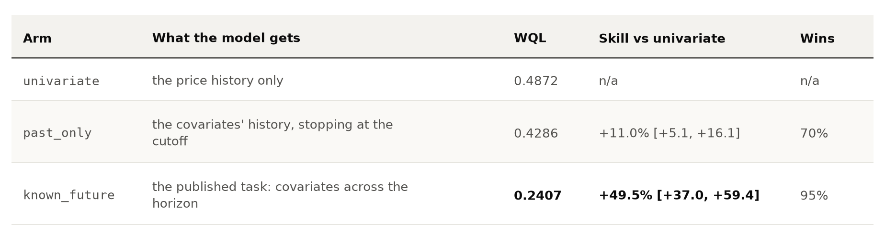
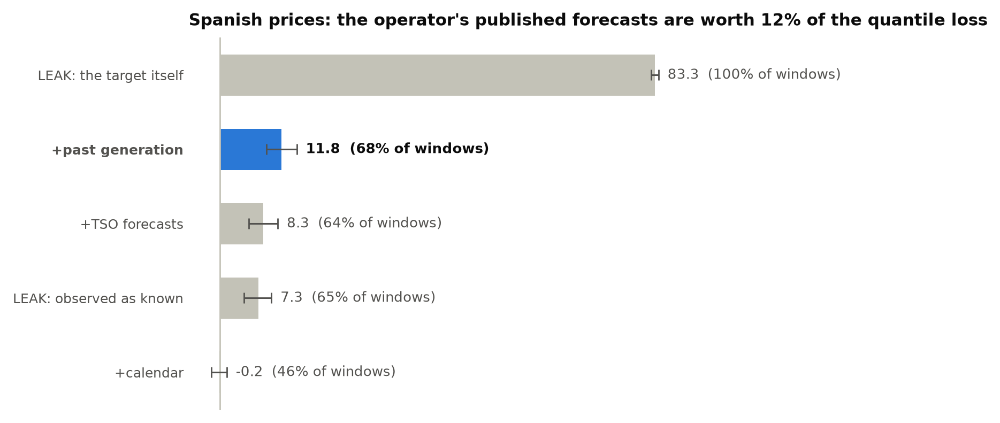
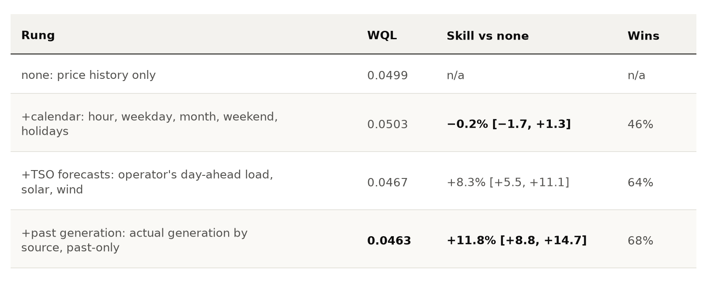
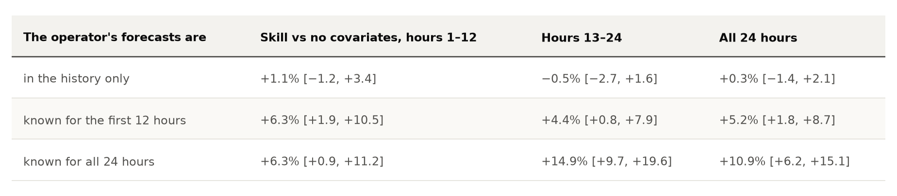
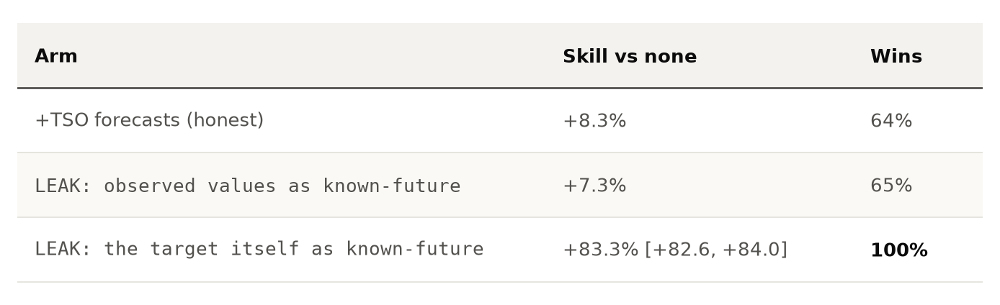
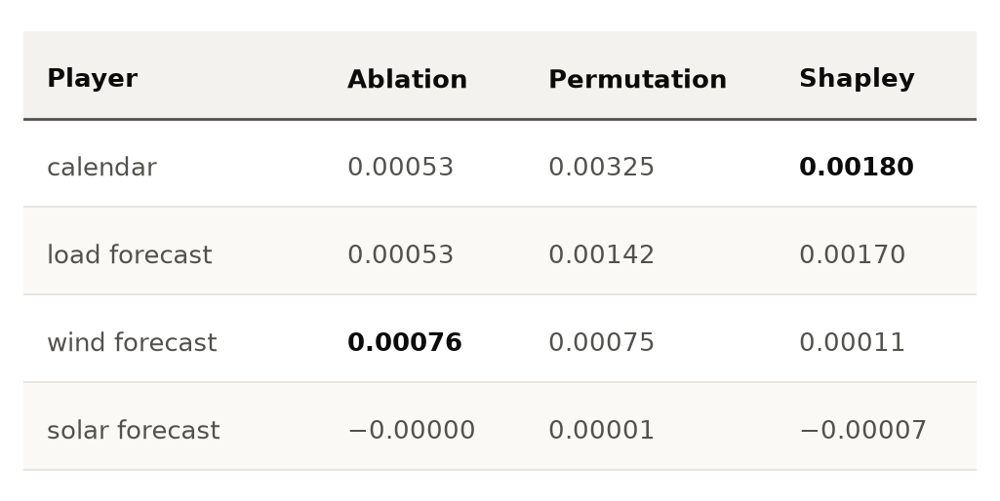
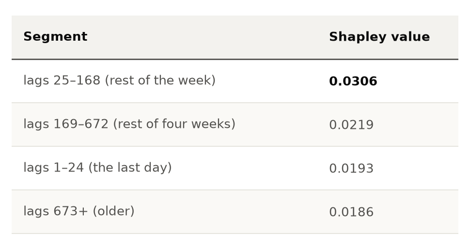
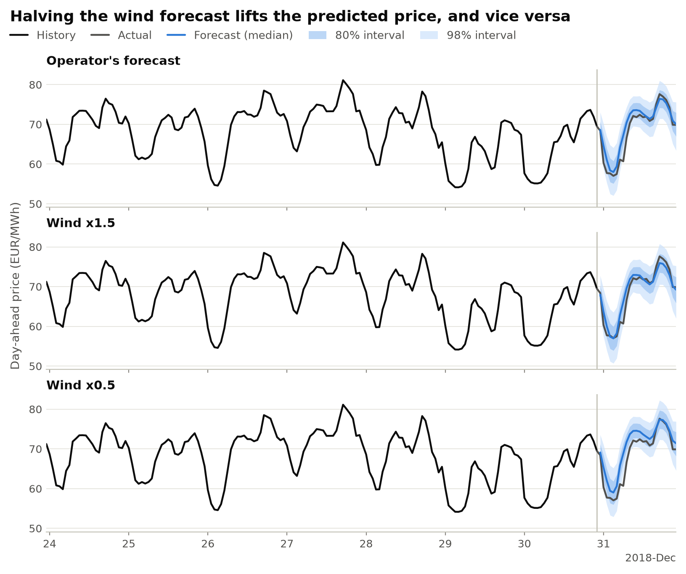

# Chronos-2 in Practice (3/5): Covariates and What Drives the Forecast

**Knowing the covariates' future halves the quantile loss on fev-bench's own German price task.
Knowing only their history takes off 11%. The gap is the whole story.**

*Disclosure: this article was drafted with the help of an AI assistant. Every experiment was run from the companion repository, every number is read from its results files, and the text was reviewed and edited by the author.*

> Draft for Medium. Every number is read from a CSV in [`results/`](https://github.com/epjover/chronos2-in-practice/tree/main/results); each figure
> names the file to upload. Published open access (not metered).

---

[Part 2](#) established a number to beat and a protocol to beat it with, and it ended on a result
that needed explaining. On a clean univariate series, Chronos-2 and the older Chronos-Bolt came out
tied within the error bars. The Chronos-2 paper's own benchmark tables say where the difference
should show up (covariate tasks, by a wide margin), so that's where this claim gets tested rather
than just taken at its word.

It holds, and the size of the gain matters too. On **EPF-DE**, fev-bench's German day-ahead
electricity price task, handing Chronos-2 the two covariates the market knows in advance cuts the
weighted quantile loss by **49.5%** against the same task without them, winning 19 of 20 published
windows. Handing it the *same two series* but stopping at the cutoff (history only, no future) still
brings an improvement of **11.0%**.

This contrast matters more than anything else in the article. A covariate becomes valuable not
because it correlates with your target, but because you know its future.

- **Code:** [`05_covariates`](https://github.com/epjover/chronos2-in-practice/blob/main/notebooks/05_covariates.ipynb),
  [`06_explainability`](https://github.com/epjover/chronos2-in-practice/blob/main/notebooks/06_explainability.ipynb)
- **Versions:** `chronos-forecasting==2.3.2`, `fev==0.10.0`, Python 3.11.

---

## 1. One rule, and no flag

Chronos-2 treats covariates as series that belong to the same group as the target. What kind of
covariate a column turns out to be comes down to one thing:

- if a column of `df` is **not** in `future_df`, it counts as a **past covariate**, because the model only sees its history and nothing beyond the cutoff;
- if a column appears in **both**, it counts as a **known-future covariate**, because the model also sees its values across the horizon.

In code, this is the covariate API:

```python
history = price[["item_id", "timestamp", "price_actual", "load_forecast_tso", "gen_solar"]]
future = tomorrow[["item_id", "timestamp", "load_forecast_tso"]]  # 24 rows per series, horizon only

forecast = pipeline.predict_df(
    history,  # the target and every covariate's past
    future_df=future,  # ONLY the covariates you will genuinely have tomorrow
    target="price_actual",
    prediction_length=24,
    quantile_levels=[0.1, 0.5, 0.9],
)
# load_forecast_tso is in both frames -> known-future covariate
# gen_solar is in history only       -> past covariate
```

There is no third option and no argument to set, which is neat, but it's also where the most
expensive mistake in applied forecasting tends to hide. A "known-future" covariate has to be
knowable *at forecast time*. A published day-ahead forecast qualifies, but the value that was
eventually observed does not, and nothing in the API will stop you from using it anyway.

In the companion repository the backtest harness makes this choice explicit rather than implicit.
Only columns declared as `known_covariates` get placed in the future frame, and a guard checks
before every call that nothing else has crossed the cutoff.

## 2. Replicating EPF-DE, not approximating it

EPF-DE is the clearest of fev-bench's covariate tasks. It forecasts the German day-ahead price 24
hours ahead, with Amprion's load forecast and a combined PV + wind forecast serving as known
covariates, across 20 evaluation windows.

"Replicating" here means reproducing the published task, rather than building something that only
resembles it. The repository loads the task from the fev-bench task list, restates it as its own
backtest configuration (horizon, window count, step, seasonality, covariate columns all copied from
the task), and then checks the translation:

```python
from c2p.fev_tasks import (
    assert_cutoffs_match,
    load_fev_task,
    task_backtest_config,
    task_series_frame,
)

task = load_fev_task("epf_de")
epf = task_series_frame(task)
config = task_backtest_config(task)
assert_cutoffs_match(task, epf, config)  # our 20 windows == fev's 20 published cutoffs
```

If the translation were off by a single step, that assertion fails and the replication stops. The check is less of a formality than it sounds, because without it, "we reproduced the benchmark task" is just a claim
nobody can check, including you.

Three arms keep apart two effects that are easy to mix up:



*Table 1. Columns: Arm, What the model gets, WQL, Skill vs univariate, Wins.*


*Figure 1. EPF-DE: the covariates' history against their future, scored on the task's own 20
windows.*

**Knowing the future is roughly four and a half times as valuable as knowing the history.** If most of the gain had shown up in `past_only`, covariates would just be extra context,
and you could stop worrying about forecast availability. It didn't turn out that way, and that
changes the engineering work. You're no longer asking "which series correlate with my target" but
"which series do I have a trustworthy forward view of".

One more number that does not usually get reported: coverage of the 80% interval improves along with
accuracy, going 71.5%, then 76.3%, then 84.4%. The covariates do not just shrink the error; they
also make the model's own uncertainty more reliable. Part 2 found Chronos-2's bands too narrow on
Spanish load, and this is the first thing in the series that moves them in the right direction.

## 3. The same design on Spanish prices

The Spanish dataset carries the same covariates. The grid operator publishes day-ahead forecasts of
load, solar and onshore wind the day before, so for a horizon that ends within the next day they are
legitimately known. The target is the hourly spot price, and the protocol follows the same 365
day-ahead windows used in Part 2.

The ladder adds one kind of information at a time, so you can attribute each rung to its own cause.



*Figure 2. Spanish day-ahead price, WQL improvement over no covariates, 365 windows. The two leak arms of section 4 are left out of the chart.*



*Table 2. Columns: Rung, WQL, Skill vs none, Wins.*

**Calendar features do nothing.** That's the finding most likely to catch out anyone who has built a
classical forecasting pipeline, where hour-of-day and day-of-week dummies are usually the first
thing added. The interval sits tight around zero at −0.2%, and the rung wins fewer than half its
windows. The reason shows up in Part 1's architecture section, because Chronos-2 reads *positions*,
and 2,048 positions of hourly price already carry the daily and weekly cycle far more precisely than
five derived columns ever could. You add calendar features when a model can't see that shape on its
own, but this one already does.

One qualification is needed here, because it bears on the advice from Part 1. The calendar rung
bundles four *periodic* features (hour, weekday, month, weekend) together with the one aperiodic
feature, holidays, and 2018 has only ten national holidays among 365 windows, too few to shift a
yearly score no matter what happens on them. So the notebook also runs a rung with the holiday flag
on its own, and scores both calendar rungs separately on the ten windows whose horizon falls on a
holiday:



*Table 3. Columns: Rung, All 365 windows, 10 holiday windows, 355 ordinary windows.*

Both halves of Part 1's claim hold up. The periodic calendar is redundant, since the model
reads it off the series itself, and on the days that do *not* follow the series' rhythm the flag
takes fourteen percent off the quantile loss, with an interval that clears zero even at
ten windows. The yearly null amounts to an average of a large gain on ten days and a small cost, too
small to pin down, spread across the other 355 days. Keep the holiday flag and drop the rest of the
calendar.

**The operator's forecasts bring 8.3%, and adding past generation on top pushes it to 11.8%.**
Both intervals clear zero. The second rung uses *past-only* covariates (their history, not
their future), which is the smaller of the two effects measured in section 2, and it still
adds three and a half points on top. On this market, the covariates work alongside each other rather than
replacing one another.

The gain is also considerably smaller than EPF-DE's 49.5%, but that isn't a contradiction. One
comparison I'm leaving out is price error in EUR/MWh between the two markets, because the years
differ, the price levels differ, and so does the volatility. What carries over is the relative
improvement, and reading it fairly suggests that how much covariates help is a property of the
market rather than of the model. A recent benchmark of Chronos-2 on daily wholesale prices across 23
European markets reaches a similar conclusion from the other direction: the model's relative value
depends on the comparator, the information set and the evaluation period (Lin & Ti, 2026).

## 4. The leak, and what it looks like

Two arms probe the mistake, and they disagree, which is what makes it interesting.



*Table 4. Columns: Arm, Skill vs none, Wins.*

**Swapping the published forecasts for the observed values changes almost nothing**, and if anything
leaves results a touch worse. The reason has more to do with economics than with statistics. A
day-ahead price gets *cleared against the day-ahead forecasts*, so the operator's published forecast
behaves less like a noisy stand-in for the outcome and more like the input the market itself used. A
leak doesn't automatically help, and in this dataset the covariate without any leak also happens to
be the better one.

**Handing over a copy of the target is what a leak looks like when it bites**: 83.3% improvement,
a confidence interval less than two points wide, and 365 wins out of 365. That signature, an
implausibly large gain paired with an implausibly tight interval and a perfect win rate, is what
you should learn to recognise, because the mechanism behind it isn't always as obvious as copying
a column. A "customer lifetime value" field recomputed nightly, a status flag updated on
completion, a weather observation joined by date: each of these can sit in the frame looking like
an ordinary covariate.

So the rule isn't "leaks inflate results by X%". **A covariate that makes your model
dramatically better is a reason to audit the column, not to publish.** And where a quantity exists
in both a forecast and an observed version, prefer the forecast.

## 5. Which covariates is the forecast using?

Chronos-2 ships no explainer: no `.explain()`, no importance attribute. What it does ship is
something attribution needs. Zero-shot inference costs only one forward pass, so switching an input
off and measuring the damage is cheap in a way it never is for a model you had to train.

Everything below is model-agnostic. None of it reads attention weights, and that's on purpose,
because attention has a long record of not being a faithful account of what a model used (Jain &
Wallace, 2019), and Chronos-2's group attention has had no such validation at all. Inputs you can
switch off give answers you can check.

Three ways to ask "how much did this input matter", each one a loop over forward passes:

- **Ablation**: drop one covariate, keep the rest, measure how much WQL gets worse.
- **Permutation**: keep the column but shuffle its values across time, so the model gets a
  covariate with the right distribution and the wrong timing.
- **Shapley values**: run every subset of the covariates (four players, so sixteen subsets)
  and credit each one with its average gain over all the subsets it joins. Of the three methods,
  this is the only one that accounts for two inputs carrying the same information.

There are four covariate players: calendar treated as a group, and each operator forecast counted on
its own, across twelve day-ahead windows spaced four weeks apart through 2018, so they fall across
different seasons. Twelve rather than 365, because Shapley needs a forecast for every coalition, and
since sixteen coalitions times twelve windows works out to 192 forecasts, the stacked windows pass
through the model as a single batch.

```python
from c2p.eval import iter_windows
from c2p.explain import covariate_shapley, stack_windows

PLAYERS = {
    "calendar": ("hour", "day_of_week", "month", "is_weekend", "is_holiday"),
    "load forecast": ("load_forecast_tso",),
    "solar forecast": ("solar_forecast_tso",),
    "wind forecast": ("wind_onshore_forecast_tso",),
}
context, future, actuals = stack_windows(list(iter_windows(price, config)))  # 12 windows, one batch
explanation = covariate_shapley(
    Chronos2Forecaster(pipeline),
    context,
    future,
    covariates=PLAYERS,
    prediction_length=24,
    freq="h",
    target="price_actual",
    value="wql_reduction",
    actuals=actuals,  # credit = how much WQL each player removes
)
explanation.shapley  # one row per player, averaged over the 12 windows
```

`ablation_importance` and `permutation_importance` take the same arguments and both return one row
per player. Use `value="prediction_mean"` instead of `"wql_reduction"` and you attribute the
forecast's level rather than its error, which matters when there are no actuals yet to compare
against.


*Figure 3. Exact Shapley values over sixteen coalitions: each player's average marginal
contribution to the WQL reduction.*



*Table 5. Columns: Player, Ablation, Permutation, Shapley.*

The numbers are in units of WQL removed. Against the ladder's no-covariate WQL of 0.0499, the
calendar's 0.0018 comes to about 3.6% of the loss, and the four players together account for roughly
7%, which lines up with the 8–12% the ladder measured on 365 windows. That agreement is the sanity
check, and it tells us twelve windows are enough to rank the players, even if they aren't enough to
put a tight interval on each one.

**The three methods disagree, and the disagreement is useful.** Ablation puts the wind
forecast first, while Shapley ranks it third, close to zero. Ablation only asks one question, what
happens without this covariate when all the others are still present, and that is just one coalition
out of sixteen, the one that happens to understate a covariate when another can substitute for it.
Shapley averages over every subset, so redundancy shows up there instead of staying hidden. When the
two disagree, it means two of your inputs are carrying the same information, so dropping either one
alone will look free, but dropping both will not.

Note also that **calendar has the largest Shapley value even though it contributed nothing in
section 3's ladder**. Both things are true, because calendar information is *used* by the model, and
it is also *redundant* with what the price history already encodes. Attribution tells you what the
model leans on, not what you could have left out, and those are different questions, so this table
only answers the first one.

## 6. Which part of the past?

The same machinery applies to the target's own history. Hertel et al. (2026) cut the context into
four segments, the last day, the rest of the week, the rest of four weeks and everything older, and
treat each one as a player that a coalition can switch off.


*Figure 4. Shapley values of four context segments, same twelve windows.*



*Table 6. Columns: Segment, Shapley value.*


**The price's own history matters about twenty-five times as much as the covariates.** Look at the
scales involved. The four context segments contribute 0.019 to 0.031 each and 0.090 between them,
while the four covariate players add up to 0.0035. Section 3's ladder put covariates at 8 to 12%, and this shows what
accounts for the other 90%. For all the attention covariates get, including in this article, the
series itself remains the dominant input.

**Occlusion and Shapley point at different days, and there's a reason behind it.** Sliding a
one-day NaN window back through the context, the single most damaging position by a factor of ten
is the most recent day (lag 1: 0.00998, while every other position stays at or below 0.00088). Yet
the Shapley value for that same last day is only the *third* largest. Both results are correct,
because occlusion hides one day while all the others stay present, so it measures a marginal
contribution at full coalition, whereas Shapley averages over coalitions where the rest of the
week is also missing. The last day is the most useful day to have, but also the
easiest one to replace, since the rest of the week can stand in for it.


*Figure 5. Occlusion: the WQL cost of hiding one day of history, by how far back it sits.*

## 7. What-if: move a covariate and watch

Attribution says what mattered on average, but a planner usually wants to know what *this* forecast
would be under a different input. Because the wind forecast is a known-future covariate, changing
it is a one-line intervention on the future frame, and the model call stays the same:

```python
future_more_wind = future.assign(
    wind_onshore_forecast_tso=future["wind_onshore_forecast_tso"] * 1.5
)
```



*Figure 6. The same day forecast three times, with the operator's wind forecast scaled. Lines
are the three medians; the band is the 80% interval of the unscaled forecast.*


*Table 7. Columns: Scenario, Mean predicted price.*

More wind lowers the predicted price, and less wind raises it. In the Spanish market that's the
correct direction, because renewables with near-zero marginal cost displace expensive plants in the
merit order. The value of this exercise is that it is *checkable against domain knowledge*, which no
attribution number is. A what-if that moved the price the wrong way would be a finding about your
pipeline, and you'd find it in one cell.

It's a sensitivity analysis, not a causal claim. It shows how the model responds to an input, not
what the market would do.

## 8. A limit to keep in mind

Chronos-2 accepts **numeric and categorical covariates only**, and it takes no text. A promotion's
description, an incident report, a weather warning written in words, none of these go in, and the
paper lists multimodal inputs as future work rather than a feature.

In practice the engineering job means turning what you know into numbers and categories: a holiday
becomes a flag, a tariff becomes a level, a published forecast becomes a column. The ladder in
section 3 is that job, done once, and section 5 is how you find out which parts of it paid off.

## Cheat sheet

- A covariate counts as known-future only if you will really have its value at forecast time. The operator's published forecast qualifies, but the observed value never does, and the API won't stop you from using it anyway.
- Put every covariate's history in `df`, and put only the known-future ones in `future_df`.
- Skip the periodic calendar (hour, weekday, month), because the model reads it off the series. Keep the holiday flag.
- Expect the series' own history to matter far more than any covariate. Attribute before you engineer, since one forward pass per coalition is cheap.
- Prefer a forecast of a quantity over its observation whenever both exist.

## What's next

Part 4 moves away from feeding the model better inputs and starts changing its weights instead. It
pits LoRA against full fine-tuning on the same 2018 windows, looking at training time, peak VRAM,
artifact size and what gets forgotten.

---

## References

1. Ansari, A. F., *et al.* (2025). *Chronos-2: From Univariate to Universal Forecasting*, §5.3.
   arXiv:2510.15821. https://arxiv.org/abs/2510.15821
2. Shchur, O., *et al.* (2025). *fev-bench*. arXiv:2509.26468. https://arxiv.org/abs/2509.26468
3. Hertel, M., *et al.* (2026). *Explainable Load Forecasting with Covariate-Informed Time Series
   Foundation Models*. arXiv:2604.28149. https://arxiv.org/abs/2604.28149
4. Lundberg, S. & Lee, S.-I. (2017). *A Unified Approach to Interpreting Model Predictions*.
   arXiv:1705.07874. https://arxiv.org/abs/1705.07874
5. Jain, S. & Wallace, B. C. (2019). *Attention is not Explanation*. arXiv:1902.10186.
   https://arxiv.org/abs/1902.10186
6. Lago, J., *et al.* (2021). *Forecasting day-ahead electricity prices: A review of state-of-the-art
   algorithms, best practices and an open-access benchmark*. arXiv:2008.08004.
   https://arxiv.org/abs/2008.08004
7. Dataset: *Hourly energy demand generation and weather* (CC0).
   https://www.kaggle.com/datasets/nicholasjhana/energy-consumption-generation-prices-and-weather
8. Lin, X. & Ti, J. (2026). *Benchmarking Chronos-2 for European wholesale electricity price
   forecasting: Evidence from foundation and conventional forecasting models*. Energy and AI, 26,
   100914. https://doi.org/10.1016/j.egyai.2026.100914

**Suggested tags:** Time Series Forecasting · Machine Learning · Foundation Models ·
Explainable AI · Python
