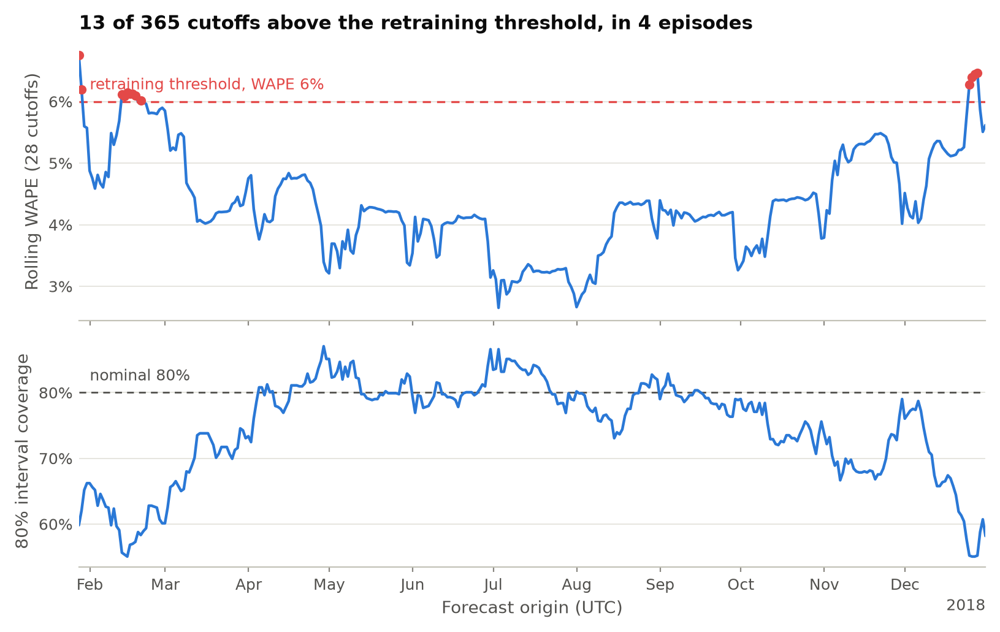
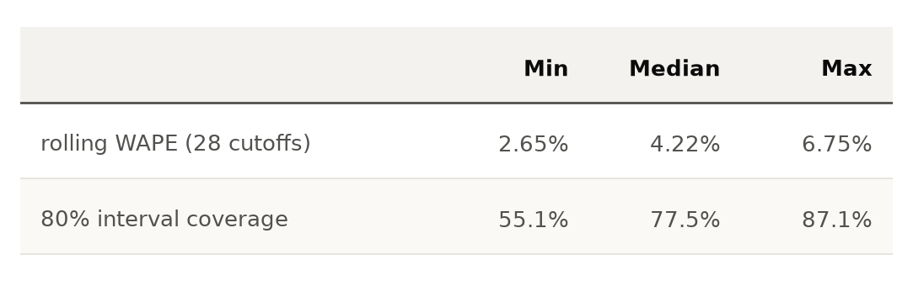
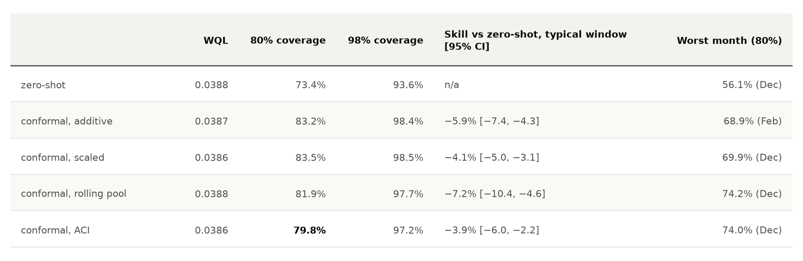
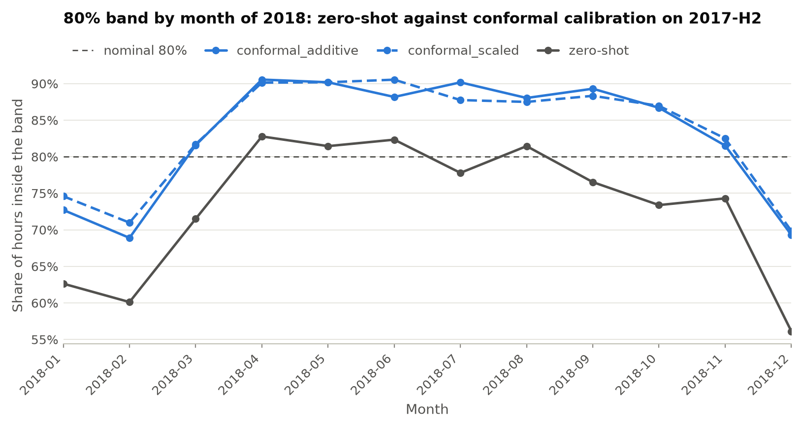

# Chronos-2 in Practice (6/7): Monitoring and Calibrated Intervals

**The model's 80% interval covers 73% of the hours of the year and 56% of December. A correction
learned once fixes the year and leaves February at 69%. One that keeps learning from the forecasts
already resolved holds every month between 74% and 84%, without touching the model.**

*Disclosure: this article was drafted with the help of an AI assistant. Every experiment was run from the companion repository, every number is read from its results files, and the text was reviewed and edited by the author.*

> Draft for Medium. Every number is read from a CSV in [`results/`](https://github.com/epjover/chronos2-in-practice/tree/main/results); each figure
> names the file to upload. Published open access (not metered).

---

[Part 5](#) put the model behind an endpoint and priced it. This part is about the day after: how
you find out that a forecaster in production has stopped working, and how you repair the one defect
that every part of this series has reported and none has fixed, the intervals.

The two belong together. Monitoring is what you do because the world moves after the model was
trained; calibration turns out to need the same loop, because an interval calibrated on last autumn
does not hold in a winter it has not seen.

- **Code:** [`src/c2p/monitoring.py`](https://github.com/epjover/chronos2-in-practice/blob/main/src/c2p/monitoring.py),
  [`src/c2p/conformal.py`](https://github.com/epjover/chronos2-in-practice/blob/main/src/c2p/conformal.py),
  [`monitoring/build_panel.py`](https://github.com/epjover/chronos2-in-practice/blob/main/monitoring/build_panel.py),
  [`monitoring/calibrate_intervals.py`](https://github.com/epjover/chronos2-in-practice/blob/main/monitoring/calibrate_intervals.py)
- **Data:** hourly Spanish load [4]: 2018 for the replay and the scoring, the second half of 2017
  for the calibration.
- **Versions:** `chronos-forecasting==2.3.2`, Python 3.11.

---

## 1. The forecast arrives before the truth does

A backtest tells you a model *was* good. Production asks whether it still is, and the two differ in
a structural way, because in production the actuals arrive after the forecast, often much later.
Everything in [`src/c2p/monitoring.py`](https://github.com/epjover/chronos2-in-practice/blob/main/src/c2p/monitoring.py) is built around that delay.

```python
from c2p.monitoring import (
    append_log,
    join_actuals,
    log_predictions,
    read_log,
    retraining_alerts,
    rolling_metrics,
)

rows = log_predictions(forecast, context, model_version="amazon/chronos-2@2.3.2", cutoff=cutoff)
append_log(rows, "logs/predictions.csv")  # no actual column: it does not exist yet
...
joined = join_actuals(read_log("logs/predictions.csv"), observed, target="load_actual")
rolling = rolling_metrics(joined, window=28, quantile_levels=(0.1, 0.9), nominal=0.8)
alerts = retraining_alerts(rolling, wape_threshold=0.06)
```

A few of the design decisions are meant to be copied.

**Log the input hash, not just the forecast.** `context_hash` is a stable digest of the exact frame
the model saw, NaNs included. Six weeks later, when a forecast looks wrong, this hash lets you tell
whether the model changed or the data changed. Without it those two causes look the same, and every
incident turns into an argument.

**Leave unresolved rows unresolved.** `join_actuals` keeps rows whose actual has not arrived,
with NaN in `actual`. The share of resolved rows is a signal in its own right. If it falls, your
data feed broke, and you want to know that before the error metric reacts a month later.

**Alert once per episode, not once per day.** `retraining_alerts` adds a `first_breach` column, true
only on the cutoff where a run of breaches starts. A threshold without this will page you every
morning for a week, and then you'll mute it.

[`monitoring/build_panel.py`](https://github.com/epjover/chronos2-in-practice/blob/main/monitoring/build_panel.py) demonstrates the loop by replaying 2018
in fast-forward. Each of the 365 cutoffs is forecast from its own past and written to the log with
no actual attached, and the actuals are joined afterwards (the same order of events as production,
but with the waiting removed). It produces 8,760 logged forecasts across 365 distinct input hashes.



*Figure 1. The panel an operator watches. Rolling WAPE over a trailing 28 cutoffs with the
retraining threshold, and the achieved coverage of the nominal 80% interval. Red markers are
cutoffs above the threshold.*



*Table 1. Columns: Min, Median, Max.*

The rolling WAPE pools 28 days of absolute error over 28 days of load, so it differs from Part 2's
per-window mean of 4.7%: the two agree on the level but differ in how the averaging is done.

At a 6% threshold, **13 of 365 cutoffs breach, in 4 episodes**: one in late January, two in
mid-February a day apart, and one in Christmas week. That clustering is the most useful thing in the
figure, and it says more about the rule than about the model. These are cold snaps and a national
holiday, recurring and predictable conditions, not drift. A fixed threshold on a seasonal series
will page you every Christmas and teach your on-call to ignore it. So either set the threshold from
the same season last year, or alert on the gap between this year and last year rather than on the
level.

The coverage panel is the one I'd act on first. The rolling coverage of the nominal 80% band
averages 74.8% (73.4% over the whole year, as in Part 2), but it drops to 55% in winter. The median
holds up; the uncertainty around it does not. Sections 3 and 4 fix it.

**Input drift** is the complement (errors tell you something broke after the fact, while a shift
in the inputs can be seen before the actuals land). Comparing the first quarter of 2018 with the
last gives a mean shift of 0.03 reference standard deviations and 21.5% of current values
outside the reference 10–90% range, against 20% expected by construction. Nothing moved. That
is the answer you want from a drift check most of the time, and the reason to keep it cheap and
explainable rather than clever.

## 2. What to do when the alert fires

The reflex is to retrain. Part 4 measured what retraining buys on this series, and it argues for a
slower hand.

**A retraining rule that can be followed.** When the rolling WAPE climbs above threshold for the
first time in an episode:

1. Train a new adapter on the data up to a cutoff that leaves the most recent weeks out.
2. Score the new adapter and the model in production on those held-out weeks, on the same
   windows, with a block-bootstrap interval on the skill (Part 2).
3. Promote the new adapter only if the interval excludes zero and the coverage of the 80% band
   is not worse. Otherwise keep what is deployed.

The held-out weeks matter: an adapter scored on windows it was trained on will always look better,
and Part 4's adapter kept less than half of the gain its validation period had shown. Step 3 will
also usually say no. Part 4's fine-tuning gains on this series run from 2% to 8% with intervals
several points wide on a full year of windows, and a few weeks of daily windows cannot separate
gains of that size from zero; Part 2 needed a full year to put an interval of twelve points around
a skill score. That is the rule working as intended. It exists to stop a reflexive retrain after a
cold week, not to schedule one.

What a breach episode in winter does call for is cheaper than a new adapter. In the four episodes
of 2018 the model was more confident than it should have been, which is a calibration problem, and
the rest of this article shows that it can be handled by a rule that updates itself every day and
never touches the weights.

## 3. Calibrating the intervals once

On Spanish load, the 80% band covers 73.4% of the hours (56% in December), while the levers of
Parts 2 to 4 (context, covariates, fine-tuning) all work on the median. **Conformalized quantile
regression** [1] is the fix that targets the bands instead, and it needs no training. Over a period
where the actuals are known, you measure how far each interval missed by, and then widen future
intervals by the quantile of those misses that makes the calibration coverage come out right. The
adjustment is learned per quantile pair and per horizon step, and applied as a post-processing step
([`src/c2p/conformal.py`](https://github.com/epjover/chronos2-in-practice/blob/main/src/c2p/conformal.py)).

**What the method promises, and when.** Conformal methods come with a coverage guarantee, and the
guarantee has a condition: the misses of the calibration period and of the period being forecast
must be exchangeable, which in practice means drawn from the same distribution [1]. A time
series does not give you that for free. A winter that behaves unlike the calibration
months breaks the condition, and the coverage with it. So the right way to read everything below
is as a measurement of how far the condition holds on this series, month by month, and not as a
guarantee that was bought.

The protocol is set up so that nothing can have seen 2018. We calibrate on the 184 day-ahead windows
of the second half of 2017 (Part 4's validation period) and score on Part 2's 365 windows of 2018,
through the same harness
([`monitoring/calibrate_intervals.py`](https://github.com/epjover/chronos2-in-practice/blob/main/monitoring/calibrate_intervals.py)). There are two
static variants: an **additive** shift in megawatts, the textbook form for one series, and a
**scaled** multiplier of the model's own interval width, the form that travels across series of
different levels. In code, the calibrated model is the same `Forecaster` as before:

```python
from c2p.conformal import ConformalForecaster, calibrate
from c2p.eval import backtest

calibration_frame = backtest(model, series_up_to_2017, calibration_config)  # forecasts + actuals
calibration = calibrate(calibration_frame, quantile_levels=config.quantile_levels, mode="scaled")
calibrated = ConformalForecaster(model, calibration)  # same .predict(); wider where it has to be
```

Over the year, both do what they should: coverage of the 80% band goes from 73.4% to 83%, and of
the 98% band from 93.6% to 98%, a touch above nominal, with the mean WQL unchanged to the third
decimal (the table is in the next section). One housekeeping step is built into the adjustment:
widening the 80% band and the 98% band by different amounts can make quantiles cross (a 0.9 column
below the 0.8 one), so `conformalize` sorts the quantile columns of every row afterwards, the
rearrangement of Chernozhukov et al. [2], which never worsens the pinball loss.

**The adjustment is largest where the model is most overconfident, and that is interpretable.** The
additive shift for the 80% band runs from about 40 MW at hour 23 of the horizon up to 1,400 MW at
hour 9, because that is the morning ramp, local 06:00–09:00, where demand climbs fastest and the
model's bands do not widen enough to admit it. Part 2's error-by-hour figure showed the same hours
from the other side. A per-step calibration finds this on its own; a single global factor would
have widened the quiet evening by the same amount as the ramp.

**A correction learned once fixes the average, not the season.** By month, the picture is less
tidy. Calibrated on a half-year that contains December but not January or February, the additive
correction over-covers April to September at 88 to 91% and still under-covers the winter: 72.7%
in January, 68.9% in February, 69.3% in December. The yearly 83% is an average of months that are too
wide and months that are too narrow. This is the exchangeability condition failing in the way the
paragraph above said it could.

## 4. Calibration that keeps learning

A forecaster in production resolves a forecast every day. Each resolved forecast is a new
measurement of how far the interval missed, and there is no reason to keep using last autumn's.
`AdaptiveConformalForecaster` starts from the same calibration frame and then, at every call,
looks in the context it is handed for the actuals of the forecasts it issued before, adds them to
its pool of misses, and recomputes the adjustment before the new forecast leaves. Nothing from
after the cutoff is used, so it runs through the same backtest harness as every other model.

Two versions, with their one setting each fixed before the run and not tuned on 2018:

- **A rolling pool**: only the misses of the last 56 forecasts (eight weeks) count. The
  correction forgets the summer by the time winter arrives.
- **Adaptive conformal inference** (ACI) [3]: all the misses stay in the pool, and what moves is
  the miss rate the correction aims for. After a day whose band missed more than 20% of the
  hours, it aims a little wider the next day; after a day that missed less, a little narrower.
  The step is the one used in the paper's experiments, 0.005 per observation, which is 0.12 per
  day of 24 hours.

```python
from c2p.conformal import AdaptiveConformalForecaster

rolling = AdaptiveConformalForecaster(model, calibration_frame, window=56)
aci = AdaptiveConformalForecaster(model, calibration_frame, gamma=0.005 * 24)
```



*Table 2. Columns: WQL, 80% coverage, 98% coverage, WQL skill vs zero-shot [95% CI], Worst month (80%).*



*Figure 2. Coverage of the 80% band by month of 2018: zero-shot, the static additive correction,
and the two adaptive ones. The static correction lifts the whole curve and keeps its shape; the
adaptive ones flatten it.*

**The adaptive corrections hold the winter.** January and February, the two months the static
calibration had never seen, go from 72.7% and 68.9% to 83.2% and 82.3% with the rolling pool, and
to 81.5% and 79.5% with ACI. Across the twelve months ACI stays between 74.0% and 83.5%, where the
static correction ran from 68.9% to 90.6% and the uncorrected model from 56.1% to 82.8%. Its yearly
coverage is 79.8% against a nominal 80%.

**December is still the worst month of both adaptive variants**, at 74.2% for the rolling pool and
74.0% for ACI, as it was for the uncorrected model at 56.1%. (The static additive correction has
its worst month in February, at 68.9%, with December a close second at 69.3%.) The Christmas weeks
are days no recent window resembles, and a rule that learns from the last few weeks arrives late by
construction. An adaptive calibration narrows the gap that a holiday opens; it does not close it.
That is a job for a covariate (Part 3's holiday flag), not for a wider band.

**The typical day pays a little for it.** The skill against the uncorrected model, which is a
geometric mean over days, is negative for every variant, −4 to −7%: on an ordinary day a wider
band costs some pinball loss, and only the bad days give it back. The mean WQL, which the bad days
dominate, does not move (0.0386 to 0.0388 against 0.0388), and in the worst tenth of the
zero-shot days the calibrated loss is lower (0.145 with ACI against 0.152). That is the trade a
reserve-margin decision wants, and a single average would hide it.

**Which one to deploy.** ACI, for a single series with a daily cadence: it has the most even
coverage, the smallest cost on the typical day, and one line of state to carry (the current miss
rate per band). The rolling pool is the choice when the series changes regime and old misses are
misleading rather than merely stale. The static correction remains the right first step, because
the adaptive ones start from it, and because it is the only one that needs no feedback loop at all.

> **Without the repository.** A static calibration is twenty lines: for each horizon step, the
> scores `max(lower − y, y − upper)` over the calibration forecasts, their `ceil((n + 1)(1 − α)) / n`
> empirical quantile, and that number added to `upper` and subtracted from `lower`. ACI adds one
> more line after each resolved day: `α_t += γ · (α − observed miss rate)`.

## Cheat sheet

- Log every forecast with its model version and input hash, then join the actuals later.
- Alert once per episode, with a threshold that knows what month it is.
- Watch the coverage of the interval next to the error. It fails first, and in a season.
- When the alert fires, do not retrain by reflex. Score a candidate on held-out weeks, and expect
  the interval to include zero.
- Calibrate the bands on last year before you publish an interval, and say that the result holds
  as far as next year resembles it.
- Look at coverage by month. A yearly 83% can be 69% every February.
- In production, let the calibration learn from the forecasts already resolved. It costs no
  training and holds the months a static correction misses.

## What's next

Everything so far has been one hourly series, one day ahead. Part 7 leaves that setting in three
directions (totals and daily data, a panel of a thousand stores, and the model's embeddings) and
closes the series with what moved the number, in order.

---

## References

1. Romano, Y., Patterson, E. & Candès, E. J. (2019). *Conformalized Quantile Regression*.
   NeurIPS 2019. arXiv:1905.03222. https://arxiv.org/abs/1905.03222
2. Chernozhukov, V., Fernández-Val, I. & Galichon, A. (2010). *Quantile and Probability Curves
   Without Crossing*. Econometrica 78(3). https://doi.org/10.3982/ECTA7880
3. Gibbs, I. & Candès, E. (2021). *Adaptive Conformal Inference Under Distribution Shift*.
   NeurIPS 2021. arXiv:2106.00170. https://arxiv.org/abs/2106.00170
4. Dataset: *Hourly energy demand generation and weather* (CC0).
   https://www.kaggle.com/datasets/nicholasjhana/energy-consumption-generation-prices-and-weather

**Suggested tags:** Time Series Forecasting · MLOps · Machine Learning · Uncertainty
Quantification · Python
