# Chronos-2 in Practice (7/7): Beyond One Hourly Series

**Summing the hourly quantiles gives tomorrow's total an 80% interval that covers 79%, because two
errors cancel. On 1,115 stores, opening days, promotions and holidays known in advance cut the error by 43%. The
encoder's embeddings catch a frozen data feed that the raw numbers miss. Then the whole series, on
one page.**

*Disclosure: this article was drafted with the help of an AI assistant. Every experiment was run from the companion repository, every number is read from its results files, and the text was reviewed and edited by the author.*

> Draft for Medium. Every number is read from a CSV in [`results/`](https://github.com/epjover/chronos2-in-practice/tree/main/results); each figure
> names the file to upload. Published open access (not metered).

---

Every experiment so far forecast one hourly series, one day ahead. That setting was chosen so that
every number could be compared with every other, and it leaves out most of what forecasting looks
like at work: the total of a day instead of its hours, data that arrive daily, a thousand series
instead of one. It also leaves out the half of the model that makes no forecast at all.

This last part goes to those four places, with the protocol of [Part 2](#) unchanged, and then
closes the series with a page that puts every lever next to what it bought.

- **Code:** [`10_frequency_and_panel`](https://github.com/epjover/chronos2-in-practice/blob/main/notebooks/10_frequency_and_panel.ipynb),
  [`11_embeddings`](https://github.com/epjover/chronos2-in-practice/blob/main/notebooks/11_embeddings.ipynb),
  [`src/c2p/aggregate.py`](https://github.com/epjover/chronos2-in-practice/blob/main/src/c2p/aggregate.py),
  [`src/c2p/embeddings.py`](https://github.com/epjover/chronos2-in-practice/blob/main/src/c2p/embeddings.py),
  [`scripts/series_summary.py`](https://github.com/epjover/chronos2-in-practice/blob/main/scripts/series_summary.py)
- **Data:** hourly Spanish load, 2015–2018 (CC0) [3], and the Rossmann store sales [4] as
  fev-bench publishes them (`rossmann_1D`) [2].
- **Versions:** `chronos-forecasting==2.3.2`, `fev==0.10.0`, Python 3.11.
- **Hardware:** notebook 10 (sections 1 to 3) was run on an RTX 3070, and its timings and
  throughput figures are GPU figures; notebook 11 (section 4) on eight CPU cores (Intel Core
  i9-12900K).

> **Terms from Part 2.** **WQL** is the error of the forecast's quantiles as a share of the
> series' level: 0.039 reads as 3.9%. **Skill** is one minus the geometric mean, over windows, of
> a model's WQL divided by a reference's: +10% is 10% less error on a typical window. **Total**
> is the same comparison on the summed error of all the windows, where the bad days weigh more.
> **Coverage** is how often the actual falls inside the 80% interval, so 80% is the target. A
> **window** is one forecast origin of the backtest, and the brackets are 95% bootstrap intervals
> over windows, or over stores where a column says so.

---

## 1. The energy of tomorrow: an interval the model does not give you

A day-ahead forecast is 24 numbers with 24 intervals. Plenty of decisions need one number: the
energy to buy for the whole day. Its point forecast is the sum of the hourly point forecasts, and
nobody disputes that. The interval is the problem.

Chronos-2 returns **marginal quantiles**: for each hour, the value that hour will stay below with a
given probability [1]. It returns no sample paths, so it says nothing about how the errors of
different hours move together, and the interval of a sum depends on that and on little else. The
answer lies between two assumptions:

- **The errors move together perfectly** (a cold day is cold all day; the statistical word is
  comonotonic). Then the 0.9 quantile of the total is the sum of the hourly 0.9 quantiles. This
  is the widest interval the marginals allow.
- **The errors are unrelated.** Then they partly cancel, and each hour's distance from its median
  adds in quadrature, like variances. This is far narrower.

A third route needs no assumption: add the hours up first, and forecast the daily series one step
ahead. Four years of data make 1,461 daily points, less than one context of the hourly protocol.

```python
from c2p.aggregate import aggregate_forecasts, daily_totals

daily_load = daily_totals(hourly_load, LOAD)  # a day is the day-ahead horizon, 23:00 to 22:00 UTC
summed = aggregate_forecasts(
    hourly_forecasts, quantile_levels=LEVELS, method="comonotonic", name="hourly quantiles, summed"
)
unrelated = aggregate_forecasts(
    hourly_forecasts, quantile_levels=LEVELS, method="independent", name="independent hours"
)
```

All of them forecast the same 363 daily totals of 2018; two days have a missing hour and no total
to score ([`10_daily_total_summary.csv`](https://github.com/epjover/chronos2-in-practice/blob/main/results/10_daily_total_summary.csv)):

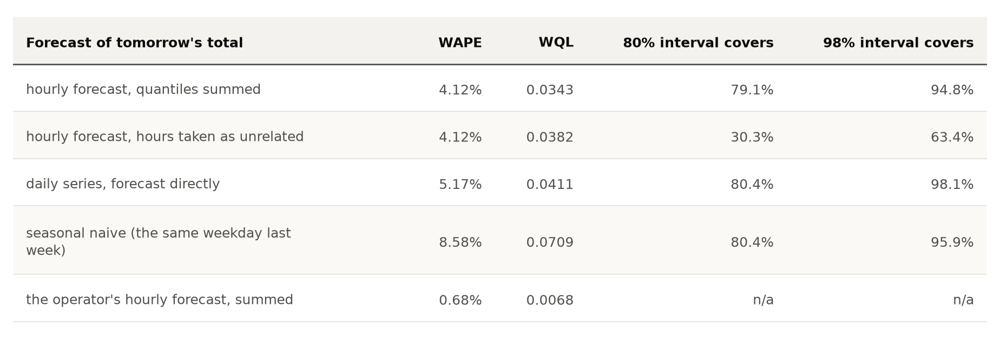

*Table 1. Columns: Forecast of tomorrow's total, WAPE, WQL, 80% interval covers, 98% interval covers.*

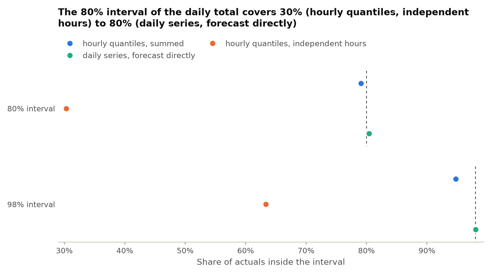

*Figure 1. Share of the 363 daily totals that fall inside the 80% and the 98% interval, for the
three ways of building it. The dashed lines are the nominal levels.*

**The hours do not cancel.** This is about the point forecast, before any interval. The hourly
median was off by 4.7% of the load (Part 2). If the errors of the 24 hours were unrelated, most
of them would cancel in the sum and the total would be off by about a fifth of that (4.7%
divided by the square root of 24 is about 1%). It is off by 4.12%.
A day that starts above the forecast stays above it, which is why the independence assumption
fails so badly: its 80% interval contains 30.3% of the totals.

**Summing the quantiles gives 79.1%, and that is two errors meeting.** The hourly intervals are
too narrow (they cover 73.4% of the hours, Part 2), and assuming perfect dependence is too wide. On
this series the two cancel to within a point at the 80% level, and not at the 98% level, where the
sum covers 94.8%, three points short: for a decision that lives in the tail, the summed interval
is still too narrow. Nothing guarantees that they will cancel on another series.

**The daily series is calibrated and less accurate.** Its intervals cover 80.4% and 98.1%, on the
nominal levels, and its point forecast is worse: 5.17% against 4.12%. Compared day by day over
the 363 days, the summed hourly forecast has a WQL 34.3% [28.1, 39.9] lower on a typical day and
16.7% [8.6, 25.5] lower over the year (0.0343 against 0.0411 in the table): Part 2's two
readings, which differ here because the hourly model's advantage is largest on ordinary days.
The hourly model sees
the afternoon and the evening before the cutoff and the shape of every recent day; the daily
series has reduced each of them to one number.

### Calibrating the total

[Part 6](#) repaired the hourly intervals with a conformal correction learned on the second half
of 2017 [9]. The same tool can be used in two places
([`10_total_calibration_summary.csv`](https://github.com/epjover/chronos2-in-practice/blob/main/results/10_total_calibration_summary.csv)):

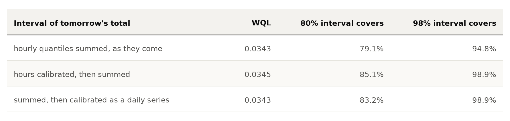

*Table 2. Columns: Interval of tomorrow's total, WQL, 80% interval covers, 98% interval covers.*

```python
from c2p.conformal import calibrate, conformalize

# the summed forecasts of the 184 calibration days, with the daily totals that came true
total_calibration = calibrate(calibration_totals, quantile_levels=LEVELS)
calibrated = conformalize(summed, total_calibration, quantile_levels=LEVELS)
```

Calibrating the hours first removes one of the two errors and leaves the other: each hourly
interval is now right on its own, the sum still assumes that all 24 errors move together, and the
total over-covers. Calibrating the total itself assumes nothing about the dependence. The summed
forecast is a forecast of a daily series like any other; measure by how much its interval missed
the daily totals of the calibration period, and move it by that much. It lands nearer the
nominal level than the first route and repairs the 98% interval that the plain sum left short.
It is still three points above 80%, for the reason Part 6 gave: a correction learned on one
half-year is right for a year that resembles it. At the 80% level neither route beats the
accident of the plain sum on this particular year. What the calibration buys is a reason to
expect the coverage to hold on the next one.

So, for a total one day ahead: take the centre from the hourly forecast, sum the quantiles, and
calibrate the result against past totals. The dependence between horizons is also where a model
that returns sample paths, or a reconciliation method built for temporal hierarchies [5], has
something to add that marginal quantiles cannot.

## 2. A week of daily totals: when the coarser series is the better input

The same question a week ahead is also a question about frequency. Seven daily totals can be 168
hourly steps, summed, or seven steps of the daily series. The windows are the rotating sample of
Part 2: 45 cutoffs eight days apart, so that every weekday starts a forecast and the horizons do
not overlap ([`10_week_ahead_summary.csv`](https://github.com/epjover/chronos2-in-practice/blob/main/results/10_week_ahead_summary.csv)).

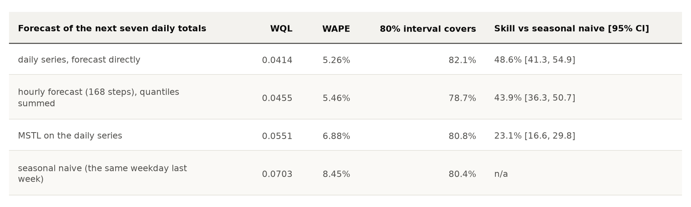

*Table 3. Columns: Forecast of the next seven daily totals, WQL, WAPE, 80% interval covers, Skill vs seasonal naive [95% CI].*

The order has turned around. One day ahead the hourly forecast was ahead; a week ahead the
daily series is, by +8.2% [+0.0, +15.5] on a typical window, an interval that touches zero, and
by +9.1% [+1.7, +14.8] on the total. (Those compare the two forecasts with each other, window by
window; they are not the difference between the two skills of the table, which are each against
the seasonal naive.) The advantage of
the hourly model was the last few hours before the cutoff, and that information is spent after a
day or two. What is left is a 168-step horizon against a 7-step one.

A series of little more than a thousand points, with no daily cycle left in it, is enough for
Chronos-2 to beat a decomposition fitted on that series by a wide margin: MSTL [6], the
seasonal-trend decomposition of Part 2, reaches 23.1% of skill, the model 48.6%. The second lesson is that the frequency at which data arrive is not necessarily the
frequency to forecast at. If the decision is daily and the horizon is long, aggregate first; if
the horizon is short, the detail pays. The backtest that decides between them is 45 windows
of each, and runs in seconds on a GPU.

## 3. A panel: 1,115 stores, with promotions known in advance

One series was a convenient place to learn the protocol. Most forecasting work is a panel: a
thousand stores, ten thousand products. fev-bench [2] includes the Rossmann store sales [4] as a
task, `rossmann_1D`: 1,115 stores, daily sales from January 2013 to July 2015, a 48-day horizon,
ten windows. Each store has five covariates whose future is known (whether it is open, whether a
promotion runs, school and state holidays, the weekday) and one that is only observed, the number
of customers. The state holiday is text, and stays a category (Part 3).

As with EPF-DE in Part 3, the task is the published one: the harness derives its cutoffs, and they
are checked against fev's before anything is scored.

```python
from c2p.eval import backtest, error_by_series
from c2p.fev_tasks import load_fev_task, task_backtest_config, task_series_frame
from c2p.models import Chronos2Forecaster

task = load_fev_task("rossmann_1D")
panel = task_series_frame(task)  # one row per store and day, the covariates as columns
config = task_backtest_config(task)  # the task's own horizon, windows and known covariates

forecasts = backtest(Chronos2Forecaster(pipeline), panel, config)
per_store = error_by_series(forecasts)  # one WQL per store, its ten windows pooled
```

The same forecasts can be read in two ways. **Per window** is how the benchmark scores the task:
all stores of a window pooled into one number, ten windows. **Per store** pools each store's ten
windows and asks on how many stores the model beats the reference, which is the question a
retailer asks ([`10_panel_summary.csv`](https://github.com/epjover/chronos2-in-practice/blob/main/results/10_panel_summary.csv)).

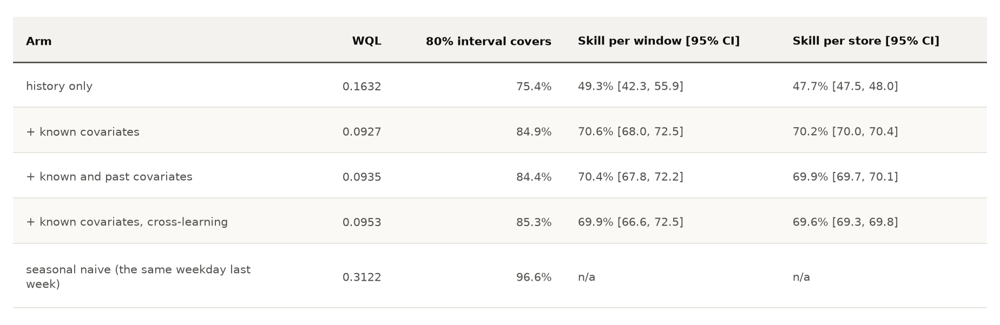

*Table 4. Columns: Arm, WQL, 80% interval covers, Skill per window [95% CI], Skill per store [95% CI].*

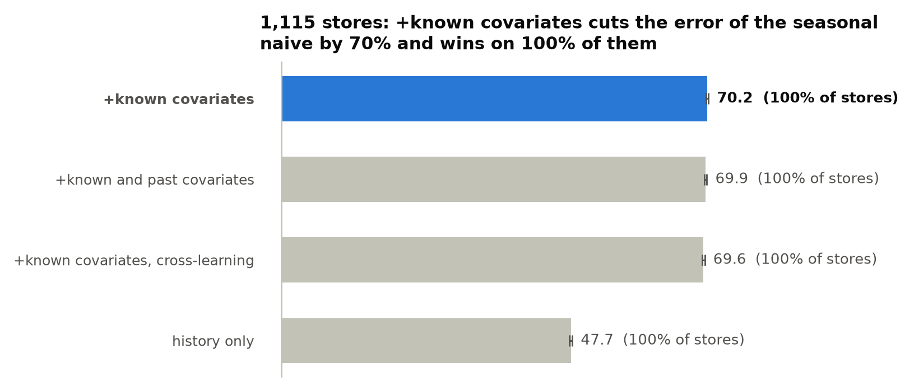

*Figure 2. WQL improvement over the seasonal naive on the Rossmann panel, with the 1,115 stores as
the units of the bootstrap.*

**What is known about the future pays more here than anywhere else in the series.** With the
five known covariates the WQL of a store is lower by 43.0% [42.6, 43.4], and it is lower on 100% of
the 1,115 stores. (Each store is compared with itself here and below, which is why these figures
are not differences between the columns of the table. Summed over the stores the loss falls by
43.2%, so the two readings of Part 2 agree.) Part 1 warned that the model learned covariates
from synthetic data only; on a second real dataset the lesson held. On the Spanish price, the operator's forecasts bought 10.9% (Part 3). The
difference is in what the covariates are. A closed store sells nothing and a promotion lifts the
week, both are decided in advance, and no amount of history says when the next one falls. When a
covariate is a plan and not a forecast, the model has nothing to guess.

**A covariate that stops at the cutoff adds nothing.** The number of customers moves with the
sales and is known only up to yesterday. Adding it changes the error by less than a point, in the
wrong direction (−0.9% [−1.0, −0.9], better on 17% of the stores). That is Part 3's finding on a
second dataset: what pays is the future of a covariate, not its past.

**One covariate carries most of the gain, and two of them cover for each other.** The five went
in together. Leaving each one out in turn, against the forecast that had all five
([`10_panel_covariates_skill.csv`](https://github.com/epjover/chronos2-in-practice/blob/main/results/10_panel_covariates_skill.csv)):

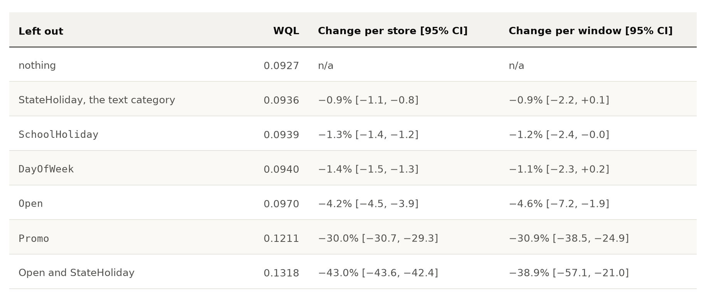

*Table 5. Columns: Left out, WQL, Change per store [95% CI], Change per window [95% CI].*

The middle column is the typical store and the last one the typical window. The WQL column
pools every store and day, so the ratio of two of its cells follows the per-window column (4.6%
for `Open`) and not the per-store one.

The promotion calendar is most of it: without it a store's error rises by 30.0%. The weekday and
the two holiday columns cost about a point each per store (per window, two of those three
intervals include zero). The last row is the one about categories. `Open`
says that a store is closed and `StateHoliday` names one reason why, so each covers for the
other: without `Open` the error rises by 4.2%, without `StateHoliday` by 0.9%, without both by
43.0%. (The gain from all five covariates also reads 43.0%. The two are different quantities
on different bases, a loss from removing two columns and a gain from adding five, and their
digits agree by chance.) With the flag gone, the label does
its job, because the library encodes `a`, `b` or `c` as the store's own average sales on such
days (Part 3), which is close to zero.

**Static attributes are not covariates.** The dataset also describes each store once: its type,
its assortment, the distance to the nearest competitor. Chronos-2 has no input for attributes
like these, so the only way to pass them is as columns that repeat one value. What the model
then receives is nothing: every input series is standardised on its own, so a constant becomes
a row of zeros, and a text label becomes the store's mean, which is a constant too. Measured,
the three constant columns make the forecast slightly worse, by 1.3% [1.2, 1.4] per store, and
by 2.1% [2.0, 2.2] when the stores of a batch are also allowed to share information
([`10_panel_static_skill.csv`](https://github.com/epjover/chronos2-in-practice/blob/main/results/10_panel_static_skill.csv)). Three more series in
every group are three more things for the attention to weigh, with no information in them. If
an attribute matters, give the model something that varies with it, or fine-tune.

**Cross-learning does not help stores that have their own history.** Letting the stores of a batch
share information costs a little (−2.1% [−2.5, −1.8] per store, better on 36% of them, and −2.3%
on the stores' summed loss, each store scaled by its own sales; the pooled WQL cells of the
table weigh the stores by their size and give a little more). Part 2
measured its gain where it exists: a series with one to three weeks of history, helped by four
that have years. Every store here has two and a half years of its own.

**Read the two intervals for what they are.** The interval per store is an order of magnitude
tighter than the one per window, because it resamples 1,115 units instead of ten. The stores are not 1,115
independent experiments: they share the calendar, the weather and the same ten windows. The store
interval says how well the average is pinned down for this set of stores; the window interval is
the one to carry to a period that has not happened yet.

**Covariates cost throughput.** On the RTX 3070 the history-only arm forecast 462 stores per
second and the arm with five known covariates 90: every covariate is one more series in each
store's group. On a panel, [Part 5](#)'s arithmetic about batch size and hardware is multiplied by
the number of columns.

## 4. The half of the model that does not forecast

`Chronos2Pipeline.embed` returns what the encoder computed for a series before any forecast is
decoded. The library documents the call; what it is good for is left to the reader.

```python
import torch

window = torch.tensor(load[-192:], dtype=torch.float32)  # eight days, twelve patches of 16 hours
embeddings, loc_scale = pipeline.embed([window])
tokens = embeddings[0][0]  # shape (14, 768): 12 patches, the [REG] token, the future patch
```

Each patch of 16 hours becomes a vector of 768 numbers; then comes [REG], a learned marker the
model appends after the last patch of the context, and the token of the first future patch, the
one the forecast head reads. The series
is standardised first and its level and scale are returned separately, so the embedding describes
a shape, not a size. Pooling turns the tokens into one vector per window:

```python
from c2p.embeddings import embed_windows

mean = embed_windows(pipeline, windows, pool="mean")  # average of the 12 patch vectors only
reg = embed_windows(pipeline, windows, pool="reg")  # the [REG] token
future = embed_windows(pipeline, windows, pool="forecast")  # the future-patch token
```

A representation from a large model is easy to be impressed by, so every test below has the same
control: **the raw window, standardised the way the encoder standardises it**. 192 numbers against
768. The embedding earns its place only where it beats the numbers it was made from. The unit is a
window of 192 hours ending at a day-ahead cutoff, one per day: the 1,088 windows of 2015 to 2017
are the library, the 365 of 2018 the test.

### What it knows

A linear probe [7] asks whether a property can be read off a representation with
a weighted sum. Nobody told the model the weekday or the month of the day about to be forecast,
so those are the properties to probe for
([`11_probe_accuracy.csv`](https://github.com/epjover/chronos2-in-practice/blob/main/results/11_probe_accuracy.csv)):

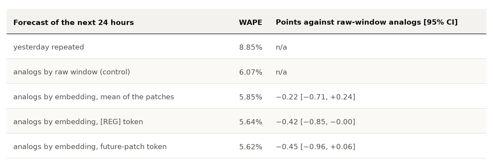

*Table 6. Columns: Representation, Weekday of the next day, Month of the next day.*

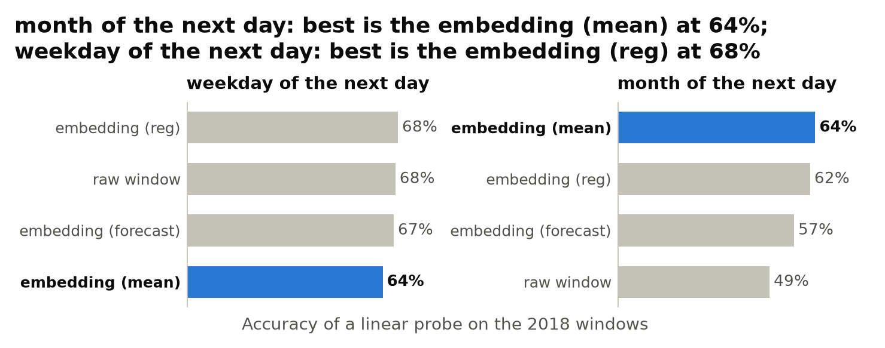

*Figure 3. Accuracy of a linear probe fitted on the windows of 2015 to 2017 and scored on the 365
windows of 2018. Always answering the most frequent class would score 14.3% for the weekday and
8.5% for the month.*

For the weekday the embedding adds little: the best pooling is under a point ahead of the raw
window (68.5% against 67.7%, with no interval on either), and the mean of the patches is four
points behind. Eight days of hourly load contain a weekend at a position that gives the answer
away, and a linear model on the raw values reads it about as well as any pooling does. The month is different. With the level removed, the month has to be read from the
shape of the days, and there the mean of the patch vectors is right 64.1% of the time against
49.3% for the raw window. The encoder has made a property linearly readable that was not.

### Analog days

The oldest forecasting method there is [8]: find the days of the past that looked
like today and see what followed them. For each 2018 window, take its five nearest library windows
by cosine similarity and average what came after them, rescaled to the level of the query. As a
forecast it has no interval and is not a contender; as a test it asks whether neighbours in
embedding space continue the same way ([`11_analog_forecast.csv`](https://github.com/epjover/chronos2-in-practice/blob/main/results/11_analog_forecast.csv)).

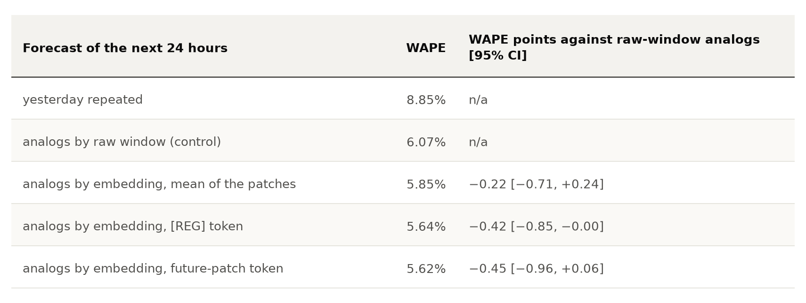

*Table 7. Columns: Forecast of the next 24 hours, WAPE, WAPE points against raw-window analogs [95% CI].*

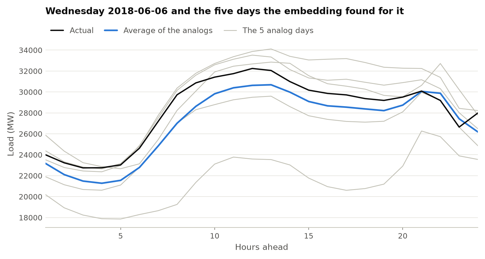

*Figure 4. Wednesday 6 June 2018 and the five past days whose windows are nearest to its window in
embedding space, each rescaled to the level of the query. The blue line is their average.*

Analogs found with the embedding are a few tenths of a point better than analogs found with the
raw values, and only the [REG] token's interval stays (barely) on one side of zero. Read it as a
small edge, not as a new method. For scale: the model's own forecast of those days has a WAPE of
4.7%, and five analog days reach 5.62% with nothing in the loop at forecast time but one encoder
pass and a table of past days. Figure 4 also shows the limit. One of the five analogs of that
Wednesday is a Saturday, and it pulls the average down: a similar shape over the last eight days is
not the same kind of day tomorrow.

### Series that behave alike

The same call works across series. Each of the 20 series of the Spanish table that are not
constant is embedded over the last 2,048 hours of 2017, and a tree joins those whose embeddings
point the same way.

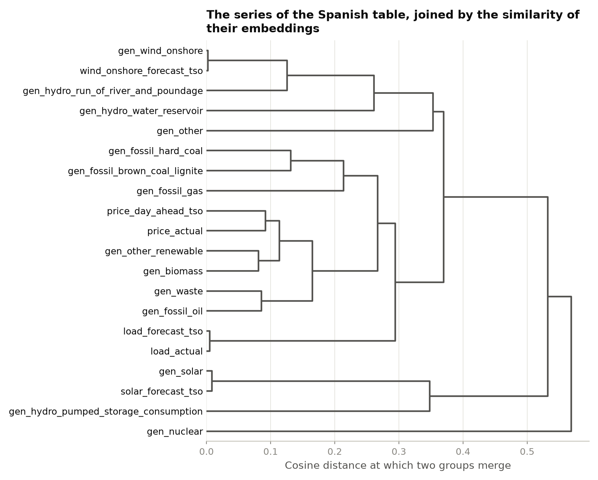

*Figure 5. The series of the Spanish table, joined by the cosine distance between their
embeddings. A forecast sits next to what it forecasts; hard coal sits with lignite.*

There is no score here, only a check against what is known about the system, and it passes:
the wind forecast joins the wind generation (cosine 0.998), the load forecast the load (0.995), the
solar forecast the solar generation (0.992), and nobody gave the model the column names. On
twenty series that confirms what the names said; on two thousand unlabelled sensors it is a way
to find the groups before deciding which to forecast together.

### Anomalies

Score each window by its mean cosine distance to its ten nearest ordinary windows:
a window that resembles nothing seen before scores high. Whether the score is any good needs
labels, and there are real ones and injected ones. Real ones: the 30 windows that end on a public
holiday that fell on a working day. Injected ones: three defects written into the last day of half
of the 2018 windows, each mild enough to pass unnoticed in a chart
([`11_anomaly_auc.csv`](https://github.com/epjover/chronos2-in-practice/blob/main/results/11_anomaly_auc.csv); the measure is the ROC AUC, the chance that
a window with the defect scores above one without, so 0.5 is a coin).

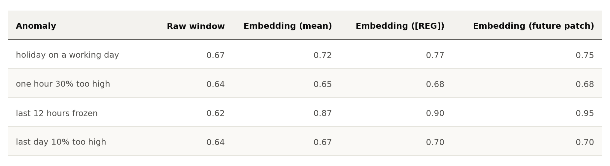

*Table 8. Columns: Anomaly, Raw window, Embedding (mean), Embedding ([REG]), Embedding (future patch).*

The frozen feed is the row to read. A window whose last twelve hours repeat one value scores above
a clean one 95% of the time with the future-patch token and 62% with the raw values. In raw space
a flat stretch at a plausible level is near plenty of ordinary windows; to the encoder, a series
that stops moving sits far from nearly all of three years of windows. On the other three rows the embedding is
ahead by a few hundredths (a tenth on the holiday row, with the [REG] token), at a level that would page someone far too often to be an alarm on its
own.

This is where the embedding connects to [Part 6](#). The monitoring there watched the error and
the coverage, which exist only after the actuals arrive. A distance in embedding space is
available **before** the forecast is sent, from the same forward pass, and it is good at the one
defect that monitoring of errors sees a day late: a broken input.

> **Without the repository.** The total: `forecasts.groupby("day")[quantile_columns].sum()` is the
> comonotonic interval, and a conformal shift learned on past totals corrects it. The embedding:
> `pipeline.embed([series])` returns one tensor per series; average its rows except the last two,
> and compare vectors with a cosine.

## 5. The series on one page

The whole series followed one protocol, so its results fit in one table. Every row below is
read from a results file by
[`scripts/series_summary.py`](https://github.com/epjover/chronos2-in-practice/blob/main/scripts/series_summary.py)
([`12_series_summary.csv`](https://github.com/epjover/chronos2-in-practice/blob/main/results/12_series_summary.csv)), in the order of the series. Where
a row compares two forecasts, the Effect is the skill on a typical window and the next column is
the same comparison on the error of all the windows together, the two readings of Part 2
([`12_two_readings.csv`](https://github.com/epjover/chronos2-in-practice/blob/main/results/12_two_readings.csv) has both for every comparison the
series quotes):

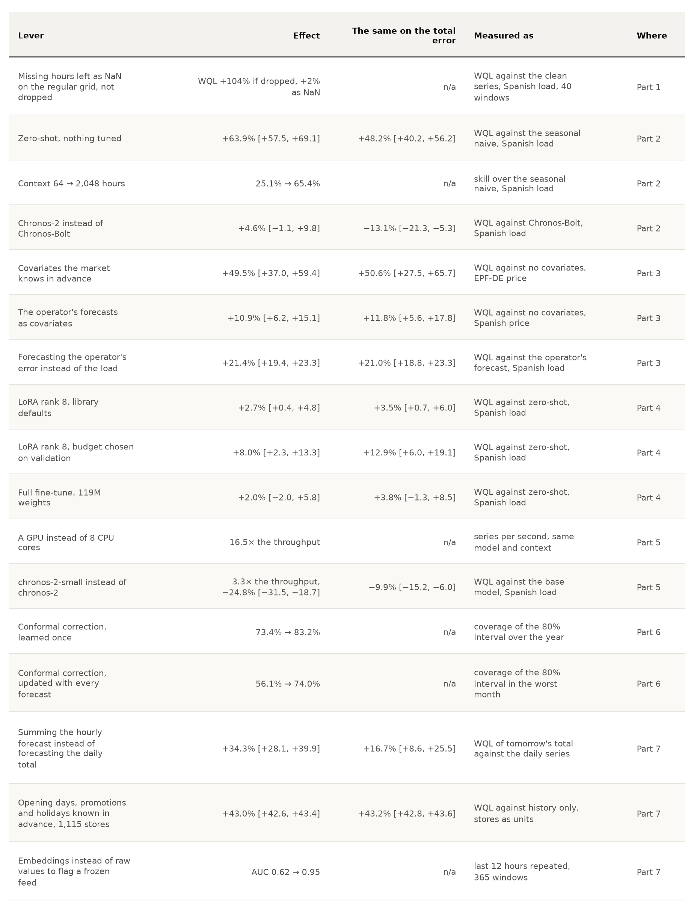

*Table 9. Columns: Lever, Effect, The same on the total error, Measured as, Where.*

The rows sit on different scales and different targets. What the table shows is an ordering, not
a sum. It is also the ordering on this data: most rows come from one country's electricity in one
test year, with EPF-DE and the Rossmann panel as the two checks from outside. The order in which
to try the levers should carry to other data; their sizes are for your own backtest to say. The large effects come from giving the model something: enough history, a regular grid,
the future values of what is known. Changing the weights moved the number less: two to three
percent at the library's defaults (the full fine-tune's interval includes zero), 8% with a
budget chosen on a validation period, and that adapter was worse on a series it was not trained
on. The two readings agree on every one of those rows to within a few points. They part where
the comparison is between models: the smaller checkpoint, and summing hours against the daily
series, look twice as far apart on a typical day as they are on the year's total, and for
Chronos-2 against Chronos-Bolt the two point in opposite directions (only the total is clear
of zero).

What did not help is as useful to know. Forecasting load jointly with price
(−1.3% [−4.5, +1.8]). Calendar features on top of a model that already reads the clock
(−0.2% [−1.7, +1.2]), and the weekday passed as a category instead (−0.8% [−2.1, +0.5]). The
customers of yesterday, and cross-learning across stores that have their own history (section 3).
And, on a clean univariate series, the newer model itself. Against the previous-generation
Chronos-Bolt, Chronos-2 was +4.6% [−1.1, +9.8] on a typical day and 13.1% behind on the year's
total error: it earns its place through covariates, not through the univariate forecast.

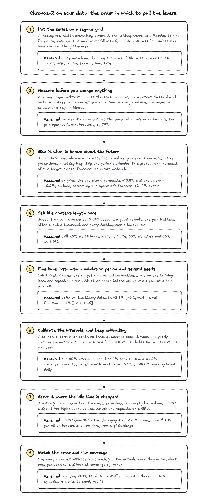

*Figure 6. The order in which to pull the levers on a new series. The sentence in each inner box
is what that step measured on the data of this series, read from the same results files as the
table.*

## 6. Where to take it from here

The questions this series leaves open, in case you want one.

**Paths instead of marginals.** Section 1 calibrated a total after the fact. A model that returns
sample paths would give the interval of any aggregate directly, and reconciliation [5] would make
the hourly and the daily forecasts agree. Neither is in Chronos-2 today.

**What was not measured.** Everything here is hourly or daily. Data finer than an hour, series
of counts with many zeros, and horizons past the 1,024 steps the model predicts in one pass
(beyond that it feeds its own forecast back, Part 1) were left out, and nothing in this series
says how the model behaves there. Nor was the cold start tested at the scale of a chain: hide
the history of a hundred Rossmann stores, keep their promotion calendar, and measure what the
other thousand add.

**The field moves.** Chronos-2 led fev-bench when its paper appeared in October 2025, and other
models have claimed the top since (Part 1). The protocol of Part 2 is what to keep: a rolling
origin, a seasonal naive, a professional forecast when there is one, intervals that respect the
dependence between days, and both readings of every comparison. It was written down so that
the model it describes can change.

## Cheat sheet

- For a total, sum the hourly quantiles and calibrate the sum against past totals. Never assume
  the hours are independent.
- If the decision is daily and the horizon is long, forecast the daily series. If the horizon is
  short, forecast the hours and add them up. A short backtest decides.
- On a panel, known covariates first: plans (opening days, promotions) pay more than
  forecasts. Skip covariates whose future you do not have.
- Leave each covariate out once. Here one of five carried most of the gain, and two were
  redundant with each other.
- Do not expect cross-learning to help series that have their own history, and do not pass
  static attributes as constant columns: they carry nothing and cost a little.
- Read a panel per window for the future and per series for the business; say which one you
  report.
- Compare an embedding with the raw window before you build on it. On this series it earned its
  place for seasonality and for a frozen input.
- Score the input before you send the forecast: a distance in embedding space flagged a frozen
  feed (AUC 0.95) a day before the error could. On subtler defects it was not reliable enough
  to alert on.

---

## References

1. Ansari, A. F., *et al.* (2025). *Chronos-2: From Univariate to Universal Forecasting*.
   arXiv:2510.15821. https://arxiv.org/abs/2510.15821
2. Shchur, O., *et al.* (2025). *fev-bench: A Realistic Benchmark for Time Series Forecasting*.
   arXiv:2509.26468. https://arxiv.org/abs/2509.26468
3. Dataset: *Hourly energy demand generation and weather* (CC0).
   https://www.kaggle.com/datasets/nicholasjhana/energy-consumption-generation-prices-and-weather
4. Dataset: *Rossmann Store Sales* (Kaggle competition, 2015).
   https://www.kaggle.com/competitions/rossmann-store-sales
5. Athanasopoulos, G., Hyndman, R. J., Kourentzes, N. & Petropoulos, F. (2017). *Forecasting with
   temporal hierarchies*. European Journal of Operational Research 262(1), 60–74.
   https://doi.org/10.1016/j.ejor.2017.02.046
6. Bandara, K., Hyndman, R. J. & Bergmeir, C. (2021). *MSTL: A Seasonal-Trend Decomposition
   Algorithm for Time Series with Multiple Seasonal Patterns*. arXiv:2107.13462.
   https://arxiv.org/abs/2107.13462
7. Alain, G. & Bengio, Y. (2016). *Understanding intermediate layers using linear classifier
   probes*. arXiv:1610.01644. https://arxiv.org/abs/1610.01644
8. Lorenz, E. N. (1969). *Atmospheric Predictability as Revealed by Naturally Occurring
   Analogues*. Journal of the Atmospheric Sciences 26(4), 636–646.
   https://doi.org/10.1175/1520-0469%281969%2926%3C636%3AAPARBN%3E2.0.CO%3B2
9. Romano, Y., Patterson, E. & Candès, E. J. (2019). *Conformalized Quantile Regression*.
   NeurIPS 2019. arXiv:1905.03222. https://arxiv.org/abs/1905.03222

**Suggested tags:** Time Series Forecasting · Machine Learning · Foundation Models · Embeddings ·
Python
